# CarrotQuant .NET 核心架构与开发规范

## 一、系统架构总览 (Software Architecture)

CarrotQuant.NET 采用 **三层分离架构**，各层之间通过接口契约解耦，支持回测与实盘双引擎。

### 1. 架构拓扑

```mermaid
graph TD
    subgraph DataLayer [Data Layer - 数据层]
        subgraph Common [Common - 基础寻址]
            StorageResolver[StorageResolver]
        end

        subgraph FieldsSubsystem [Fields - 标的属性与维表子系统]
            FieldSourceFactory[FieldSourceFactory]
            FieldTable[FieldTable]
            FieldRegistry[FieldRegistry]
            FieldRegistryFactory[FieldRegistryFactory]
            IFieldRegistry[IFieldRegistry]

            FieldSourceFactory --> FieldTable
            FieldTable --> FieldRegistry
            FieldRegistryFactory --> FieldRegistry
            FieldRegistry --> IFieldRegistry
        end

        subgraph TimeseriesSubsystem [Timeseries - 时序子系统]
            TimeseriesSourceBase[TimeseriesSourceBase]
            CsvTimeseriesSource[CsvTimeseriesSource]
            ParquetTimeseriesSource[ParquetTimeseriesSource]
            TimeseriesSourceFactory[TimeseriesSourceFactory]
            MarketDataAligner[MarketDataAligner]
            DynamicMarketMetadata[DynamicMarketMetadata]
            TimeseriesCache[TimeseriesCache]
            TimeseriesCacheManager[TimeseriesCacheManager&lt;T&gt;]
            ITimeseriesCache[ITimeseriesCache]
            ChunkMatrix2D[ChunkMatrix2D&lt;T&gt;]
            TimeseriesRegistry[TimeseriesRegistry]
            TimeseriesRegistryFactory[TimeseriesRegistryFactory]
            ITimeseriesRegistry[ITimeseriesRegistry]
            ITimeseriesWriter[ITimeseriesWriter]

            TimeseriesSourceBase --> CsvTimeseriesSource
            TimeseriesSourceBase --> ParquetTimeseriesSource
            MarketDataAligner --> TimeseriesSourceBase
            DynamicMarketMetadata --> TimeseriesRegistry
            TimeseriesSourceFactory --> CsvTimeseriesSource
            TimeseriesSourceFactory --> ParquetTimeseriesSource
            TimeseriesRegistryFactory --> TimeseriesRegistry
            CsvTimeseriesSource --> TimeseriesRegistry
            ParquetTimeseriesSource --> TimeseriesRegistry
            TimeseriesRegistry --> TimeseriesCacheManager
            TimeseriesCacheManager --> ITimeseriesCache
            TimeseriesCacheManager --> ChunkMatrix2D
            TimeseriesRegistry --> ITimeseriesRegistry
            TimeseriesRegistry --> ITimeseriesWriter
        end

        subgraph EventsSubsystem [Events - 事件子系统]
            EventSourceFactory[EventSourceFactory]
            CsvEventSource[CsvEventSource]
            ParquetEventSource[ParquetEventSource]
            EntityMapper[EntityMapper]
            EventTable[EventTable]
            EventRegistry[EventRegistry]
            EventRegistryFactory[EventRegistryFactory]
            IEventTable[IEventTable]
            IEventRegistry[IEventRegistry]

            EventSourceFactory --> CsvEventSource
            EventSourceFactory --> ParquetEventSource
            EntityMapper --> CsvEventSource
            EntityMapper --> ParquetEventSource
            CsvEventSource --> EventTable
            ParquetEventSource --> EventTable
            EventTable --> IEventTable
            EventRegistry --> IEventTable
            EventRegistryFactory --> EventRegistry
        end

        StorageResolver --> TimeseriesSourceFactory
        StorageResolver --> EventSourceFactory
        StorageResolver --> FieldSourceFactory
    end

    subgraph EngineExecutionLayer [Engine and Execution Layer - 引擎与执行层]
        BacktestingEngine[BacktestingEngine]
        LivingEngine[LivingEngine]
        IEngine[IEngine]
        IEngineContext[IEngineContext]
        IExchangeGateway[IExchangeGateway]
        IBroker[IBroker]
        IMonitor[IMonitor]

        BacktestingEngine --> IEngine
        LivingEngine --> IEngine
        ITimeseriesRegistry --> IEngine
        IEventRegistry --> IEngine
        IFieldRegistry --> IEngine
        IEngine --> IExchangeGateway
        IEngine --> IBroker
        IEngine --> IMonitor
        IEngine --> IEngineContext
    end

    subgraph StrategyLayer [Strategy Layer - 策略层]
        IStrategy[IStrategy]
        IStrategyPipeline[IStrategyPipeline]

        IEngineContext --> IStrategy
        IStrategy --> IStrategyPipeline
    end
```



### 2. 核心分层职责与流向

| 分层 | 核心职责 | 核心组件 / 契约 |
| :--- | :--- | :--- |
| **Data Layer (数据层)** | 数据获取、格式转换、内存缓冲与统一供给 | `StorageResolver`, `CsvTimeseriesSource`, `ParquetTimeseriesSource`, `TimeseriesRegistry`, `TimeseriesCacheManager<T>`, `ITimeseriesRegistry`, `IEventTable`, `IEventRegistry`, `IFieldRegistry`, `FieldRegistry`, `FieldSourceFactory`, `FieldTable` |
| **Engine Layer (引擎层)** | 回测撮合与实盘路由、账户资产管理、上下文注入 | `IEngine`, `BacktestingEngine`, `LivingEngine`, `IEngineContext`, `IExchangeGateway`, `IMatchingEngine`, `IBroker`, `IMonitor` |
| **Strategy Layer (策略层)** | 特征分析、信号生产、组合规划与交易风控 | `IStrategy`, `ISignalStrategy`, `RuleStrategyBase`, `StrategyPipeline`, `SequentialPipeline`, `ParallelPipeline` |

- **数据流向**: (`ITimeseriesRegistry`, `IEventRegistry`, `IFieldRegistry`) → `IEngine` → (`IExchangeGateway` / `IBroker` / `IMonitor`) → `IEngineContext` → 策略层
- **策略流水线典型流向**: 信号生产 (`ISignalStrategy`) → 组合持仓规划 → 交易风控执行 (`IStrategy` / `RuleStrategyBase`)

### 3. 策略协作模型概要
- **黑板解耦模式**: 通过 `context.Market`（`IMarketState`）统一交换强类型信号与状态，实现生产端（`ISignalStrategy`）与消费端（组合规划/执行策略）正交解耦。
- **组合管线拓扑**: 基于组合模式（Composite Pattern）通过 `SequentialPipeline`（串行有序）与 `ParallelPipeline`（多核并发）自由编排策略层次。
- **运行期密封优化**: 引擎启动前调用 `Compile()` 固化拓扑与 Lookback 深度，消除运行期拓扑变动与越界检查开销。详细契约与机制见 [第二节](#二策略与黑板体系-strategy--blackboard-architecture)。

---

## 二、策略与黑板体系 (Strategy & Blackboard Architecture)

### 1. 核心契约分层
- `IStrategy`: 统一顶层抽象，单一 `OnUpdate(IEngineContext context)` 与离散事件 `OnEvent(IEngineContext context, string tableName, IReadOnlyList<IDataRow> events)` 入口，原生支持全市场截面排序、单标的时序与网格双向调仓。
- `ISignalStrategy`: 纯信号语义契约，专注于信号生产与特征分析，通过黑板（`context.Market`）发布状态、概率分布或打分，无账户与持仓负担。
- `RuleStrategyBase`: 规则交易便利模板基类，内部按标的遍历并分发至 `CheckEntry(context, symbol)` 与 `CheckExit(context, symbol, position)`。
- `IStrategyPipeline`: 组合策略管线契约，定义拓扑添加 `Add`、密封优化 `Compile`、策略展开 `GetStrategies` 与递归最大 `Lookback` 汇总。

### 2. 通用强类型黑板 (`IMarketState`)
- **通用强类型状态容器**: 支持零装箱的 `GetState<T>(key)`、`SetState<T>(state, key)`、`HasState<T>(key)` 与 `Clear()`，用于策略间正交解耦与异步数据交换。
- **单类型默认单例与显式 Tag 隔离**:
  - 默认单例：缺省 `key` 时以 `typeof(T).FullName` 索引，杜绝魔法字符串拼写风险；
  - 显式命名空间隔离：多策略实例并发产生同类型数据时，通过显式 `key`（如策略名或特征 Tag）隔离。
- **并发线程安全**: 底层采用 `ConcurrentDictionary<string, object>` 保证多核并发管线下的线程安全。

### 3. 策略管线体系 (Composite Pipeline)
- **架构对称性与单一职责**:
  - `StrategyPipeline`: 抽象基类，统筹生命周期管理、Lookback 递归汇总锁定、`Compile()` 不可变数组固化、Roslyn 动态编译上下文收集与 `IDisposable` 卸载。
  - `SequentialPipeline`: 串行具体管线，严格按序执行子策略 `OnUpdate` 与 `OnEvent`，适用于前后存在因果依赖的阶段（特征分析 → 信号融合 → 仓位规划 → 风控执行）。
  - `ParallelPipeline`: 并行具体管线，默认采用确定性单线程顺序执行（`Concurrent = false`）；显式开启 `Concurrent = true` 且子策略数大于 1 时，利用 `System.Threading.Tasks.Parallel.For` 零 GC 实例委托复用多核并发驱动 `OnUpdate` 与 `OnEvent`，适用于无时序依赖的独立 Alpha 生产。
  - 便捷工厂方法：`StrategyPipeline.Sequential()` 与 `StrategyPipeline.Parallel()`。
- **密封优化 (`Compile()`)**:
  - 递归密封优化所有嵌套子管线；
  - 拓扑不可变数组固化（`IStrategy[]`），消除 .NET JIT 循环时的数组越界检查（BCE），提速 20%~30%；
  - 锁定全局最大 `Lookback` 深度，底层环形缓冲区运行期零二次扩容；
  - 锁定拓扑结构，杜绝运行期竞态修改（子策略 `OnStart(context)` 生命周期预热由引擎在正式循环前按拓扑统一步进触发）。
- **外部策略动态载入 (Roslyn)**:
  - 内置 `Microsoft.CodeAnalysis.CSharp` 动态编译 `.cs` 源码为原生机器码；
  - 采用 `CollectibleAssemblyLoadContext` 支持热重载与参数调优卸载，杜绝元数据内存泄露；
  - 自动捕获 Roslyn Diagnostics 诊断信息，精准提示语法错误位置。
- **YAML 声明式驱动 (`StrategyPipelineFactory`)**:
  - 支持强类型 `PipelineMode`（`Sequential` / `Parallel`）配置；
  - 支持多层子管线嵌套（`pipeline:` 列表递归装配）；
  - 支持 Roslyn 源码文件（`source: path.cs`）与已编译类型（`type: ClassName`）；
  - 支持强类型属性（含枚举与基元类型）自动反射注入（`params:` 字典）。

---

## 三、数据层契约 (Data Layer Contracts)

所有接口位于 `CarrotBacktesting.NET/Abstraction/Data/`，禁止上层绕过接口直接访问物理存储。

### 1. 物理层抽象（ETL 层）

| 接口 / 类型 | 文件 | 职责 |
| :--- | :--- | :--- |
| `IMarketMetadata` | `Abstraction/Data/IMarketMetadata.cs` | 统一元数据契约（描述时间与代码维度及物理寻址） |
| `ITimeseriesSource`  | `Abstraction/Data/ITimeseriesSource.cs`   | 批量读取个股序列（Col = 股票，Row = 时间序列） |

**物理实现与设计细节**：
- `TimeseriesSourceBase`: 模板方法抽象基类，收敛参数边界检查、ArrayPool 内存池租借与自适应翻倍扩容、时间戳排序、以及 `MarketDataAligner.AlignAndFill` 全局交易日历投射与 NaN 哨兵填充管线。
- `TimeseriesSourceFactory`: 时序数据源工厂，根据 `StorageResolver.GetFormat(tableId)` 自动派发构建 `CsvTimeseriesSource` 或 `ParquetTimeseriesSource`，调用端零物理格式耦合。
- `ReadSymbolSeries<T>(symbol, fieldName, startIndex, length, destination)`: 直接写入调用方提供的内存块，严格零拷贝；`T : unmanaged` 约束兼容 MMF/连续内存布局。
- `CsvTimeseriesSource`: 支持 Hive 分区 `{root}/{table_id}/year={yyyy}/{symbol}.csv` 与 Flat 结构；基于 Sylvan.Data.Csv 流式解析，泛型分发 `ValueConverter<T>` 零装箱转换。
- `ParquetTimeseriesSource`: 支持按年/月分区 `{root}/{table_id}/year={yyyy}/[month={mm}/]data.parquet` 或单文件；基于 `YearCache` 按需列缓存解压，通过 `Unsafe.As` 零拷贝转换。
- **统一稠密矩阵载体**：系统统一采用 `ChunkMatrix2D<T>`（`IReadOnlyMatrix2D<T>`）作为全市场稠密数据载体。横向截面快照统一由行切片（`ReadOnlyRowView<T>`）提供，纵向时序统一由列切片（`ReadOnlyColumnView<T>`）提供，回测与实盘统一由 Matrix 供给。

### 2. 内存层接口与 Matrix 访问

| 接口 / 类型 | 文件 | 职责 |
| :--- | :--- | :--- |
| `ITimeseriesRegistry` | `Abstraction/Data/ITimeseriesRegistry.cs` | 数据层只读输出入口，`GetMatrix<T>(fieldName)` 返回 `IReadOnlyMatrix2D<T>`，提供 `IsUpdated(tableIndex/tableName)` 纳秒级变更感知与 `GetTableIndex` |
| `ITimeseriesWriter` | `Abstraction/Data/ITimeseriesWriter.cs` | 实盘时序写入与一致性落盘契约（`AppendRow`, `AppendCol`, `Commit`） |
| `IFieldTable` | `Abstraction/Data/IFieldTable.cs` | 标的静态维表契约，单一内核支持动态点查与 `.Get<T>()`/`.As<T>()` 强类型流式 LINQ |
| `IFieldRegistry` | `Abstraction/Data/IFieldRegistry.cs` | 标的静态属性与维表对应契约，支持 1:1 单值点查、1:N 多值标签及 N:1 双向倒排索引选股 |
| `IDataRow` | `Abstraction/Data/IDataRow.cs` | 动态数据行纯契约抽象，物理隔离具体实现 |
| `IEventTable` | `Abstraction/Data/IEventTable.cs` | 异构事件与离散数据表契约，单一内核支持 `[date, symbol]` 复合索引、截面字典遍历与流式 LINQ |
| `IEventRegistry` | `Abstraction/Data/IEventRegistry.cs` | 事件注册表，统一管理外部时态事件流，提供 `HasNewEvents(time, tableName)` 事件到达轻量探测 |

**变更感知掩码与事件到达感知 (Change Mask & Event Detection)**：
1. **位掩码极速判定 (`ITimeseriesRegistry.IsUpdated`)**:
   - 引擎使用 64 位无符号位掩码 `_updatedMask` 记录当前时间步各时序表的更新状态，单寄存器位运算完成，零 GC、零装箱；
   - 容量越界防御：分配序号时若 `tableIndex >= 64`，显式抛出 `NotSupportedException` 防御状态穿透；
   - 读无锁并发设计：支持通过 `GetTableIndex(tableName)` 缓存索引，按表名读路径纯无锁并发安全。
2. **事件到达轻量探测 (`IEventRegistry.HasNewEvents`)**:
   - `HasNewEvents(DateTime time, string? tableName = null)`：在主时钟推进时，常数时间探测指定时刻全表或特定事件表是否存在新到达事件，避免空跑无用事件处理逻辑。

**核心内存约束 (SSOT)**：
1. `ITimeseriesRegistry.GetMatrix<T>()` 必须返回只读类型 `IReadOnlyMatrix2D<T>`，严禁暴露可写 Matrix。单标的（$N=1$）回测通过 `provider.GetSeries<T>()` 获取只读一维时序序列。
2. 维度严格对齐：`IMarketMetadata.Symbols` 顺序对应列索引；`TradeDates` 顺序对应行索引。
3. 零内存暴露：严禁对外暴露 `List<T>`、`T[]` 等分配型集合供外部持有。
4. **Symbol 维度契约（只增不减，只多不少）**：在系统生命周期内，标的代码（Symbols）具有全局唯一且单调递增的列索引（`SymbolIndex`）。退市标的绝不剔除（以 `NaN` 占位），新增标的只追加在尾部。已有列索引绝对不可变动，杜绝幸存者偏差。

### 3. ChunkMatrix2D 内存容器与视图契约

```
ITimeseriesSource ──(构造时扫描)──► IMarketMetadata (TradeDates, Symbols)
         │
         │  ReadSymbolSeries<T>()
         ▼
  ChunkMatrix2D<T> ──(实现)──► IReadOnlyMatrix2D<T> ──► ITimeseriesRegistry.GetMatrix<T>()
```
- 架构归属：核心抽象契约与切片内存视图统一位于 `CarrotBacktesting.NET.Abstraction.Data`。
- 关键类型：`ChunkMatrix2D<T>`、`IReadOnlyMatrix2D<T>`、`IMatrix2D<T>`、`ReadOnlyRowView<T>`、`ReadOnlyColumnView<T>`、`RowView<T>`、`ColumnView<T>`、`MatrixExtensions`。

### 4. 异构事件流系统 (Event System)

针对复权因子、龙虎榜、分红、停牌等异构 KV 数据，采用与稠密矩阵分离的多模态双轨架构：

| 特性 | **ITimeseriesRegistry (稠密矩阵)** | **IEventRegistry (稀疏事件/KV)** |
| :--- | :--- | :--- |
| **物理形态** | 连续内存块 (`ChunkMatrix2D`, MMF) | 字典树、实体列表 (`Dictionary<DateTime, Dictionary<string, IReadOnlyList<T>>>`) |
| **访问范式** | 批量切片、二维索引 `(row, col)` 访问 | 随机、点对点 `(date, symbol)` 检索 |
| **应用场景** | 向量化指标计算（OHLCV、MACD、因子合成） | 决策分支（停牌拦截、分红除权、事件驱动） |
| **对齐要求** | **强对齐**（日期与代码矩阵完整填补） | **弱对齐**（发生时存在记录，无需空位对齐） |
| **优化目标** | **高吞吐 (Throughput)**，连续内存向量化批处理 | **低延迟 (Latency)**，O(1) 常数时间点查 |

- **EventTable**: 单一内核事件表，支持二维复合索引 `table[date, symbol][col]`、强类型点查 `table.Get<T>(date, symbol)` 与流式 LINQ `table.As<T>(date)` / `table.As<T>(symbol)` / `table.As<T>()`；支持时间单调递增日期集合 `table.Dates`；支持通过 `table[date]` 获取当日截面字典（`IReadOnlyDictionary<string, IReadOnlyList<IDataRow>>`）与全局广播事件（`TryGetGlobal`）。
- **EventSourceFactory**: 工厂类，自动检测 CSV/Parquet 格式，通过 `EntityMapper` 表达式树预编译原生委托 `Func<string[], T>` 高速映射，支持构造函数参数名与列名无序自适应绑定，零装箱、零反射开销；支持按回测时间区间动态执行物理年份分区剪枝。
- **EventRegistry**: 事件流注册中心，统一管理事件表，支持索引器 `Events["name"]` 与 `Events.GetTable("name")`。

### 5. 标的静态属性与维表子系统 (Fields System)

管理板块、概念、行业及标的静态资料等无时间戳平铺维表（如东财行业对应表、东财概念对应表）：
- **IFieldTable**: 静态维表契约，单一内核同时提供免定义动态链式索引 `Fields["industry"][symbol]["col"]`、强类型点查 `table.Get<T>(symbol)`、强类型谓词倒排选股 `table.GetKeys<T>(predicate)`、强类型流式 LINQ `table.As<T>()` 与代码键值对流 `table.AsPairs<T>()`，支持 `table.Keys` 与 `foreach` 迭代，以及双向倒排选股池圈选与多模查询：
  - 动态全局倒排选股：`table.GetKeys("低空经济")`（省略列名，全表全列秒级检索）；
  - 动态指定列倒排选股：`table.GetKeys("钼", "board_name")`；
  - 强类型谓词选股：`table.GetKeys(x => x.BoardName == "钼")`（编译期安全保障，杜绝魔法字符串拼写错误）；
  - 1:N 便捷多值提取：`table.GetValues("sh.600000", "board_name")`；
  - 1:N 多行安全获取：`table.GetRows("sh.600000")`。
- **FieldRegistry**: 标的维表注册中心，支持 `Fields["table"]` 索引器获取维表。
- **FieldSourceFactory**: 物理维表加载工厂，支持 CSV 与 Parquet 平铺表直接映射为单一内核动态维表（`FieldTable`）。

### 6. 存储调度与批量加载 (StorageResolver & Bulk Loader)

- **IStorageResolver** (`Abstraction/Data/IStorageResolver.cs`): 基于 `tableId` 统一调度物理文件：
  - **元数据缓存**: 内部采用 `ConcurrentDictionary<string, TableMetadataCache>` 避免重复 I/O。
  - **决策机制**: 优先读取表目录下 `metadata.json`；缺失时自动由 Parquet Footer 或 CSV 表头回退推断。
  - **布局模式**:
    - `Hive`: `{root}/{table_id}/year={yyyy}/[month={mm}/]`，传入 `startDate` 与 `endDate` 执行年份/月份动态剪枝。
    - `Flat`: `{root}/{table_id}/` 平铺存储，支持直接按 symbol 精确匹配或全量枚举。
- **纵向批量加载流程**:
  1. `StorageResolver.ResolvePhysicalFiles()` 按表与日期区间返回物理文件列表。
  2. `CsvTimeseriesSource` / `ParquetTimeseriesSource` 构造时扫描文件建立代码与全局交易日并集（Schema 字段由 `IMarketMetadata` 自包含权威供给，零外部耦合）。
  3. `TimeseriesRegistry.GetMatrix<T>()` 调度 `TimeseriesCacheManager<T>`，优先检查 `ITimeseriesCache`（支持 LZ4 原生块压缩与 4096 行分块），命中时直接单块解压注入非托管连续内存返回 `ChunkMatrix2D<T>`；未命中或不兼容时从源数据加载并持久化至 `.cache/{tableId}/{fieldName}/`。内存采用定长环形页表槽位管理（`max_pages`，默认 4），通过单指令双边界检查拦截越界访问；引擎推进时通过 `StepTo` 自动滑动窗口淘汰冷块，并由后台异步预读（`prefetch`，默认 true；实盘 Living 下一票否决强行关闭）下一块。实盘单行追加由 `TimeseriesCacheManager.AppendRow` 驱动，达到 4096 行时自动执行跨页轮转（Rollover），并通过 `Commit()` 精准增量落盘活跃分块，历史分块零写放大。单标的回测（$N=1$）可通过 `provider.GetSeries<T>()` 一键获取全周期只读一维列视图。策略回溯深度通过 `IStrategy.Lookback`（默认 200）与 `IStrategyPipeline.Lookback`（子策略自动取最大值）统筹定义。
- **ReadSymbolSeries 核心机制**:
  - 方法契约：`ReadSymbolSeries(symbol, fieldName, startIndex, length, destination)`
  - CSV：定位 `{symbol}.csv` 逐行流式解析，按日期二分查找写入 `destination`，通过 `ValueConverter<T>` 零装箱转换。
  - Parquet：从 `YearCache` 预解压列直接按股票偏移批量拷贝，通过 `Unsafe.As` 零拷贝转换。

### 7. 数据层模块化物理布局 (Data Directory Structure)

`CarrotBacktesting.NET/Data/` 遵循领域高内聚（Package by Feature）与单一事实来源原则，纵向按业务子领域划分，统一归纳于 `CarrotBacktesting.NET.Data` 根命名空间：
- `Timeseries/`: 时序数据完整纵向子系统（稠密矩阵数据流）。
  - `Storage/`: 底层时序物理源驱动 (`TimeseriesSourceBase`, `CsvTimeseriesSource`, `ParquetTimeseriesSource`, `TimeseriesSourceFactory`)。
  - `Cache/`: 时序分块本地存储与内存页槽位管理 (`ITimeseriesCache`, `TimeseriesCache`, `TimeseriesCacheManager`)。
  - `Matrix/`: 连续二维非托管矩阵容器与行列切片视图 (`ChunkMatrix2D`, `MatrixExtensions`, `Views/`)。
  - `Metadata/`: 二维矩阵坐标系（代码池与日历网格）(`DynamicMarketMetadata`)。
  - `Registry/`: 统一供给门面与装配工厂 (`TimeseriesRegistry`, `TimeseriesRegistryFactory`)。
  - `Utils/`: 交易日历网格对齐与缺失值填充 (`MarketDataAligner`)。
- `Events/`: 异构事件完整纵向子系统（离散稀疏数据流）。
  - `Storage/`: 底层事件物理抽取驱动 (`CsvEventSource`, `ParquetEventSource`, `EventSourceFactory`)。
  - 核心结构：事件表 (`EventTable`)、注册中心 (`EventRegistry`) 与装配工厂 (`EventRegistryFactory`)。
- `Fields/`: 标的静态属性与维表子系统（行业/概念/分类维表与双向倒排选股）。
  - `FieldTable`: 标的维表容器（支持动态 `IDataRow` 与强类型流式映射）。
  - `FieldRegistry`: 标的维表注册中心。
  - `FieldRegistryFactory`: 标的维表注册中心装配工厂（支持从配置清单批量装配）。
  - `FieldSourceFactory`: 静态维表加载驱动（支持 CSV/Parquet 平铺表直接映射为维表）。
- `Common/`: 跨模态共享底层基础设施。
  - `StorageResolver`: 统一物理存储寻址（Hive/Flat 格式调度，TS/EV/Fields 共享）。
  - `DefaultDataColumns`: 默认标的与双时间轴基础列名契约（收敛 symbol/datetime/timestamp/date 保留字段与候选列表）。
  - `DataRow`: 轻量动态行数据结构（实现 `IDataRow`）。
  - `EntityMapper`: 通用表达式树预编译构造器（原生 IL 速度映射，零装箱，带字段上下文强类型异常防御）。
  - `CsvReaderExtensions`: CSV 流式读取通用扩展（安全探测列、列序号字典映射、混合日期解析、无装箱泛型转换）。
  - `ParquetReaderExtensions`: Parquet 列式读取通用扩展（大小写不敏感字段查找、全类型批量字符串列归一化、强类型日期列读取、Task.Run 异步隔离防死锁）。

### 8. 策略层模块化物理布局 (Strategy Directory Structure)

`CarrotBacktesting.NET/Strategy/` 遵循扁平高内聚原则，统一归纳于 `CarrotBacktesting.NET.Strategy` 根命名空间：
- `RuleStrategyBase.cs`: 规则交易便利模板基类（内置标的遍历与持仓状态分发至 `CheckEntry` 与 `CheckExit`）。
- `StrategyPipeline.cs`: 组合管线抽象基类（Lookback 递归聚合、不可变数组密封固化、生命周期分发、Roslyn ALC 收集管理、`Sequential()` 与 `Parallel()` 静态工厂）。
- `SequentialPipeline.cs`: 串行组合管线实现（严格按序单线程驱动各子策略 `OnUpdate` 与 `OnEvent`）。
- `ParallelPipeline.cs`: 并行组合管线实现（默认单线程安全执行，开启 `Concurrent` 后利用 `Parallel.For` 零 GC 委托复用多核并发驱动 `OnUpdate` 与 `OnEvent`）。
- `StrategyPipelineFactory.cs`: 策略管线装配工厂（接收强类型 `PipelineConfiguration` 配置或 YAML 文件路径装配管线，底层由 `PipelineConfigLoader` 负责 YAML 反序列化，支持强类型 `PipelineMode` 模式分发、嵌套子管线展开与属性参数反射注入）。
- `RoslynStrategyCompiler.cs`: 内置 Roslyn 动态 C# 源码内存编译器（位于 `CarrotBacktesting.NET/Scripting/`）。

---

## 四、引擎、策略与执行层契约

### 1. 引擎层核心契约与实现 (`CarrotBacktesting.NET.Engine`)

| 契约 / 类型 | 文件 | 职责说明 |
| :--- | :--- | :--- |
| `IEngine` | `Abstraction/Engine/IEngine.cs` | 核心驱动接口，支持 `Run` / `RunAsync` / `Pause` / `Resume` / `Stop` 与状态快照 (`SaveState` / `RestoreState`) |
| `BacktestingEngine` | `Engine/BacktestingEngine.cs` | 高性能回测驱动单一权威内核，统筹时间步切片裁剪、缓存滑动、跨日结算驱动、事件派发与策略生命周期 |
| `IEngineContext` | `Abstraction/Engine/IEngineContext.cs` | 策略运行环境，封装 `ITimeseriesRegistry`, `IBroker`, `IMarketState`, `IEventRegistry`, `IFieldRegistry` |
| `EngineContext` | `Engine/EngineContext.cs` | 策略运行上下文权威实现，单例常驻，热路径零堆分配（零 GC），支持类型化插件与扩展组件注入 |
| `IBroker` | `Abstraction/Engine/IBroker.cs` | 账户资产与持仓管理，提供订单提交、T+N 跨日结算 `RollDate` 与 `OnTrade` 成交回报事件 |
| `SimulatedBroker` | `Engine/Broker/SimulatedBroker.cs` | 统一虚拟经纪商单一内核，统领现货/期货保证金/多空状态机与对称 Hook 拦截 |
| `IMarketState` | `Abstraction/Engine/IMarketState.cs` | 市场黑板上下文，支持策略间跨层异步状态共享 |
| `MarketState` | `Engine/MarketState.cs` | 通用强类型黑板实现，基于 ConcurrentDictionary 保证并发安全与类型单例索引 |
| `IMonitor` | `Abstraction/Engine/IMonitor.cs` | 统一监控抽象，管理日志输出、指标采集与告警 |
| `NullMonitor` | `Engine/NullMonitor.cs` | 零开销默认空监控实现（Null Object Pattern） |
| **数据模型** | `Abstraction/Engine/OrderTypes.cs` | `OrderRequest` (下单意图), `ExecutionReport` (成交明细), `OrderStatus` (生命周期), `PositionEvent` |

### 2. 策略与分析层契约

| 契约 / 类型 | 命名空间 | 职责说明 |
| :--- | :--- | :--- |
| `IStrategy` | `Abstraction.Strategy` | 策略通用基础契约，定义名称、`Lookback` 回溯深度、生命周期、主时钟 `OnUpdate` 与离散事件 `OnEvent` 入口 |
| `ISignalStrategy` | `Abstraction.Strategy` | 纯信号语义标记契约，面向学术打点、胜率与因子表现，通过黑板发布信号 |
| `RuleStrategyBase` | `Strategy` | 规则与交易模拟便利模板基类，内部遍历标的并分发 `CheckEntry` 与 `CheckExit` |
| `IStrategyPipeline` | `Abstraction.Strategy` | 策略管线契约，支持组合模式编排、不可变数组密封固化与 `Compile()` 预热优化 |
| `StrategyPipeline` | `Strategy` | 组合策略管线抽象基类，提供 `Sequential()` 与 `Parallel()` 静态工厂，管理生命周期与数组密封 |
| `SequentialPipeline` | `Strategy` | 串行组合策略管线实现，严格按序执行各阶段 `OnUpdate` 与 `OnEvent` |
| `ParallelPipeline` | `Strategy` | 并行组合策略管线实现，默认单线程顺序执行，开启 `Concurrent` 后通过多核并发驱动独立信号与特征计算 |
| `StrategyPipelineFactory`| `Strategy` | 策略管线装配工厂，支持 YAML 配置文件驱动、嵌套管线与属性反射注入 |
| `RoslynStrategyCompiler`| `Scripting` | 内置 Roslyn 动态 C# 源码内存编译器，基于可回收程序集加载上下文（ALC）与零文件锁 |
| `ICheckpointable<T>`| `Abstraction.Strategy` | 强类型状态快照扩展，实现断点续传 |
| `IRecorder` | `Abstraction.Analysis` | 全过程流水采集（订单、成交、净值快照），通过 `GetReport()` 输出 `BacktestReport` |

### 3. Broker 交易规则与对称 Hook 架构

系统采用配置模型（`SessionConfig`, `EngineConfig`, `BrokerConfig`, `DataConfig`）结合对称 Hook 拦截机制：
1. **多资产数学状态转移统一**：
   - 占用资金 / 保证金：$|\text{Volume}| \times \text{Price} \times \text{Multiplier} \times \text{MarginRate}$
   - 浮动盈亏：$\text{Direction} \times (\text{CurrentPrice} - \text{OpenPrice}) \times \text{Volume} \times \text{Multiplier}$
   - 股票、期货、ETF、美股通用同一套数学状态机，仅依靠标的物理属性（乘数、杠杆率、T+N、做空开关）区分，底层零冗余分叉。
2. **纯数值配置与对称 Hook 矩阵 (零隐式逻辑)**：
   - 系统计算严格遵循配置给定值，严禁在底层隐式猜列或自作聪明回退查维表；
   - 每一个核心配置项对称挂接一个覆盖 Hook，用户需要特化时显式挂载 Lambda：
     - `VolumeLimit` 对应 `OnCheckVolume`（成交量流动性硬约束与分批撮合）；
     - `SettleDays` 对应 `OnGetSettleDays`（0 即 T+0，1 即 T+1）；
     - `CheckLimit` 对应 `OnCheckLimit`（涨跌停封板与停牌拦截，由用户代码判定）；
     - `FeeRate` + `MinFee` 对应 `OnCalculateFee`（自定义单向印花税或阶梯佣金）；
     - `Slippage` 对应 `OnCalculateSlippage`（动态冲击成本模型）；
     - `Multiplier` 对应 `OnGetMultiplier`（用户显式从 `Fields` 维表查期货合约规格）；
     - `MarginRate` 对应 `OnGetMarginRate`（用户显式从 `Fields` 维表查保证金率）。
3. **通用量化基准默认值与多市场预设 (Universal Default & Presets)**：
   - 默认基线（`new BrokerConfig()`）：`InitialCash=1000000.0`, `SettleDays=0 (T+0)`, `AllowShort=false`, `FeeRate=0.001`, `MinFee=0.0`, `Slippage=0.001`, `VolumeLimit=0.05 (5%流动性硬约束)`, `CheckLimit=false`, `Multiplier=1.0`, `MarginRate=1.0`。
   - 官方典范静态预设：
     - `BrokerConfig.Universal`：现代通用量化基线；
     - `BrokerConfig.AStock`：中国 A 股现货实战预设（T+1, 禁裸空, 万三佣金, 5元起收, 千一滑点, 开启涨跌停检查）；
     - `BrokerConfig.Futures(marginRate, multiplier)`：期货/CTA 实战预设（T+0, 允许双向做空, 万零点五费率, 0元起收, 杠杆率与乘数）；
     - `BrokerConfig.Crypto()`：加密货币预设（T+0, 支持做空, 万五费率, 0元起收, 千一滑点）。

### 4. 实盘与回测双轨运行模型 (Living & Backtesting Dual-Engine Alignment)

策略体系遵循“单一内核”与“物理对称”原则，策略业务逻辑不感知运行环境差异：
1. **统一上下文驱动 (`IEngineContext`)**:
   - 策略面向统一抽象接口编程，回测注入 `BacktestContext`，实盘注入 `LivingContext`；
   - 报单、撤单与持仓查询均统一调用 `context.Broker`，实盘直接路由至真实交易所网关。
2. **行情矩阵供给对齐 (`AppendRow` 机制)**:
   - 实盘引擎收到交易所推送的新 1 分钟 Bar 时，调用底层 `TimeseriesCacheManager.AppendRow(...)` 增量写入非托管连续内存末尾，并将 `CurrentIndex` 指针自增 1，然后触发 `pipeline.OnUpdate(context)`；
   - 策略读取到的依然是紧凑的 `ReadOnlyRowView<T>`，所有指标计算函数与回测完全无缝兼容。
3. **实盘历史数据自动预热 (History Warmup)**:
   - 实盘进程启动时，在执行 `Compile()` 后直接读取 `pipeline.Lookback`（全管线最大回溯依赖）；
   - 在触发 `OnStart(context)` 之前，引擎自动从外部行情源预先拉取前 $N$ 根历史 Bar 填充矩阵槽位。
4. **免停机热重载 (Live Hot-Reload)**:
   - 基于 `CollectibleAssemblyLoadContext`，实盘运行期若需要更新 Alpha 因子源码，可动态重新编译新 `.cs` 脚本，热插拔替换管线中的子节点，卸载的程序集元数据由 GC 回收。

### 5. 吞吐性能分级与横向基准 (Throughput Benchmarks)

#### (1) 数据体量物理锚点 (全市场 1 分钟线)
- **A 股市场规模**: 约 5,000 只标的；
- **日历网格**: 每年约 250 个交易日；
- **日内周期**: 每个交易日 240 根 1 分钟 Bar；
- **年化 Bar 体量**: $5,000 \times 250 \times 240 = \mathbf{300,000,000}$ (3 亿) Bars/年。

#### (2) 吞吐能力分级测算 (现代 x86_64 CPU + .NET 10)
| 测试模式 / 策略复杂度 | 预期吞吐量 (Bar/s) | 3 亿 Bar (1 年全市场 1m) 耗时 | 物理耗时与瓶颈深度归因 |
| :--- | :---: | :---: | :--- |
| **空策略 / 纯矩阵扫描 (Baseline)** | **2,000 万 ~ 5,000 万** | **6 ~ 15 秒** | 非托管 `ChunkMatrix2D` 连续内存，L1/L2 Cache 预取命中率 > 98%，消除 JIT 数组越界检查，单 Bar 仅需 20~50 纳秒，零 GC 暂停。 |
| **纯信号打点评估 (ISignalStrategy)** | **1,000 万 ~ 2,500 万** | **12 ~ 30 秒** | 绕过撮合器与订单持仓状态机，直接在连续特征上评估 IC/IR 与胜率，单标的浮点运算极度紧凑。 |
| **经典技术指标 / CTA / 均线策略** | **200 万 ~ 800 万** | **35 ~ 150 秒** | 计算滑动均线、ATR 等浮点数学运算，工作集从 L1/L2 溢出至 L3 缓存，订单状态与持仓事件入队。 |
| **全市场截面选股 + Top-K 排序 + 调仓** | **50 万 ~ 200 万** | **150 ~ 600 秒** | 每 1 分钟对全市场 5,000 只标的进行一次 $O(N \log N)$ 排序并计算目标权重。 |

#### (3) 主流量化框架横向性能对比
| 框架与生态 | 核心实现语言 | 空策略吞吐 (Bar/s) | 真实策略吞吐 (Bar/s) | 3 亿 Bar 回测所需时间 | 架构机制与优劣势剖析 |
| :--- | :--- | :---: | :---: | :---: | :--- |
| **Backtrader** | 纯 Python | ~70,000 (7 万) | ~20,000 ~ 30,000 | > 1.2 小时 | 纯 Python 对象模型，依靠生成器与类封装，高频全市场分钟级回测吞吐受限。 |
| **VNPY** | Python / C++ | ~150,000 (15 万) | ~50,000 ~ 100,000 | 约 50~100 分钟 | 单线程事件驱动，事件字典频繁在 Python 层解包，受制于 GIL 锁与高频事件路由损耗。 |
| **QuantConnect (Lean)** | C# (.NET) | ~800,000 (80 万) | ~200,000 ~ 500,000 | 约 10~25 分钟 | 概念设计完整，但每时间步包装 `Slice` 与 `Dictionary`，堆分配与 GC 压力较大。 |
| **NautilusTrader** | Rust / Cython | ~2,500,000 (250 万) | ~800,000 ~ 1,500,000 | 约 3~6 分钟 | 原生零 GC 架构，Tick 级事件仿真严谨，单事件逐一路由面对全市场矩阵吞吐存在上限。 |
| **VectorBT** | Python / Numba | 2,000 万 ~ 5,000 万 | 1,000 万 ~ 3,000 万 | 约 10~30 秒 | 纯矩阵向量化广播速度快，但无法处理真实订单状态机、T+1、流动性拦截与路径依赖。 |
| **CarrotQuant .NET** | **现代 C# (.NET 10)** | **2,000 万 ~ 5,000 万** | **200 万 ~ 800 万** | **约 35~120 秒** | **兼具矩阵高吞吐与订单撮合保真度**。非托管连续内存 + AsOf 时间片 + 对称 Hook 拦截。 |
1. **多资产数学状态转移统一**：
   - 占用资金 / 保证金：$|\text{Volume}| \times \text{Price} \times \text{Multiplier} \times \text{MarginRate}$
   - 浮动盈亏：$\text{Direction} \times (\text{CurrentPrice} - \text{OpenPrice}) \times \text{Volume} \times \text{Multiplier}$
   - 股票、期货、ETF、美股通用同一套数学状态机，仅依靠标的物理属性（乘数、杠杆率、T+N、做空开关）区分，底层零冗余分叉。
2. **纯数值配置与对称 Hook 矩阵 (零隐式逻辑)**：
   - 系统计算严格遵循配置给定值，严禁在底层隐式猜列或自作聪明回退查维表；
   - 每一个核心配置项对称挂接一个覆盖 Hook，用户需要特化时显式挂载 Lambda：
     - `VolumeLimit` 对应 `OnCheckVolume`（成交量流动性硬约束与分批撮合）；
     - `SettleDays` 对应 `OnGetSettleDays`（0 即 T+0，1 即 T+1）；
     - `CheckLimit` 对应 `OnCheckLimit`（涨跌停封板与停牌拦截，由用户代码判定）；
     - `FeeRate` + `MinFee` 对应 `OnCalculateFee`（自定义单向印花税或阶梯佣金）；
     - `Slippage` 对应 `OnCalculateSlippage`（动态冲击成本模型）；
     - `Multiplier` 对应 `OnGetMultiplier`（用户显式从 `Fields` 维表查期货合约规格）；
     - `MarginRate` 对应 `OnGetMarginRate`（用户显式从 `Fields` 维表查保证金率）。
3. **通用量化基准默认值与多市场预设 (Universal Default & Presets)**：
   - 默认基线（`new BrokerConfig()`）：`InitialCash=1000000.0`, `SettleDays=0 (T+0)`, `AllowShort=false`, `FeeRate=0.001`, `MinFee=0.0`, `Slippage=0.001`, `VolumeLimit=0.05 (5%流动性硬约束)`, `CheckLimit=false`, `Multiplier=1.0`, `MarginRate=1.0`。
   - 官方典范静态预设：
     - `BrokerConfig.Universal`：现代通用量化基线；
     - `BrokerConfig.AStock`：中国 A 股现货实战预设（T+1, 禁裸空, 万三佣金, 5元起收, 千一滑点, 开启涨跌停检查）；
     - `BrokerConfig.Futures(marginRate, multiplier)`：期货/CTA 实战预设（T+0, 允许双向做空, 万零点五费率, 0元起收, 杠杆率与乘数）；
     - `BrokerConfig.Crypto()`：加密货币预设（T+0, 支持做空, 万五费率, 0元起收, 千一滑点）。

---

## 五、数据存储与元数据规范 (CarrotQuant.Data)

### 1. 核心存储标准
- **存储格式**: 统一使用 `CSV` 或 `Parquet`。
- **双时间轴契约**: 必须遵循 (`timestamp` Int64 毫秒戳, `symbol` String, `datetime` String)。
- **原子写入**: 文件写入遵循“先写 `.tmp`，后原子替换 (`os.replace`)”。
- **复权口径**: 严禁使用前复权；复权数据仅限 `raw` (原始不复权) 或 `adj` (后复权)。
- **Table ID 命名规范**: `{market}.{category}.[sub_category/freq/adj].{source}`（例如 `ashare.kline.1m.raw.custom`）。
- **物理路径布局**:
  - TimeSeries (TS): `{root}/{table_id}/year={yyyy}/[month={mm}/]{symbol}.csv` 或 `data.parquet`
  - Event (EV): `{root}/{table_id}/year={yyyy}/data.{format}`
- **分区模式 (Partition)**:
  - `symbol`: 物理文件按股票代码拆分（如 `{symbol}.csv`）。
  - `none`: 无代码分区，整表单文件存储（如 `data.parquet`）。

### 2. 元数据规范 (metadata.json)
每个表目录下应提供 `metadata.json`，核心定义：
- `schema`: 显式字段类型映射。
- `statistics` (可选): 物理巡检产出的状态描述，仅用于分析辅助。

### 3. 类型映射字典 (Polars 对齐)

| Schema 声明 | .NET 类型 | Polars 类型 | 说明 |
| :--- | :--- | :--- | :--- |
| `Int64` | `long` | `pl.Int64` | 整数/时间戳 |
| `Float64` | `double` | `pl.Float64` | 浮点数值 |
| `String` | `string` | `pl.String` | 代码、文本 |
| `Boolean` | `bool` | `pl.Boolean` | 布尔状态 |
| `Date` | `DateTime` / `DateOnly` | `pl.Date` | 日期格式 |
| `Datetime` | `DateTime` | `pl.Datetime`| 日期时间 |

---

## 六、YAML 配置规范 (`CarrotBacktesting.NET.Config`)

系统采用蛇形命名（`snake_case`）YAML 文件驱动引擎与数据层；相对路径均以当前配置文件所在物理目录为基准自动合并为绝对路径。
顶层聚合为 `SessionConfig` 全局会话配置根，统筹四大正交支柱：

- `engine`: 运行模式 (`mode: backtest/living`)、起止时间 (`start_date`, `end_date`)。
- `broker`: 账户初始资金 (`initial_cash`)、结算制度 (`settle_days`)、做空许可 (`allow_short`)、费率滑点 (`fee_rate`, `min_fee`, `slippage`)、流动性风控与合约保证金 (`volume_limit`, `check_limit`, `multiplier`, `margin_rate`)。
- `data`: 数据层统一多态入口（单一事实来源）：
  - **外链独立配置**: 赋外部文件相对路径字符串（如 `data: "shared/data.yaml"`），支持多策略复用；
  - **直接内嵌配置**: 内嵌数据层映射对象，包含 `root`、`timeseries`（含 `table_id` 与可选 `fields`）、`events`（含 `name` 与 `table_id`）、`fields`（含 `name`、`table_id`、可选 `key_column` 与 `value_columns`）。
- `pipeline`: （可选）策略管线拓扑多态入口：支持外链相对路径字符串（如 `pipeline: "shared/pipeline.yaml"`）或直接内嵌流水线节点映射。
- **统一门面 API**: `SessionConfig.Load(path)`、`SessionConfig.FromYaml(yaml, baseDir)`、`config.ToYaml()`、`config.Save(path)`，底层由权威唯一的 `YamlSerializer` 单点驱动。
- **配置模板与完整 YAML 范例**: 详见 [docs/API.md](docs/API.md#3-yaml-配置范例) 与 [docs/configuration.md](docs/configuration.md)。

---

## 七、历史版本架构与专业报表速查索引 (v3 Reference)

> 💡 源码归档于 `CarrotBacktesting.NET/V3/`，完整指南见 [V3/README.md](file:///d:/Quant/CarrotQuant.NET/CarrotBacktesting.NET/V3/README.md)，供分析器迁移与 Excel 报表生成时速查。

- **AnalysisContext 数据载体**:
  - `SetArtifact<T>(obj)`: 注册结构化统计结果（`SignalAnalysisResult`, `TradeAnalysisResult`）；
  - `SetFileArtifact(key, path)` / `GetFileArtifact(key)`: 存取物理图表路径。
- **图表工件命名契约**: `Plot_{GroupName}_{PlotType}`（如 `Plot_Total_Heatmap_Signal`, `Plot_Total_Overview_Weighted`, `Plot_Total_Timeline`, `Plot_Total_Monthly`）。
- **Excel 五大标准工作表结构 (ExcelExporter)**:
  1. `Dashboard`: 标的/日历摘要、最佳持有期成效汇总、核心性能指标（累计/年化收益、最大回撤、夏普、胜率、盈亏比）；
  2. `[GroupName]_Signal`: T+N 胜率与收益双层表头明细，右侧网格 Range 锚定图表（概览与热力图）；
  3. `[GroupName]_Monthly`: 最佳持有期月度明细与时间线走势图；
  4. `[GroupName]_Exit`: 平仓后 T+1~T+N 走势与卖出时机量化分析；
  5. `All_Trades` / `Market_Daily`: 全量流水（首行冻结、自动筛选、反射展开 MarketSnapshot）与每日宏观决策指标。
- **报表工程防御红线**:
  - 中文列宽自适应：`AdjustToContents()` 基础上各列额外增加 **2 字符宽度缓冲区**，防御排版截断；
  - 布局解耦：图表必须使用单元格范围（FromCell/ToCell）锚定，严禁使用像素绝对坐标；
  - 空数据防御：报表管线必须覆盖零交易与空数据分支，实现防 NPE 保护。

---

## 八、工程研发与文档维护规范

1. **单一事实来源 (SSOT & DRY)**: 核心契约与数据结构单点权威定义，严禁冗余拷贝或散落多处定义。
2. **显式优于隐式 (Explicit > Implicit)**: 优先读取 `metadata.json` 显式类型，配置与参数清晰透明，严禁未经对齐的隐式推断与静默容错。
3. **专业工程手册文案与精炼注释（严禁营销夸大与哲学浮夸）**:
   - **专业手册定位与领域中立**: 代码注释、文档与提交信息必须定位为严谨的“专业工程手册”，重点陈述技术事实、算法复杂度、物理边界与指标契约；坚决杜绝“设计哲学”、“颠覆性”、“极致强大”、“完美无瑕”、“终极方案”、“压榨性能”、“泥沙俱下”等哲学思辨、戏剧化修辞与 AI 营销套话。
   - **示例驱动与全面详实**: 文档与 API 规范必须全面、精准，关键环节（配置、数据加载、策略生命周期、订单交互）必须提供完整、清晰、可直接对照执行的代码或 YAML 范例，杜绝空泛说明。
   - **文档链接规范**: Markdown 文档内部的接口、类与路径引用严禁使用开发机绝对路径（如 `file:///`），统一采用反引号代码标记或相对路径。
   - **精炼合理的中文注释**: 注释重点阐明“设计意图 (Why)”与“边界约束 (Constraints)”，解释非直观算法或架构决策；坚决杜绝代码复述式废话（如不要在 `GetMatrix` 上写“获取 Matrix”）。
4. **文档即代码真相（实时同步）**: 任何接口、数据结构、物理路径或配置模型的调整，必须第一时间同步维护本文档（[AGENTS.md](AGENTS.md)）、API 参考手册（[docs/API.md](docs/API.md)）与 Wiki 文档（[docs/](docs/)），消除过时信息。
5. **最小改动与精准执行**: 修改遵循最小可行原则，严禁未查明根因盲目修改无关代码或无因格式重排。
   - **编辑警示**: 在使用 `edit` 工具修改代码时，请确保 `oldText` 块精准且最小化，严禁通过包含大量无关的前后文增加匹配难度，防止误伤不相关的代码区域。
6. **测试闭环与真实断言**: 代码重构与新增特性必须同步执行单元测试（`dotnet test`），严禁使用弱条件分支掩盖故障。
