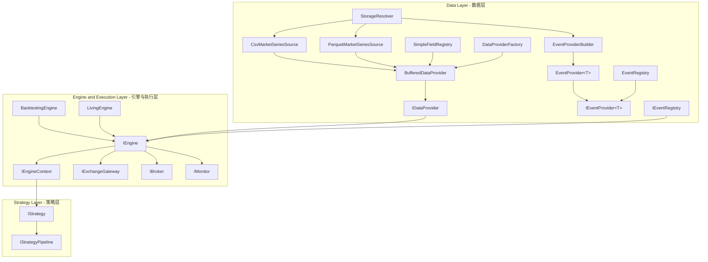

# CarrotQuant .NET 核心架构与开发规范 (v4)

## 一、系统架构总览 (v4 Software Architecture)

CarrotQuant.NET v4 采用 **三层分离架构**，各层之间通过接口契约解耦，支持回测与实盘双引擎。

### 1. 架构拓扑



### 2. 核心分层职责与流向

| 分层 | 核心职责 | 核心组件 / 契约 |
| :--- | :--- | :--- |
| **Data Layer (数据层)** | 数据获取、格式转换、内存缓冲与统一供给 | `StorageResolver`, `CsvMarketSeriesSource`, `ParquetMarketSeriesSource`, `BufferedDataProvider`, `IDataProvider`, `IEventProvider<T>`, `IEventRegistry` |
| **Engine Layer (引擎层)** | 回测撮合与实盘路由、账户资产管理、上下文注入 | `IEngine`, `BacktestingEngine`, `LivingEngine`, `IEngineContext`, `IExchangeGateway`, `IMatchingEngine`, `IBroker`, `IMonitor` |
| **Strategy Layer (策略层)** | 宏观决策、信号生成、组合管理与交易执行 | `IStrategy`, `IStrategyPipeline`, `IMarketStrategy`, `ISignalStrategy`, `IPortfolioStrategy` |

- **数据流向**: `IDataProvider` → `IEngine` → (`IExchangeGateway` / `IBroker` / `IMonitor`) → `IEngineContext` → 策略层
- **策略调度链**: `IPortfolioStrategy` → `IMarketStrategy` → `ISignalStrategy`

### 3. 策略协作机制

#### 3.1 Context 黑板模式
通过 `IEngineContext` 作为统一的信息交换中心（黑板），实现策略解耦与状态共享：
- **信号发生器**: 负责行情分析与信号生产（Signal Generation），输出结论至上下文，不触碰交易接口。
- **执行处理器**: 监听黑板上的信号并转化为物理订单（Order Placement），对信号来源解耦。
- **风控监察员**: 监听账户回报（ExecutionReport/PositionEvent），实时执行风险对冲与合规校验。
- **松耦合机制**: 遵循“状态生产 → Context 存储 → 状态消费”模式，单一策略职责聚焦且支持自由组合。

#### 3.2 策略管线 (Pipeline)
基于组合模式（Composite Pattern）编排策略拓扑：
- **串联管线 (Sequential)**: 按序执行，适用于因果依赖链（如：`宏观策略` → `个股信号` → `执行策略`）。
- **并联管线 (Parallel)**: 并发执行，适用于相互独立、计算密集型的策略组，利用多核性能。
- **编译优化**: 引擎启动前通过 `Compile()` 密封优化管线拓扑，保障时间步事件分发性能。

---

## 二、市场策略 (IMarketStrategy) 体系

### 1. RaUA 架构管线
- `IMarketStrategy` 产生的宏观决策通过 `context.Market` 注入到个股扫描 (`ISignalStrategy`) 和交易执行上下文中。
- **MarketBias** (市场偏向): `Up` (看多/活跃), `Neutral` (中性), `Down` (看空/冰点)。

### 2. 决策消费与剪枝
- **剪枝机制**: 引擎在执行 `ISignalStrategy` 前检查 `context.Market`。若 `MarketContext.SkipAlpha` 为 `true`，自动跳过当日所有个股的信号计算。
- **状态访问**: 策略通过 `context.Market.GetState<T>()` 获取强类型自定义状态（如：`var metrics = context.Market.GetState<MyMarketMetrics>();`）。

---

## 三、数据层契约 (Data Layer Contracts)

所有接口位于 `CarrotBacktesting.NET/Abstraction/Data/`，禁止上层绕过接口直接访问物理存储。

### 1. 物理层抽象（ETL 层）

| 接口 / 类型 | 文件 | 职责 |
| :--- | :--- | :--- |
| `IMarketMetadata` | `Abstraction/Data/IMarketMetadata.cs` | 统一元数据契约（描述时间与代码维度及物理寻址） |
| `IMarketSnapshotSource`| `Abstraction/Data/IMarketSnapshotSource.cs` | 流式读取宽表快照（Row = 交易日，Col = 全市场股票） |
| `IMarketSeriesSource`  | `Abstraction/Data/IMarketSeriesSource.cs`   | 批量读取个股序列（Col = 股票，Row = 时间序列） |

**物理实现与设计细节**：
- `MoveNext()`: 驱动逐行/逐日遍历，零状态暴露。
- `ReadFieldSnapshot<T>(fieldName, Span<T> destination)`: 直接写入调用方提供的内存块，严格零拷贝；`T : unmanaged` 约束兼容 MMF 布局。
- `CsvMarketSeriesSource`: 支持 Hive 分区 `{root}/{table_id}/year={yyyy}/{symbol}.csv` 与 Flat 结构；基于 Sylvan.Data.Csv 流式解析，泛型分发 `ValueConverter<T>` 零装箱转换。
- `ParquetMarketSeriesSource`: 支持按年/月分区 `{root}/{table_id}/year={yyyy}/[month={mm}/]data.parquet` 或单文件；基于 `YearCache` 按需列缓存解压，通过 `Unsafe.As` 零拷贝转换。

### 2. 内存层接口与 Buffer 访问

| 接口 / 类型 | 文件 | 职责 |
| :--- | :--- | :--- |
| `IDataProvider` | `Abstraction/Data/IDataProvider.cs` | 数据层统一输出入口，`GetBuffer<T>(fieldName)` 返回 `IReadOnlyBuffer2D<T>` |
| `IFieldRegistry` | `Abstraction/Data/IFieldRegistry.cs` | 字段注册表，管理已加载与自定义指标字段元信息 |
| `FieldInfo` | `Abstraction/Data/IFieldRegistry.cs` | 字段元数据 record: `(string Name, Type DataType, bool IsCustom)` |
| `IEventProvider<T>` | `Abstraction/Data/IEventProvider.cs` | 异构 KV 数据流提供器（复权因子、分红、公告等） |
| `IEventRegistry` | `Abstraction/Data/IEventRegistry.cs` | 事件注册表，统一管理外部 KV 数据流 |

**核心内存约束 (SSOT)**：
1. `IDataProvider.GetBuffer<T>()` 必须返回只读类型 `IReadOnlyBuffer2D<T>`（来自 `Carrot.Memory`），严禁暴露可写 Buffer。
2. 维度严格对齐：`IMarketMetadata.Symbols` 顺序对应列索引；`TradeDates` 顺序对应行索引。
3. 零内存暴露：严禁对外暴露 `List<T>`、`T[]` 等分配型集合供外部持有。
4. **Symbol 维度契约（只增不减，只多不少）**：在系统生命周期内，标的代码（Symbols）具有全局唯一且单调递增的列索引（`SymbolIndex`）。退市标的绝不剔除（以 `NaN` 占位），新增标的只追加在尾部。已有列索引绝对不可变动，杜绝幸存者偏差。

### 3. Carrot.Memory 契约与 ChunkBuffer2D 内存容器

```
IMarketSeriesSource ──(构造时扫描)──► IMarketMetadata (TradeDates, Symbols)
         │
         │  ReadSymbolSeries<T>()
         ▼
  ChunkBuffer2D<T> ──(实现)──► IReadOnlyBuffer2D<T> ──► IDataProvider.GetBuffer<T>()
```
- 项目引用：`..\..\Carrot.Memory\Carrot.Memory\Carrot.Memory.csproj`
- 关键类型：`ChunkBuffer2D<T>`、`IReadOnlyBuffer2D<T>`、`IBuffer2D<T>`、`ReadOnlyRowView<T>`、`ReadOnlyColumnView<T>`。

### 4. 异构事件流系统 (Event System)

针对复权因子、龙虎榜、分红、停牌等异构 KV 数据，采用与稠密矩阵分离的双轨架构：

| 特性 | **IDataProvider (稠密矩阵)** | **IEventRegistry (稀疏事件/KV)** |
| :--- | :--- | :--- |
| **物理形态** | 连续内存块 (`Buffer2D`, MMF) | 字典树、对象图 (`Dictionary<DateTime, Dictionary<string, T>>`) |
| **访问范式** | 批量切片、二维索引 `(row, col)` 访问 | 随机、点对点 `(date, symbol)` 访问 |
| **应用场景** | 向量化指标计算（OHLCV、MACD、因子合成） | 决策分支（停牌拦截、分红除权、事件驱动） |
| **对齐要求** | **强对齐**（日期与代码矩阵完整填补） | **弱对齐**（发生时存在记录，无需空位对齐） |
| **优化目标** | **高吞吐 (Throughput)**，连续内存向量化批处理 | **低延迟 (Latency)**，O(1) 常数时间点查 |

- **EventProvider\<T\>**: 内存字典二级索引，提供 O(1) 随机查询 `TryGet(date, symbol, out val)`。
- **EventProviderBuilder**: 工厂类，自动检测 CSV/Parquet 格式，通过反射将 schema 字段映射到 T 的构造参数，免手写解析逻辑。
- **EventRegistry**: 类型安全的事件流注册表，策略通过 `context.Events.GetProvider<T>("name")` 获取数据流。

### 5. 存储调度与批量加载 (StorageResolver & Bulk Loader)

- **IStorageResolver** (`Abstraction/Data/IStorageResolver.cs`): 基于 `tableId` 统一调度物理文件：
  - **元数据缓存**: 内部采用 `ConcurrentDictionary<string, TableMetadataCache>` 避免重复 I/O。
  - **决策机制**: 优先读取表目录下 `metadata.json`；缺失时自动由 Parquet Footer 或 CSV 表头回退推断。
  - **布局模式**:
    - `Hive`: `{root}/{table_id}/year={yyyy}/[month={mm}/]`，传入 `startDate` 与 `endDate` 执行年份/月份动态剪枝。
    - `Flat`: `{root}/{table_id}/` 平铺存储，支持直接按 symbol 精确匹配或全量枚举。
- **纵向批量加载流程**:
  1. `StorageResolver.ResolvePhysicalFiles()` 按表与日期区间返回物理文件列表。
  2. `CsvMarketSeriesSource` / `ParquetMarketSeriesSource` 构造时扫描文件建立代码与全局交易日并集，并向 `SimpleFieldRegistry` 注册 schema 字段。
  3. `BufferedDataProvider.GetBuffer<T>()` 优先检查 `TimeseriesCacheStore`（支持 LZ4 原生块压缩与 4096 行分块），命中时直接流式反序列化注入非托管连续内存返回 `ChunkBuffer2D<T>`；未命中或不兼容时从源数据加载并持久化至 `.cache/{tableId}/{fieldName}/`。
- **ReadSymbolSeries 核心机制**:
  - 方法契约：`ReadSymbolSeries(symbol, fieldName, startIndex, length, destination)`
  - CSV：定位 `{symbol}.csv` 逐行流式解析，按日期二分查找写入 `destination`，通过 `ValueConverter<T>` 零装箱转换。
  - Parquet：从 `YearCache` 预解压列直接按股票偏移批量拷贝，通过 `Unsafe.As` 零拷贝转换。

---

## 四、引擎、策略与执行层契约

### 1. 引擎层核心契约 (`CarrotBacktesting.NET.Abstraction.Engine`)

| 契约 / 类型 | 文件 | 职责说明 |
| :--- | :--- | :--- |
| `IEngine` | `Abstraction/Engine/IEngine.cs` | 核心驱动接口，支持 `Run` / `Pause` / `Stop` 与状态快照 (`SaveState` / `RestoreState`) |
| `IEngineContext` | `Abstraction/Engine/IEngineContext.cs` | 策略运行环境，封装 `IDataProvider`, `IBroker`, `IMarketState`, `IEventRegistry` |
| `IBroker` | `Abstraction/Engine/IBroker.cs` | 账户资产与持仓管理，提供订单提交与 `OnTrade` 成交回报事件 |
| `IExchangeGateway`| `Abstraction/Engine/IExchangeGateway.cs` | 交易所物理网关抽象（屏蔽回测撮合器与实盘交易所 API） |
| `IMatchingEngine` | `Abstraction/Engine/IMatchingEngine.cs` | 回测撮合引擎，按时间步驱动撮合逻辑 |
| `IMarketState` | `Abstraction/Engine/MarketContext.cs` | 市场黑板上下文，支持策略间跨层异步状态共享 |
| `IMonitor` | `Abstraction/Engine/IMonitor.cs` | 统一监控抽象，管理日志输出、指标采集与告警 |
| **数据模型** | `Abstraction/Engine/OrderTypes.cs` | `OrderRequest` (下单意图), `ExecutionReport` (成交明细), `OrderStatus` (生命周期), `PositionEvent` |

### 2. 策略与分析层契约

| 契约 / 类型 | 命名空间 | 职责说明 |
| :--- | :--- | :--- |
| `IStrategy` | `Abstraction.Strategy` | 策略基础契约，包含 `Initial`/`Start`/`Update`/`Stop` 及订单/成交回调 |
| `IStrategyPipeline` | `Abstraction.Strategy` | 策略管线契约，支持管线编排与密封编译 |
| `ICheckpointable<T>`| `Abstraction.Strategy` | 强类型状态快照扩展，实现断点续传 |
| `IRecorder` | `Abstraction.Analysis` | 全过程流水采集（订单、成交、净值快照），通过 `GetReport()` 输出 `BacktestReport` |

---

## 五、数据存储与元数据规范 (CarrotQuant.Data)

### 1. 核心存储标准
- **存储格式**: 统一使用 `CSV` 或 `Parquet`。
- **双时间轴契约**: 必须遵循 (`timestamp` Int64 毫秒戳, `symbol` String, `datetime` String)。
- **原子写入**: 文件写入遵循“先写 `.tmp`，后原子替换 (`os.replace`)”。
- **复权口径**: 严禁使用前复权；复权数据仅限 `raw` (原始不复权) 或 `adj` (后复权)。
- **Table ID 命名规范**: `{market}.{category}.[sub_category/freq/adj].{source}`（例如 `ashare.kline.1m.raw.custom`）。
- **物理路径布局**:
  - TimeSeries (TS): `{root}/{table_id}/year={yyyy}/[month={mm}/]{symbol}.csv` 或 `data.parquet`
  - Event (EV): `{root}/{table_id}/year={yyyy}/data.{format}`
- **分区模式 (Partition)**:
  - `symbol`: 物理文件按股票代码拆分（如 `{symbol}.csv`）。
  - `none`: 无代码分区，整表单文件存储（如 `data.parquet`）。

### 2. 元数据规范 (metadata.json)
每个表目录下应提供 `metadata.json`，核心定义：
- `schema`: 显式字段类型映射。
- `statistics` (可选): 物理巡检产出的状态描述，仅用于分析辅助。

### 3. 类型映射字典 (Polars 对齐)

| Schema 声明 | .NET 类型 | Polars 类型 | 说明 |
| :--- | :--- | :--- | :--- |
| `Int64` | `long` | `pl.Int64` | 整数/时间戳 |
| `Float64` | `double` | `pl.Float64` | 浮点数值 |
| `String` | `string` | `pl.String` | 代码、文本 |
| `Boolean` | `bool` | `pl.Boolean` | 布尔状态 |
| `Date` | `DateTime` / `DateOnly` | `pl.Date` | 日期格式 |
| `Datetime` | `DateTime` | `pl.Datetime`| 日期时间 |

---

## 六、YAML 配置规范 (`CarrotBacktesting.NET.Config`)

系统采用蛇形命名（`snake_case`）YAML 文件驱动引擎与数据层；相对路径均以当前配置文件所在物理目录为基准自动合并为绝对路径。

- `engine`: 运行模式 (`mode: backtest/living`)、起止时间 (`start_date`, `end_date`)、初始资金 (`initial_cash`)。
- `data`: 数据层统一多态入口（单一事实来源）：
  - **外链独立配置**: 赋外部文件相对路径字符串（如 `data: "shared/data.yaml"`），支持多策略复用；
  - **直接内嵌配置**: 内嵌数据层映射对象，包含 `root`、`timeseries`（含 `table_id` 与可选 `fields`）、`events`（含 `name` 与 `table_id`）。
- **配置模板与完整 YAML 范例**: 详见 [docs/API.md](docs/API.md#3-yaml-配置范例)。

---

## 七、历史版本 (v3) 架构与报表规范参考

> ⚠️ **历史文档指引**: v3 版本系统规范已完整归档至 [CarrotBacktesting.NET/V3/README.md](CarrotBacktesting.NET/V3/README.md)。
> v4 重构中若涉及历史分析器、图表生成与 Excel 报表迁移，请直接查阅该归档文档。

### v3 核心机制速查索引：
1. **AnalysisContext**: 历史分析器上下文载体，提供 `SetArtifact<T>`, `SetFileArtifact`, `GetFileArtifact` 契约。
2. **插件生命周期与配置**: `IAnalyzer` / `IExporter` 通过 `Init(AnalyzerConfig/ExporterConfig)` 初始化，由 `AnalysisRunner` 队列驱动。
3. **图表工件命名**: 遵循 `Plot_{GroupName}_{PlotType}`（如 `Plot_Total_Heatmap_Signal`）。
4. **Excel 专业报表规范**:
   - 五大分区结构：`Dashboard` (总览), `[Group]_Signal` (T+N 双层表头与 Range-based 区域图表锚定), `[Group]_Monthly` (月度稳定性), `[Group]_Exit` (平仓收益分析), `All_Trades` (全量流水，通过反射将 `Trade.MarketSnapshot` 自动展开为独立列), `Market_Daily` (宏观日报)。
   - 技术深度：中文列宽自适应额外增加 2 字符缓冲区；基于单元格区域固定图表防止错位。
5. **停牌向前填充 (Forward Fill)**: 缺失交易日填充 `StockFrame`，收盘价向前沿用，成交量置 0，状态置为 `TradeStatus.Halted`。
6. **双路径并行模型**: TimeSeries（纵向个股并行）与 MarketSnapshot（横向日期截面并行）。

---

## 八、工程研发与文档维护规范

1. **单一事实来源 (SSOT & DRY)**: 核心契约与数据结构单点权威定义，严禁冗余拷贝或散落多处定义。
2. **显式优于隐式 (Explicit > Implicit)**: 优先读取 `metadata.json` 显式类型，配置与参数清晰透明，严禁未经对齐的隐式推断与静默容错。
3. **专业工程手册文案与精炼注释（严禁营销夸大与哲学浮夸）**:
   - **专业手册定位与领域中立**: 代码注释、文档与提交信息必须定位为严谨的“专业工程手册”，重点陈述技术事实、算法复杂度、物理边界与指标契约；坚决杜绝“设计哲学”、“颠覆性”、“极致强大”、“完美无瑕”、“终极方案”、“压榨性能”、“泥沙俱下”等哲学思辨、戏剧化修辞与 AI 营销套话。
   - **示例驱动与全面详实**: 文档与 API 规范必须全面、精准，关键环节（配置、数据加载、策略生命周期、订单交互）必须提供完整、清晰、可直接对照执行的代码或 YAML 范例，杜绝空泛说明。
   - **文档链接规范**: Markdown 文档内部的接口、类与路径引用严禁使用开发机绝对路径（如 `file:///`），统一采用反引号代码标记或相对路径。
   - **精炼合理的中文注释**: 注释重点阐明“设计意图 (Why)”与“边界约束 (Constraints)”，解释非直观算法或架构决策；坚决杜绝代码复述式废话（如不要在 `GetBuffer` 上写“获取 Buffer”）。
4. **文档即代码真相（实时同步）**: 任何接口、数据结构、物理路径或配置模型的调整，必须第一时间同步维护本文档（[AGENTS.md](AGENTS.md)）、API 参考手册（[docs/API.md](docs/API.md)）与 Wiki 文档（[docs/](docs/)），消除过时信息。
5. **最小改动与精准执行**: 修改遵循最小可行原则，严禁未查明根因盲目修改无关代码或无因格式重排。
   - **编辑警示**: 在使用 `edit` 工具修改代码时，请确保 `oldText` 块精准且最小化，严禁通过包含大量无关的前后文增加匹配难度，防止误伤不相关的代码区域。
6. **测试闭环与真实断言**: 代码重构与新增特性必须同步执行单元测试（`dotnet test`），严禁使用弱条件分支掩盖故障。
