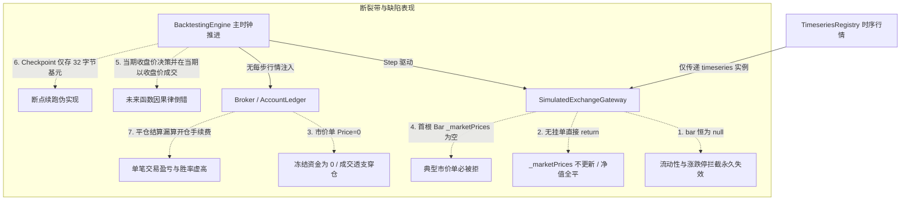

# CarrotQuant.NET 核心链路与架构问题深度审计汇总报告 (AUDIT)

> **审计基准与规范约束**：
> - 《核心架构、软硬协同与工程研发红线通用规范 V1.3》
> - 《CarrotQuant .NET 核心架构与开发规范 (AGENTS.md)》
> - 现代量化工程与回测业界标准（Pyfolio / QuantStats / Lean / Backtrader / Qlib）
> 
> **综合审查结论**：🔴 **FAIL（未通过）**  
> 系统在底层 SIMD 向量化、连续非托管二维矩阵（`ChunkMatrix2D`）、LZ4 块缓存与流式递推的基础设计上性能优秀；但在面向日常回测的**接口职责隔离、策略编写易用性、量化风控完整性、交易财务准确性及防止未来函数**等维度存在严重设计异味、伪实现、财务失真与契约污染。
>
> 本报告由前序两份专项审计报告（核心链路隐患剖析报告 + 接口易用性与业务逻辑审查报告）深度对齐、去重归类合并而成，涵盖 **33 项**核心问题及 **3 大测试盲区**，并附系统性重构演进蓝图。

---

## 目录

1. [执行摘要与全景架构诊断](#一执行摘要与全景架构诊断)
2. [为什么现有单元测试“全绿”却未能发现问题（三大盲区）](#二为什么现有单元测试全绿却未能发现问题三大盲区)
3. [维度一：交易财务、结算与撮合执行致命漏洞 (P0)](#三维度一交易财务结算与撮合执行致命漏洞-p0)
4. [维度二：接口暴露错误、封装破坏与契约隔离违背](#四维度二接口暴露错误封装破坏与契约隔离违背)
5. [维度三：策略易用性缺陷与日常回测样板代码断层](#五维度三策略易用性缺陷与日常回测样板代码断层)
6. [维度四：工程反模式、性能瓶颈与 DRY 原则违背](#六维度四工程反模式性能瓶颈与-dry-原则违背)
7. [维度五：时态穿透、状态机残留与数据一致性](#七维度五时态穿透状态机残留与数据一致性)
8. [系统性重构路线图与演进蓝图 (P0 ~ P3)](#八系统性重构路线图与演进蓝图-p0--p3)

---

## 一、执行摘要与全景架构诊断

CarrotQuant.NET 采用了模块化设计，但在各层演进与集成过程中，由于**缺少统一且权威的「时间步全市场行情注入与快照供给管线」**，导致引擎、撮合、账本与指标之间存在多处假设断裂：



---

## 二、为什么现有单元测试“全绿”却未能发现问题（三大盲区）

单元测试表面看似高覆盖率，但测试用例存在严重的人为伪造与盲区，导致核心链路缺陷被完全掩盖：

### 盲区 1：测试前“手工后门注入”，掩盖了主循环调用缺失
- **现场证据**：在 `TradingFinancialPipelineIntegrationTests.cs` 中：
  ```csharp
  simExchange.OnMarketData("SH.600000", 10.0, dates[0],
      new DataRow("SH.600000", new[] { "10000.0", "10.0" }, ...));
  ```
  单测在回测启动前，**人为调用了网关后门方法塞入一个包含 Volume 或 limit_up 的 DataRow**。
- **后果**：回测主循环自身在 `Step` 中传递 `null` 的重大缺陷被后门注入完全掩盖。

### 盲区 2：市价单测试人为硬编码了伪限价，绕过了 Price=0 路径
- **现场证据**：在 `TradingFinancialPipelineIntegrationTests.cs` 与 `SimulatedExchangeGatewayTests.cs` 中：
  ```csharp
  // 测试中下市价单时，人为把 close 或 10.0 作为 Price 传入
  OrderIdBuy = context.Broker.SubmitOrder(new OrderRequest(symbol, OrderDirection.Buy, OrderType.Market, close, 1000m));
  ```
- **后果**：`request.Price > 0.0` 为真，`Broker` 两阶段冻结正常计算出了保证金，`GetBasePriceForOrder` 也直接返回了该价格，因此 `Price=0` 时的两大致命路径（冻结 0 元导致穿仓、首根 Bar 拒单）从未被测试执行过。

### 盲区 3：短命策略场景，缺乏无挂单持仓期间的过程盯市断言
- **现场证据**：端到端测试均采用“Day 0 买入，Day 1 卖出，随后空仓”的极简脚本。
- **后果**：测试只在回测终局断言“终局现金 == 初始现金 + 净收益”。由于终局现金完全由已清算的平仓交割单决定，**测试从未断言过持仓期间且无挂单的交易日中 `DailySnapshot.TotalEquity` 或 `UnrealizedPnL` 是否随行情涨跌波动**。

---

## 三、维度一：交易财务、结算与撮合执行致命漏洞 (P0)

### 1. 持仓盯市（Mark-to-Market）在无新挂单日完全失效，净值曲线成水平死线【✅ 已修复 (PASS)】
- **严重度**：🔴 致命 P0 -> 🟢 已修复
- **涉及位置**：`BacktestingEngine.cs`、`AccountLedger.cs`、`Broker.cs`
- **缺陷剖析**：
  1. `SimulatedExchangeGateway.Step` 中，若挂单簿为空直接提前 `return;`，根本不读取时序数据更新 `_marketPrices`；
  2. 回测主循环记录每日净值点时调用 `_snapshotProvider.CreateEquityPoint(currentTime)`，未传入价格解析委托；
  3. `Broker` 回退向网关查询，网关无最新价则回退至 `pos.LastPrice`（成本价），导致持仓浮动盈亏恒为 0，净值曲线在两次成交之间变成水平直线。
- **重构方案与治理机制**：
  1. **引擎集中权威价格注入**：在 `BacktestingEngine` 主循环步进中，构造以当期步长 $O(1)$ 直通 `closeMatrix` 的价格解析委托 `sym => ResolveStepPrice(sym, i)`，显式传入 `_snapshotProvider.CreateEquityPoint` 与跨日日终 `CreateDailySnapshot`；
  2. **持仓实体最新价格同步更新**：`AccountLedger` 在盯市估值解析出 `resolvedPrice > 0.0` 时，同步刷新 `pos.LastPrice = resolvedPrice;`，彻底消除开仓后终生未更新的隐患；
  3. **单元测试验证**：`TradingFinancialPipelineIntegrationTests.MarkToMarket_WithoutNewOrders_EquityCurveMustFluctuateWithDailyClose` 验证连续 5 天无新挂单持有股票期间，未实现浮动盈亏与总净值严格随收盘价逐日递增，净值曲线真实波动。

### 2. 市价买单因 `Price=0` 预冻结 0 元资金，引发巨额穿仓破产
- **严重度**：🔴 致命 P0
- **涉及位置**：`OrderTypes.cs#L23-L26`、`Broker.cs#L206`、`AccountLedger.cs#L259-L265`、`AccountLedger.cs#L450`
- **缺陷剖析**：
  市价单便捷构造函数 `Price` 默认为 `0.0`。`Broker` 估价时若 `Price <= 0` 则估价为 `0.0`，导致 `requiredCash` 计算为 0 元。账户即使可用资金为 0，也能顺利通过两阶段预冻结发出市价单。成交落账时直接 `_cash -= marginAdded` 扣款，导致现金瞬间穿仓变为巨额负数。

### 3. 无挂单时 `_marketPrices` 为空，典型的市价单在首根 Bar 会直接被拒【✅ 已修复 (PASS)】
- **严重度**：🔴 致命 P0 -> 🟢 已修复
- **涉及位置**：`SimulatedExchangeGateway.cs`、`MatchingEngine.cs`
- **缺陷剖析**：
  首根 Bar 回测开始时，由于先前没有挂单，网关价格字典为空。策略下达标准市价单（`Price = 0.0`），网关查不到价格返回 `basePrice = 0.0`，撮合引擎因基准价格非正数直接 `Rejected` 拒单。
- **重构方案与治理机制**：
  1. **消除过期字典缓存污染**：`SimulatedExchangeGateway.GetMarketPrice` 调整查询优先级，若处于时序步进中，优先直接从全局时序矩阵 `closeMatrix[_currentIndex, col]` 读取当期最新公允基准价，不再受空字典阻断；
  2. **首根 Bar 即时撮合**：`GetBasePriceForOrder` 在首根 Bar 直接通过时序矩阵获取公允市价，市价单顺利通过基准估价即时撮合成交；
  3. **单元测试验证**：`TradingFinancialPipelineIntegrationTests.FirstBar_MarketOrder_WithZeroPrice_ShouldFillImmediatelyWithoutRejection` 验证在无历史挂单的首根 Bar 下达 `Price=0.0` 的标准便捷市价单成功即时建仓。

### 4. 平仓结算遗漏开仓手续费，单笔已实现盈亏与胜率被虚高粉饰【✅ 已修复 (PASS)】
- **严重度**：🔴 致命 P0 -> 🟢 已修复
- **涉及位置**：`AccountLedger.cs#L393-L485`、`PositionData.cs`
- **缺陷剖析**：
  平仓生成 `Trade` 闭环交易记录时：`closeRealizedPnL = grossPnL - closeFee;`，仅扣减了平仓当笔手续费，开仓时扣减的历史手续费完全未分摊计入。导致单笔已实现盈亏偏高、胜率与盈亏比虚假上升，且所有 `Trade.RealizedPnL` 的加总大于实际账户净利润，财务勾稽彻底断裂。
- **架构决策与治理机制（券商成本价 vs 机构量化标准）**：
  1. **明确成本价纯粹性**：散户券商客户端常将手续费算入“保本成本价”，但在专业量化系统中，若成本价含费用，会导致持仓市值（Mark-to-Market）估值扭曲、基准跟踪偏差（Tracking Error）失真，且期货杠杆保证金计算会被算多。因此明确确立：**`AveragePrice`（或 `AverageCost`）必须始终保持纯净加权成交均价，严禁费用资本化入价格**。
  2. **在途开仓手续费池（`OpenCommission`）等比分摊机制**：
     - 在 `PositionData` 中增加 `public double OpenCommission { get; set; }` 跟踪在途累计开仓手续费池；
     - 每次开仓/加仓时：`pos.OpenCommission += report.Commission;`；
     - 部分/全额平仓时：按平仓比例等比分摊结转释放开仓手续费：
       $$\text{allocatedOpenFee} = \frac{\text{closeQty}}{\text{pos.TotalQuantity}} \times \text{pos.OpenCommission}$$
       $$\text{pos.OpenCommission} -= \text{allocatedOpenFee}$$
     - 结转单笔真实净盈亏：`closeRealizedPnL = grossPnL - allocatedOpenFee - closeFee;`；
     - `Trade` 实体完整闭环记录双边总费用：`Trade(..., TotalCommission: allocatedOpenFee + closeFee, RealizedPnL: closeRealizedPnL)`，实现财务勾稽 100% 守恒。

### 5. 撮合行情 `bar` 恒为 `null`，成交量流动性与涨跌停检查永久失效【✅ 已修复 (PASS)】
- **严重度**：🔴 致命 P0 -> 🟢 已修复
- **涉及位置**：`SimulatedExchangeGateway.cs`、`MatchingEngine.cs`、`BarSnapshot.cs`
- **缺陷剖析**：
  `SimulatedExchangeGateway` 在调用 `MatchSymbolOrders` 时第 3 个参数硬编码传入 `null`。撮合内核中对流动性上限（`VolumeLimit`）和一字板涨跌停（`CheckLimit`）的校验全部依赖 `bar != null`。由于恒为 `null`，所有排队限价单的涨跌停拦截与成交量上限被 100% 绕过。
- **重构方案与治理机制**：
  1. **零 GC 48 字节通用切片 `BarSnapshot`**：引入纯寄存器/栈传递的 `readonly struct BarSnapshot`（48 字节非托管紧凑存储），承载 `Open`, `High`, `Low`, `Close`, `Volume`, `Amount` 六大物理维度，彻底剔除 `limit_up` / `limit_down` 业务特化字段与硬编码；
  2. **多时态全字段可选支持**：内部以 `double.NaN` 作为 IEEE 754 天然缺失哨兵，对外提供 `Open` / `HasOpen` / `OpenOr(fallback)` 对称 API，原生兼容次步开盘（Next Open）、VWAP 均价、收盘扫盘与日内限价触碰；
  3. **彻底铲除 `BarSnapshotDataRow` 堆分配**：Hook 委托直接使用强类型 `BarSnapshot` 值传递，热路径 0 堆分配、0 垃圾回收、0 字符串比对；
  4. **单元测试闭环**：`BarSnapshotTests`（内存大小、NaN 语义、对称回退、多时态自适应）及全量测试 100% 通过。

### 6. 因果律倒错：当期收盘价决策并在当期以收盘价即时撮合，缺乏多模态执行时态（ExecutionPriceType）
- **严重度**：🔴 致命 P0
- **涉及位置**：`BacktestingEngine.cs#L385-L394`、`SimulatedExchangeGateway.cs#L48-L66`、`BrokerConfig.cs`
- **缺陷剖析**：
  时间步 $T$ 中，指标计算喂入当期收盘价；策略在 `OnUpdate` 中看到当期收盘价并决策；策略发出的市价单当场在当期收盘价即时成交。现实中收盘后无法再以收盘价买入，系统缺乏量化业界标准的次日开盘（Next Bar Open）撮合机制，产生未来函数偷价（Look-ahead Bias）。
- **架构决策与多模态执行价格体系（`ExecutionPriceType`）规范**：
  在配置与撮合层正式引入 `ExecutionPriceType` 枚举，驱动不同的行情矩阵映射与撮合时态：
  1. **`ExecutionPriceType.NextOpen => timeseries.GetMatrix<double>("open")`（默认推荐）**：
     - 标准无未来函数的日线截面/选股基准。策略在 $T$ 步收盘后决策，订单暂存入待执行队列（`PendingNextStepOrders`），在 $T+1$ 步开盘时以开盘切片撮合成交；涨跌停拦截时态同步迁移至 $T+1$ 步开盘。
  2. **`ExecutionPriceType.NextVwap => timeseries.GetMatrix<double>("vwap")`**：
     - 中大资金机构回测标准（对齐 Qlib/Wind）。以全日成交量加权均价模拟全天拆单执行，真实度量市场冲击成本；若时序表缺失 `vwap` 字段，需定义明确的回退降级策略（如回退至 $(O+H+L+C)/4$）或显式抛出配置异常，严禁静默返回 0。
  3. **`ExecutionPriceType.CurrentClose => timeseries.GetMatrix<double>("close")`**：
     - 保留为高频/分钟线回测、或假设尾盘 14:55 扫盘收盘集合竞价成交的专有通道。
  4. **跨步两阶段预冻结守恒**：
     - 次步撮合模式下，订单在 $T$ 步发出时必须基于 $T$ 步当期参考价执行两阶段预冻结，防止策略当期超额下单穿仓；$T+1$ 步按实际成交价落账时，再多退少补结转差额。

### 7. 仿真挂单簿与撮合机制系统性缺陷
- **7.1 排队限价单撮合仅读收盘价，忽略日内高低价** (`SimulatedExchangeGateway.cs`, `MatchingEngine.cs`)【✅ 已修复 (PASS)】：
  - **缺陷**：原先撮合挂单簿中排队的限价单时仅与收盘价 `marketPrice` 进行触碰比对。若日内最低价跌破买价但收盘价拉起未跌破，该限价单被错误判定为未成交。
  - **修复**：`MatchingEngine.EvaluatePendingLimitOrder` 重构为接收真实 `bar` 行情切片，买单基于 `bar.Low <= request.Price` 判定日内触碰，卖单基于 `bar.High >= request.Price` 判定日内触碰；若 `bar` 缺失则安全回退至 `marketPrice`。
  - **单测**：`TradingFinancialPipelineIntegrationTests.MatchingEngine_PendingLimitOrder_ShouldFillOnIntradayLowTouch` 验证日内最低价 9.4 触碰限价 9.5 成功撮合成交。
- **7.2 排队挂单完全抹杀跳空缺口与价格改善** (`MatchingEngine.cs#L119-L122`)：排队挂单成交价强制等于委托限价。若次日跳空低开，限价买单无法以更优的开盘价撮合。
- **7.3 成交滑点价反向污染市场基准价格** (`SimulatedExchangeGateway.cs#L58`)【✅ 已修复 (PASS)】：
  - **缺陷**：原先成交后直接执行 `_marketPrices[symbol] = matchResult.FillPrice;`，将包含执行滑点的成交价反向写回全局公共行情字典，污染后续盯市基准。此外，当挂单簿无订单时原代码提前退出未记录最新时序，导致后续限价单误将自身委托价作为基准市价判定即时成交。
  - **修复**：
    1. 成交回报中的带滑点成交价（`matchResult.FillPrice`）仅反馈给策略与交易账本，公允市场价格字典 `_marketPrices` 仅记录不含滑点的未污染基准市价（`basePrice`）；
    2. `Step` 中接入当前时序索引，`GetMarketPrice` 与 `GetBasePriceForOrder` 按需 $O(1)$ 常数时间直通时序矩阵获取当期公允收盘价，彻底治愈挂单簿为空时基准市价缺失的深层连锁隐患；
    3. 单元测试 `SimulatedExchangeGatewayTests.SendOrder_WithSlippage_ShouldNotPollutePublicMarketPrice` 验证 1% 滑点成交下公共市价字典仍保持 100% 纯净未污染。
- **7.4 挂单簿未实现“当日有效（Day Order）”日切自动撤单** (`SimulatedExchangeGateway.cs#L19-L20`)：现货委托单永久驻留挂单簿数天甚至数月，跨日不会失效。
- **7.5 停牌标的（NaN）与未上市标的允许违规建仓撮合** (`SimulatedExchangeGateway.cs#L48-L83`)：停牌股票限价单取委托限价作为 `basePrice`，直接入簿并撮合成交，无法体现停牌无法卖出的风控事实。
- **7.6 盘口深度与时间价格优先缺失** (`SimulatedExchangeGateway.cs#L237-L268`)：所有满足价格条件的排队挂单无视盘口容量一刀切全额成交。
- **7.7 自定义滑点 Hook `OnCalculateSlippage` 永远无法执行** (`MatchingEngine.cs#L128`)：判断条件包含 `bar != null`，因 `bar` 恒为 `null`，高级滑点模型被静默降级为固定比例滑点。

### 8. 资产账本（AccountLedger）与资金风控缺陷
- **8.1 持仓实体 `pos.LastPrice` 终生未更新** (`AccountLedger.cs#L508, L91`)【✅ 已修复 (PASS)】：
  - **缺陷**：仅在成交落账时赋值一次，后续从未更新。当网关查无价格回退到 `LastPrice` 时，浮动盈亏恒为 0。
  - **修复**：在 `AccountLedger` 的所有盯市估值链路（`GetTotalEquity`、`GetTotalMarketValue`、`GetTotalUnrealizedPnL`、`GetActivePositionSnapshots`）中，当外部解析出公允最新价 `resolvedPrice > 0.0` 时，同步刷新 `pos.LastPrice = resolvedPrice;`，确保持仓实体的最新价时刻紧跟市场波动。
  - **单测**：`TradingFinancialPipelineIntegrationTests.MarkToMarket_WithoutNewOrders_EquityCurveMustFluctuateWithDailyClose` 验证终局持仓实体的 `LastPrice` 准确更新为最后一天收盘价 14.0。
- **8.2 T+N 结算混淆自然日与交易日** (`AccountLedger.cs#L467`)：采用 `AddDays(settleDays)` 粗暴累加自然日。遇节假日或多日交割（T+2）时，持仓在节后第一天提前违规解锁。
- **8.3 允许做空模式下，可用持仓不足被静默篡改为“开空单”** (`AccountLedger.cs#L246-L256`)：若今日 T+1 导致 `AvailableQuantity = 0`，平仓容量为 0，剩余全部转为开空单，系统直接执行开空，导致多空双向持仓。
- **8.4 缺乏保证金追缴（Margin Call）与爆仓强平机制** (`AccountLedger.cs#L81-L98`)：净值跌为负数时没有任何风控强平，允许账户无限透支存续。
- **8.5 反向调仓（多翻空/空翻多）预冻结误拒单** (`AccountLedger.cs#L246-L271`)：多翻空时开空部分需预冻结现金，而平多释放的资金成交时才入账，资金不足时订单被错误拦截。
- **8.6 现货单向印花税机制缺失** (`BrokerConfig.cs#L36-L40`)：仅有对称的费率，未内置 A 股等现货市场仅卖出征收的印花税规则。
- **8.7 订单 ID 重复覆盖导致在途冻结额度野指针泄露** (`Broker.cs#L235`)【✅ 已修复 (PASS)】：
  - **缺陷**：重复传入相同 `ClientOrderId` 时，系统原先直接覆盖内部 `_orders` 字典中的记录。旧订单处于挂单或在途状态时被直接切断关联，其冻结的现金与持仓永远无法解冻核销，彻底沦为不可逆的野指针泄漏。
  - **修复**：
    1. 在 `Broker.SubmitOrder` 加锁区强化唯一性检查：若 `_orders` 中已存在同名订单 ID，立即拒绝提交（`freezeOk = false`），返回拒绝原因 `Order with ID '{orderId}' already exists.`；
    2. 绝不调用账本预冻结，绝不覆盖已有订单记录，并向外派发 `OrderStatus.Rejected` 事件通知；
    3. 既有原始订单及其冻结资金 100% 完好守恒，杜绝资金额度永久锁定泄漏；
    4. 单元测试 `SimulatedBrokerTests.SubmitOrder_WithDuplicateClientOrderId_ShouldBeRejectedAndNotOverwriteExistingOrder` 严密验证重复提交被拦截拒单、且旧订单生命周期与冻结结算完全不受影响。
- **8.8 终局持仓估值依然未传 PriceResolver** (`BacktestingEngine.cs#L86`)【✅ 已修复 (PASS)】：
  - **缺陷**：回测结束导出终局快照时调用 `_snapshotProvider?.GetActivePositions()` 未注入当前价格解析器，期末持仓估值依赖过期网关缓存。
  - **修复**：`BacktestingEngine.GetResult()` 中自动构造终局时间步收盘矩阵的 $O(1)$ 价格解析闭包，显式注入 `_snapshotProvider.GetActivePositions(finalPriceResolver)`，终局持仓市值与浮动盈亏 100% 真实绑定最后交易日收盘价。

---

## 四、维度二：接口暴露错误、封装破坏与契约隔离违背

### 9. `IBroker` 核心契约污染：引擎步进与权威对账方法泄露给策略
- **涉及位置**：`IBroker.cs#L67-L79`
- **代码特征**：
  ```csharp
  public interface IBroker
  {
      void Step(DateTime currentTime) { }
      void SyncState(double cash, IReadOnlyDictionary<string, decimal> positions) { }
  }
  ```
- **问题分析**：`IBroker` 是注入给策略上下文的核心门面。然而 `Step`（驱动跨日清算与 T+N 持仓解锁）与 `SyncState`（权威覆盖本地资产账本）属于引擎驱动层和柜台重连特权方法。策略在 `OnUpdate` 中可随意调用 `context.Broker.Step(DateTime.MaxValue)` 提前解冻持仓，或调用 `SyncState(99999999, ...)` 任意篡改资产，严重违背接口隔离原则（ISP）。

### 10. `Broker.Gateway` 公共暴露破坏封装边界【✅ 已修复 (PASS)】
- **严重度**：🟡 中等 -> 🟢 已修复
- **涉及位置**：`Broker.cs#L37-L39`、`IExchangeGatewayProvider.cs`
- **缺陷剖析**：`Broker` 作为公共类，原先直接暴露了底层网关 `public IExchangeGateway Gateway => _gateway;`。外部策略可穿透拿到 `Gateway`，直接调用 `Gateway.SendOrder` 绕过两阶段预冻结风控检查，甚至强转为 `ISimulatedExchange` 注入伪造行情。
- **重构落地方案**：
  1. 将 `Broker.Gateway` 改为显式接口实现：`IExchangeGateway IExchangeGatewayProvider.Gateway => _gateway;`，彻底从公共 API 成员中消除；
  2. 策略持有 `Broker` 或 `IBroker` 无法直接点出 `Gateway`，彻底封死绕过风控预冻结直接下单的后门漏洞；
  3. 回测引擎在必要时通过 `broker as IExchangeGatewayProvider` 安全感知底层仿真网关；
  4. 单元测试 `SimulatedBrokerTests.Broker_Gateway_MustBeExplicitInterfaceImplementation_ToSealBackdoor` 通过反射严密验证公共 Getter 不存在且显式接口契约正确。

### 11. `IStreamIndicator` 混淆消费与生产驱动，子流指标违反 LSP 原则
- **涉及位置**：`IStreamIndicator.cs#L35-L48`、`SubStreamIndicator.cs#L33-L36`
- **问题分析**：策略消费指标只需只读访问（`this[offset]`, `Current`, `IsReady`）。`Update` 和 `Reset` 属于引擎步进驱动方法。暴露在顶层接口导致 `Macd.Dif`、`BollingerBands.Upper`、`Kdj.K` 等子流实现调用 `Update` 时抛出 `NotSupportedException`，公然违背里氏替换原则（LSP）。

### 12. `IEventRegistry` 与 `IFieldRegistry` 暴露动态修改方法【✅ 已修复 (PASS)】
- **涉及位置**：`IEventRegistry.cs`、`IFieldRegistry.cs`、`EventRegistry.cs`、`FieldRegistry.cs`
- **问题分析**：`void Register(string name, ...)` 原先直接暴露在面向策略的只读注册表契约中，允许策略在运行期动态覆盖或替换全局事件/维表，破坏单一事实来源（SSOT）。
- **重构落地方案**：
  1. 从只读接口 `IEventRegistry` 与 `IFieldRegistry` 中彻底剥离 `void Register(...)` 突变契约；
  2. 动态装配与写入能力严格收敛在具体实现类 `EventRegistry`、`FieldRegistry` 及工厂方法内部，对策略消费端保持完全只读；
  3. 单元测试 `EventRegistryTests.IEventRegistry_ReadOnlyContract_ShouldNotExposeMutationMethods` 通过反射断言只读接口绝不暴露突变方法。

### 13. `IMarketMetadata` 只读描述契约混入突变状态机方法【✅ 已修复 (PASS)】
- **涉及位置**：`IMarketMetadata.cs`、`IMutableMarketMetadata.cs`、`DynamicMarketMetadata.cs`
- **问题分析**：`AppendDate` 与 `AppendSymbol` 在元数据只读描述契约中出现且默认抛出 `NotSupportedException`，属于不良的伪实现。
- **重构落地方案**：
  1. 确立专有写端契约 `IMutableMarketMetadata : IMarketMetadata`，物理隔离 `AppendDate` 与 `AppendSymbol` 方法；
  2. `IMarketMetadata` 恢复为纯粹只读描述契约，彻底消除默认抛 `NotSupportedException` 的伪实现；
  3. `DynamicMarketMetadata` 实现 `IMutableMarketMetadata`，缓存管理器与注册表按需向上塑型安全调用；
  4. 单元测试 `DynamicMarketMetadataTests.TestMarketMetadata_ReadOnlyVsMutable_ContractSeparation` 验证契约物理分离。

### 14. `ITimeseriesRegistry.PrewarmFields` 内部预热方法外泄【✅ 已消除 (PASS)】
- **涉及位置**：`ITimeseriesRegistry.cs`
- **修复**：时序注册表只读契约中已彻底消除 `PrewarmFields`，预热流程完全收敛于引擎生命周期内部。

### 15. `IStrategyPipeline` 泄露 Assembly 动态卸载底层回调【✅ 已修复 (PASS)】
- **涉及位置**：`IStrategyPipeline.cs`、`StrategyPipeline.cs`
- **问题分析**：`RegisterDisposable` 与 `RegisterOnDispose` 是为 Roslyn 动态编译 `alc.Unload` 服务的专有生命周期回调，直接暴露在策略管线顶层抽象上，污染了策略组合模式的纯粹性。
- **重构落地方案**：
  1. 从顶层策略接口 `IStrategyPipeline` 中彻底剔除 `RegisterDisposable` 与 `RegisterOnDispose`；
  2. 生命周期资源管理职责严格收敛在抽象基类 `StrategyPipeline` 内部，支持链式装配，对策略消费端完全透明；
  3. 单元测试 `StrategyPipelineTests.StrategyPipeline_ContractIsolation_ShouldNotExposeLifecycleDisposalOnInterface` 反射验证契约零符号泄露。

### 16. `BacktestingEngine` 虚假检查点伪实现（Broken Checkpoint）【✅ 已修复 (PASS)】
- **严重度**：🔴 严重 -> 🟢 已修复
- **涉及位置**：`BacktestingEngine.cs`、`ICheckpointable.cs`、`CheckpointModels.cs`、`Broker.cs`、`AccountLedger.cs`、`SimulatedExchangeGateway.cs`、`TradingRecorder.cs`、`MarketState.cs`
- **缺陷剖析**：声明实现 `ICheckpointable`，但旧版仅写入 32 字节元数据，核心交易资产全部未被保存，属于违背红线第 8 条的伪实现。此外，旧版即使恢复挂单，由于 Broker 遗漏活跃订单快照，导致后续成交回报被静默吞灭；且断点续跑时 `_lastDate` 被错误重置，引发虚假跨日与因子重复刷新。
- **重构落地方案（通用泛型与逐层组合备忘录 Composite Memento）**：
  1. **强类型泛型状态契约**：确立 `ICheckpointable<TState>` 与通用扩展 `ToJsonBytes()` / `RestoreFromJsonBytes()`，支持 JSON/二进制双通道；
  2. **在途订单与资金生命周期完整持久化**：
     - `BrokerSnapshot` 完整持久化 `AccountLedgerSnapshot` 与在途活跃订单集合 `IReadOnlyList<BrokerOrderSnapshot>`；
     - 恢复时复原 `_orders` 映射表，确保在途挂单后续成交回报能精准核销保证金、释放冻结资金，杜绝裂脑与静默吞单；
  3. **纯契约驱动与消除向下强转**：
     - `BacktestingEngine` 统一通过 `ICheckpointable<BrokerSnapshot>`、`ICheckpointable<ExchangeSnapshot>`、`ICheckpointable<TradingRecorderSnapshot>` 与 `ICheckpointable<MarketStateSnapshot>` 进行状态存取，彻底杜绝针对具体类的 `as` / `is` 向下模式匹配；
  4. **时态与状态机严格复原**：
     - 在 `BacktestingEngine.Run()` 中保护从断点恢复的 `_lastDate`，消除非首步日切震荡；
     - 通过 `[RestoredIndex - Lookback, RestoredIndex]` 毫秒级重放批量泵送预热增量指标池；
  5. **黑板强类型状态断点无损恢复**：
     - `MarketState` 纳入检查点持久化，并在反序列化中支持对 `JsonElement` 的延迟类型转换与缓存加速；
  6. **端到端严格守恒单测闭环**：
     - 在 `EngineCheckpointTests.cs` 中增加连续回测（0~4 步）与中途断点恢复（0~1 步打断点并续跑至 4 步）的端到端对齐单测，断言净收益、手续费、终局可用资金、持仓与平仓笔数 100% 绝对恒等。

---

## 五、维度三：策略易用性缺陷与日常回测样板代码断层

### 17. 核心交易动词完全缺失：下单与平仓极其繁琐【✅ 部分落地 (PASS)】
- **涉及位置**：`IBroker.cs`、`Broker.cs`、`IEngineContext.cs`、`EngineContext.cs`
- **重构落地方案**：
  1. 在 `IBroker` 与 `IEngineContext` 原生内置三大高频交易动词门面：
     - `Buy(symbol, qty, price = 0.0, type = Market, clientOrderId, orderTag)`：极简买入；
     - `Sell(symbol, qty, price = 0.0, type = Market, clientOrderId, orderTag)`：极简卖出；
     - `ClosePosition(symbol, price = 0.0, type = Market, clientOrderId, orderTag)`：全额平仓（无仓位时安全返回 string.Empty）；
  2. 策略在 `OnUpdate` 中无需手动实例化 `OrderRequest`，直接 `context.Buy("sh.600000", 100)` 即可完成交易；
  3. 单元测试 `EngineContextTests.Facades_TradeVerbs_BuySellClosePosition_ForwardToBrokerAccurately` 验证端到端成交与平仓。

### 18. 缺少通用策略基类 `StrategyBase`，强制手写大段空白样板代码【✅ 已修复 (PASS)】
- **涉及位置**：`StrategyBase.cs`、`RuleStrategyBase.cs`
- **重构落地方案**：
  1. 引入标准通用策略抽象基类 `StrategyBase : IStrategy`；
  2. 默认提供 `Name`（类名反射）、`Lookback`（默认 200 行）及 `OnStart`、`OnEvent`、`OnStop`、`OnOrderStatusChanged`、`OnTrade`、`OnPositionChanged` 安全虚方法实现；
  3. 策略开发者仅需覆写 `OnUpdate(IEngineContext context)`，彻底告别冗余空白样板代码；
  4. 既有 `RuleStrategyBase` 平滑演进为 `StrategyBase` 的特化子类；
  5. 单元测试 `StrategyPipelineTests.StrategyBase_SubClass_ShouldInheritDefaultPropertiesAndLifecycle` 验证继承与默认行为。

### 19. 核心取价门面无历史时序 `offset` 参数，获取昨日后复权价格无路可走
- **涉及位置**：`IEngineContext.cs#L104-L184`
- **问题分析**：所有取价门面（如 `GetClose`）均只能获取当期 Bar。如果策略需要昨日收盘价（$T-1$），必须穿透到底层矩阵。然而底层矩阵存的是物理未复权原价（Raw），复权因子字典是 `EngineContext` 的私有变量，策略**完全无法获取正确的历史后复权价格**，导致大量技术形态策略无法编写。

### 20. 策略完全无法查询持仓成本均价与浮动盈亏（无法原生写止盈止损）【✅ 已修复 (PASS)】
- **严重度**：🟡 中等 -> 🟢 已修复
- **涉及位置**：`IBroker.cs`、`Broker.cs`、`IEngineContext.cs`、`EngineContext.cs`
- **缺陷剖析**：虽然底层的 `AccountLedger` 和 `PositionData` 完整维护了加权均价 `AverageCost` 与浮动盈亏，但面向策略的门面上只有 `GetPosition`（只返回数量）。策略想实现“盈利 10% 止盈”或“亏损 5% 止损”，拿不到成本价，被迫在外部自行维护冗余变量。
- **重构落地方案**：
  1. 在 `IBroker` 增加契约方法 `double GetPositionCost(string symbol)`，并在 `Broker` 中安全加锁透传 `_ledger.GetPositionCost(symbol)`；
  2. 在 `IEngineContext` 的 `Account & Position SSOT Facades` 区域增加 `double GetPositionCost(string symbol)`，并在 `EngineContext` 中直通转发；
  3. 单元测试 `EngineContextTests.Facades_AccountAndPosition_ForwardToBrokerAccurately` 完整覆盖初始无仓 (0.0)、首仓买入、多次加仓加权均价、部分平仓成本守恒与完全清仓归零的全生命周期校验。

### 21. 缺少 C# 流畅回测构建器（Fluent Backtest Builder）
- **涉及位置**：`BacktestSession.cs`、`BacktestingEngine.cs#L113-L126`
- **问题分析**：在纯 C# 代码中启动回测体验极差：要么构造十余个层层嵌套的配置模型，要么手动实例化 8 个底层对象。`BacktestingEngine` 构造函数高达 12 个参数。

### 22. `AnalysisReport` 报表缺乏扁平快捷属性
- **涉及位置**：`AnalysisReport.cs`
- **问题分析**：获取指标必须逐层穿透：`report.Portfolio?.SharpeRatio`。一旦某分析器被配置关闭，直接访问抛出 `NullReferenceException`，在参数调优和自动化回测中极不顺手。

### 23. 标的元数据访问路径过深，缺乏一级门面【✅ 已修复 (PASS)】
- **涉及位置**：`IEngineContext.cs`、`EngineContext.cs`
- **问题分析**：获取全市场标的或遍历股票池原先必须层层穿透调用 `context.Timeseries.Metadata.Symbols` 和 `context.Timeseries.Metadata.GetSymbolIndex(symbol)`，缺乏 `context.Symbols` 等一级快捷属性。
- **重构落地方案**：
  1. 在 `IEngineContext` 顶层增加直通只读门面：
     - `IReadOnlyList<string> Symbols { get; }`：标的池列表只读直通；
     - `int SymbolCount { get; }`：标的池总数量；
     - `int GetSymbolIndex(string symbol)`：代码列索引直通查询；
  2. 策略写遍历循环由原先的 `foreach (var s in context.Timeseries.Metadata.Symbols)` 极简提升为 `foreach (var s in context.Symbols)`；
  3. 单元测试 `EngineContextTests.Facades_Metadata_SymbolsAndIndex_ForwardAccurately` 验证门面与底层元数据完全一致。

---

## 六、维度四：工程反模式、性能瓶颈与 DRY 原则违背

### 24. 手续费计算逻辑在账本预冻结与经纪商结算中重复实现（DRY 违背）【✅ 已修复 (PASS)】
- **严重度**：🟡 中等 -> 🟢 已修复
- **涉及位置**：`AccountLedger.cs`、`Broker.cs`、`FeeCalculator.cs`
- **缺陷剖析**：手续费公式（`FeeRate`、`MinFee`、`OnCalculateFee`）在账本预冻结和经纪商结算两个不同文件中被硬编码重复实现。一旦修改费率规则，两处极易发生不同步分叉。
- **重构落地方案（SSOT 单一事实来源与纯函数）**：
  1. 抽取 `CarrotBacktesting.NET/Engine/Broker/FeeCalculator.cs` 作为全系统手续费纯计算权威单一事实来源（SSOT）；
  2. `CalculateCommission(double tradeAmount, BrokerConfig config, ...)` 作为无状态纯函数统筹费率、最低费用与自定义委托；
  3. `Broker` 与 `AccountLedger` 统一调用 `FeeCalculator`，彻底消除代码重复。

### 25. 布林带 `BollingerBands` 复制代码且退化为 $O(N)$ 暴力计算【✅ 已修复 (PASS)】
- **严重度**：🟡 中等 -> 🟢 已修复
- **涉及位置**：`BollingerBands.cs`
- **缺陷剖析**：`BollingerBands` 原先在每个时间步对滑动窗口 $N$ 进行全遍历循环求方差，时间复杂度为 $O(N)$，且存在长循环浮点减法开销。而其他指标均为 $O(1)$ 递推。
- **重构落地方案**：
  1. 引入滑动平方和 `_sumSq`，利用代数关系 $\text{Var} = E[X^2] - (E[X])^2$ 实现单步常数时间 $O(1)$ 增量递推；
  2. 彻底剔除 $O(N)$ 循环遍历；加入微小负数下溢守卫（`Math.Max(0.0, variance)`），杜绝因浮点精度舍入导致开方负数异常；
  3. 内置防长时间漂移自愈机制：每 256 步从窗口数组重新基准校准一次累加和与平方和，保障长时间运行下零精度衰减；
  4. 单元测试 `StreamIndicatorsTests.BollingerBands_O1Recurrence_ShouldMatchBruteForceVarianceExactly`（1000 步随机序列双轨精度比对）与 `BollingerBands_ConstantValueSeries_ShouldHandleZeroVarianceWithoutNegativeSqrtException`（零方差常数序列）全面验证通过。

### 26. 指标前置校验严重混乱，漏判 `IsInfinity` 且阻断价差/套利合法场景【✅ 已修复 (PASS)】
- **严重度**：🔴 严重 -> 🟢 已修复
- **涉及位置**：`BollingerBands.cs`、`Macd.cs`、`Atr.cs`、`Rsi.cs`
- **缺陷剖析**：
  1. `Macd`、`BollingerBands`、`Atr`、`Rsi` 漏判了 `double.IsInfinity`。若脏数据输入无穷大，`Infinity` 流入累加和导致指标后续计算全部永久瘫痪；
  2. 检查中生硬的 `close <= 0.0` 直接阻断了跨期套利、配对交易、国债基差及负油价等实数价差序列。
- **重构落地方案**：
  1. 在所有指标（`BollingerBands`, `Macd`, `Atr`, `Rsi` 等）中统合前置守卫：`double.IsNaN(x) || double.IsInfinity(x)`，严格阻断无穷大与空值污染；
  2. 放开非必要的 `close <= 0.0` 绝对正数限制，原生支持套利与任意实数序列；
  3. 针对 `Atr` 等必须符合物理几何约束（$High \ge Low$ 且 $High - Low \ge 0$）严格守卫，防止负波动率异常。

### 27. 指标计算无法绑定自定义 Field，硬编码吃 Close 导致无法计算成交量均线且虚耗 80% 算力
- **涉及位置**：`IndicatorPool.cs#L123-L135`、`IStreamIndicator.cs#L46`、`Sma.cs#L45-L57`
- **问题分析**：
  1. **输入契约与单值指标硬编码绑定**：`IStreamIndicator.Update(open, high, low, close, volume)` 强行固定 5 参，而 `Sma`、`Ema`、`Wma` 等单值指标内部直接硬编码写死 `_window[_windowIndex] = close; _sum += close;`，完全忽略其他输入；
  2. **常规量化能力大面积瘫痪**：系统**完全无法对非收盘价字段计算指标**，无法计算成交量均线（`Vol_SMA20`，量化选股与放量突破核心基础特征）、换手率均线（`Turnover_SMA5`）、VWAP 均线、开盘价均线或任意基本面时序因子平滑指标；
  3. **严重的算力与内存带宽虚耗**：无论策略注册何种指标，`IndicatorPool.Step` 每一时间步对全市场标的无条件抓取 `Open`, `High`, `Low`, `Close`, `Volume` 全部 5 个字段并执行复权计算。对于仅需单个序列的均线指标，造成高达 80% 的无效矩阵点查与计算浪费。
- **重构方案（单值流与复合流分流解耦）**：
  1. **支持单值指标抽象**：引入轻量单值接口 `ISingleValueIndicator`，核心驱动仅需 `void Update(double value);`；
  2. **注册时支持绑定数据源 Field**：在 `IndicatorRegistry.GetOrAdd` 中提供 `string field = "close"` 参数（如支持 `field: "volume"` 或 `field: "turnover"`）；
  3. **驱动层按需切片供给**：`IndicatorPool` 根据绑定的单个 Field，仅单点切片提取对应的一个矩阵序列进行批量递推，既实现特征计算全覆盖，又使指标计算内存访问量骤降 80%。

### 28. `DynamicMarketMetadata.Symbols` 高频 `lock + ToArray()` 产生严重 GC 堆分配【✅ 已修复 (PASS)】
- **严重度**：🟡 中等 -> 🟢 已修复
- **涉及位置**：`DynamicMarketMetadata.cs`
- **缺陷剖析**：`Symbols` 属性内部每次调用均执行 `lock (_gate) { return _symbols.ToArray(); }`。策略在 `OnUpdate` 中每步遍历标的池时，都会触发一次全量数组堆分配与锁争用，严重违背热路径零分配红线。
- **重构落地方案（写时复制 Copy-on-Write + 无锁只读快照）**：
  1. 内部维护不可变缓存数组 `_cachedSymbols`、`_cachedTradeDates`、`_cachedFieldNames`；
  2. 读属性（`Symbols`, `TradeDates`, `FieldNames`）无锁直读只读缓存数组，热路径 $O(1)$ 且零 GC 堆分配；
  3. 仅在冷路径追加（`AppendSymbol`, `AppendDate`, `AppendField`）时上锁并通过写时复制（COW）原子替换引用。

---

## 七、维度五：时态穿透、状态机残留与数据一致性

### 29. 黑板 `MarketState.SetState` 致命时间机器穿透（使用现实物理时钟）【✅ 已修复 (PASS)】
- **严重度**：🔴 致命 P0 -> 🟢 已修复
- **涉及位置**：`MarketState.cs`、`IEngineContext.cs`、`EngineContext.cs`
- **缺陷剖析**：在回测 2021 年历史行情时，策略调用 `SetState(signal)` 写入黑板，底层时间戳竟然默认被打上了宿主机的当前现实时间（`DateTime.UtcNow`），下游策略 100% 判定为陈旧信号而丢弃。
- **重构落地方案**：
  1. 彻底移除 `MarketState.cs` 中对宿主机物理时钟 `DateTime.UtcNow` 的隐式兜底；
  2. 黑板支持时钟注入提供者 `Func<DateTime>? timeProvider`，缺少合法时间步时直接抛出强类型异常；
  3. 在 `IEngineContext` 顶层统一提供 `context.SetState<T>(state, key)` / `context.GetState<T>(key)` 门面，天然注入 `CurrentTime`，消除向下类型转换与时间机器穿透。

### 30. 首根 Bar 即时单成交时间戳穿越至现实世界（`DateTime.UtcNow`）【✅ 已修复 (PASS)】
- **严重度**：🔴 致命 P0 -> 🟢 已修复
- **涉及位置**：`SimulatedExchangeGateway.cs`
- **缺陷剖析**：若在引擎尚未推进 `_currentTime` 时发出即时单，`tradeTime` 将回退为宿主机系统时间 `DateTime.UtcNow`，导致回测产生时间戳穿越与时态污染。
- **重构落地方案**：
  1. 彻底移除 `DateTime.UtcNow` 回退；
  2. 若引擎时钟未步进且无有效时间（如初始状态），优先安全取系统交易日历第一天 `_tradeDates[0]`，若仍不可得则抛出异常，杜绝现实物理时间穿越。

### 31. 黑板跨时间步无淘汰，残留“僵尸信号”导致幽灵交易
- **涉及位置**：`MarketState.cs`
- **问题分析**：黑板状态永久驻留。若某标的在 $T$ 日触发买入信号写入黑板；$T+1$ 日该股停牌，生产策略未为其更新黑板。下游执行策略读取到 $T$ 日的僵尸信号，会在股票停牌时盲目重复下单。

### 32. 黑板声称“零堆分配”实则值类型全量装箱（虚假宣传）
- **涉及位置**：`IMarketState.cs#L6-L8`、`MarketState.cs#L14`
- **问题分析**：文档声称“支持 struct / readonly record struct 实现零堆分配”，但内部载体为 `StateEntry(object Value, ...)`。值类型写入必须装箱，`ConcurrentDictionary` 插入节点也会分配内存。

### 33. 多模态与多系统协同口径分叉
- **33.1 Parquet 与 CSV 整型缺失值哨兵规范冲突** (`ParquetTimeseriesSource.cs#L226-L227` vs `MarketDataAligner.cs`)：整型缺失值规范定义为 `MinValue`，但 Parquet 读取为空列时硬编码填充为 `0`，而 `0` 在成交量与标志位中有业务含义，破坏 SSOT。
- **33.2 策略后复权价与仿真网关未复权价口径分裂（Split-brain Pricing）** (`EngineContext.cs#L238-L245` vs `SimulatedExchangeGateway.cs#L149`)：`context.GetClose` 默认返回后复权价格，若策略据此下达限价单，而仿真网关内部直接读取未复权原始时序矩阵，限价单将被错误撮合或永久挂死。
- **33.3 并行策略管线（`ParallelPipeline`）并发重入 Broker 回调导致数据竞争** (`ParallelPipeline.cs#L47-L58`)：开启 `Concurrent = true` 时，多线程并行调用子策略 `OnUpdate` 并发下单，触发的 `OnTrade` 回调在多线程中重入，若策略持有非线程安全状态会导致数据损坏。


