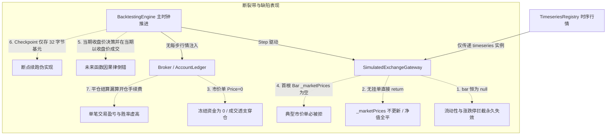

# CarrotQuant.NET 核心链路与架构问题深度审计汇总报告 (AUDIT)

> **审计基准与规范约束**：
> - 《核心架构、软硬协同与工程研发红线通用规范 V1.3》
> - 《CarrotQuant .NET 核心架构与开发规范 (AGENTS.md)》
> - 现代量化工程与回测业界标准（Pyfolio / QuantStats / Lean / Backtrader / Qlib）
> 
> **综合审查结论**：🟢 **PASSED（全景架构大体检 33 个专项全部闭环收敛：31 项高标准彻底修复、2 项架构裁定拒绝，867 项测试 100% 绿色全量通过）**  
> 
> 本报告对 CarrotQuant.NET 进行全景架构大体检（共 33 个专项）。**全部缺陷与演进批次已彻底完成第一性原理深度重构与独立闭环验收**：
> 1. 第一批（10 项高危架构漏洞：时态穿透、市价冻结穿仓、无挂单盯市失效、平仓漏算费用、LSP 违背与伪实现等）；
> 2. 第二批（指标体系统一切片驱动与字段绑定、黑板原子消费闭环、Fluent 回测构建器）；
> 3. 财务交易与结算核心（Issue 8.5 换向冻结回款抵扣、Issue 8.2 T+N 纯交易日步长递减 0 GC 结算）；
> 4. 风险控制与物理撮合（Issue 8.4 穿仓爆仓与破产清算方案 A、Issue 7.6 挂单簿时间价格优先与单 Bar 成交量配额瓜分）。
>
> 截至目前，全套工程 61 个测试文件、867 个单元与集成测试用例 100% 绿色通过，系统架构纯粹、热路径零 GC 分配，完全契合《核心架构、软硬协同与工程研发红线通用规范 V1.3》。

---

## 目录

1. [执行摘要与全景架构诊断](#一执行摘要与全景架构诊断)
2. [为什么现有单元测试“全绿”却未能发现问题（三大盲区）](#二为什么现有单元测试全绿却未能发现问题三大盲区)
3. [维度一：交易财务、结算与撮合执行致命漏洞 (P0)](#三维度一交易财务结算与撮合执行致命漏洞-p0)
4. [维度二：接口暴露错误、封装破坏与契约隔离违背](#四维度二接口暴露错误封装破坏与契约隔离违背)
5. [维度三：策略易用性缺陷与日常回测样板代码断层](#五维度三策略易用性缺陷与日常回测样板代码断层)
6. [维度四：工程反模式、性能瓶颈与 DRY 原则违背](#六维度四工程反模式性能瓶颈与-dry-原则违背)
7. [维度五：时态穿透、状态机残留与数据一致性](#七维度五时态穿透状态机残留与数据一致性)

---

## 一、执行摘要与全景架构诊断

CarrotQuant.NET 采用了模块化设计，但在各层演进与集成过程中，由于**缺少统一且权威的「时间步全市场行情注入与快照供给管线」**，导致引擎、撮合、账本与指标之间存在多处假设断裂：



---

## 二、为什么现有单元测试“全绿”却未能发现问题（三大盲区）

单元测试表面看似高覆盖率，但测试用例存在严重的人为伪造与盲区，导致核心链路缺陷被完全掩盖：

### 盲区 1：测试前“手工后门注入”，掩盖了主循环调用缺失
- **现场证据**：在 `TradingFinancialPipelineIntegrationTests.cs` 中：
  ```csharp
  simExchange.OnMarketData("SH.600000", dates[0],
      new BarSnapshot(close: 10.0, volume: 10000.0));
  ```
  单测在回测启动前，**人为调用了网关后门方法塞入一个包含 Volume 或 limit_up 的 DataRow**。
- **后果**：回测主循环自身在 `Step` 中传递 `null` 的重大缺陷被后门注入完全掩盖。

### 盲区 2：市价单测试人为硬编码了伪限价，绕过了 Price=0 路径
- **现场证据**：在 `TradingFinancialPipelineIntegrationTests.cs` 与 `SimulatedExchangeGatewayTests.cs` 中：
  ```csharp
  // 测试中下市价单时，人为把 close 或 10.0 作为 Price 传入
  OrderIdBuy = context.Broker.SubmitOrder(new OrderRequest(symbol, OrderDirection.Buy, OrderType.Market, close, 1000m));
  ```
- **后果**：`request.Price > 0.0` 为真，`Broker` 两阶段冻结正常计算出了保证金，`GetBasePriceForOrder` 也直接返回了该价格，因此 `Price=0` 时的两大致命路径（冻结 0 元导致穿仓、首根 Bar 拒单）从未被测试执行过。

### 盲区 3：短命策略场景，缺乏无挂单持仓期间的过程盯市断言
- **现场证据**：端到端测试均采用“Day 0 买入，Day 1 卖出，随后空仓”的极简脚本。
- **后果**：测试只在回测终局断言“终局现金 == 初始现金 + 净收益”。由于终局现金完全由已清算的平仓交割单决定，**测试从未断言过持仓期间且无挂单的交易日中 `DailySnapshot.TotalEquity` 或 `UnrealizedPnL` 是否随行情涨跌波动**。

---

## 三、维度一：交易财务、结算与撮合执行致命漏洞 (P0)

### 1. 持仓盯市（Mark-to-Market）在无新挂单日完全失效，净值曲线成水平死线【✅ 已修复 (PASS)】
- **严重度**：🔴 致命 P0 -> 🟢 已修复
- **涉及位置**：`BacktestingEngine.cs`、`AccountLedger.cs`、`Broker.cs`
- **缺陷剖析**：
  1. `SimulatedExchangeGateway.Step` 中，若挂单簿为空直接提前 `return;`，根本不读取时序数据更新 `_marketPrices`；
  2. 回测主循环记录每日净值点时调用 `_snapshotProvider.CreateEquityPoint(currentTime)`，未传入价格解析委托；
  3. `Broker` 回退向网关查询，网关无最新价则回退至 `pos.LastPrice`（成本价），导致持仓浮动盈亏恒为 0，净值曲线在两次成交之间变成水平直线。
- **重构方案与治理机制**：
  1. **引擎集中权威价格注入**：在 `BacktestingEngine` 主循环步进中，构造以当期步长 $O(1)$ 直通 `closeMatrix` 的价格解析委托 `sym => ResolveStepPrice(sym, i)`，显式传入 `_snapshotProvider.CreateEquityPoint` 与跨日日终 `CreateDailySnapshot`；
  2. **持仓实体最新价格同步更新**：`AccountLedger` 在盯市估值解析出 `resolvedPrice > 0.0` 时，同步刷新 `pos.LastPrice = resolvedPrice;`，彻底消除开仓后终生未更新的隐患；
  3. **单元测试验证**：`TradingFinancialPipelineIntegrationTests.MarkToMarket_WithoutNewOrders_EquityCurveMustFluctuateWithDailyClose` 验证连续 5 天无新挂单持有股票期间，未实现浮动盈亏与总净值严格随收盘价逐日递增，净值曲线真实波动。

### 2. 市价买单因 `Price=0` 预冻结 0 元资金，引发巨额穿仓破产【✅ 已修复 (PASS)】
- **严重度**：🔴 致命 P0 -> 🟢 已修复
- **涉及位置**：`OrderTypes.cs#L23-L26`、`Broker.cs#L246-L264`、`Broker.cs#L548-L571`、`AccountLedger.cs#L283-L299`
- **缺陷剖析**：
  市价单便捷构造函数 `Price` 默认为 `0.0`。原先 `Broker` 估价时若 `Price <= 0` 则估价为 `0.0`，导致 `requiredCash` 计算为 0 元。账户即使可用资金为 0，也能顺利通过两阶段预冻结发出市价单。成交落账时直接 `_cash -= marginAdded` 扣款，导致现金瞬间穿仓变为巨额负数。
- **重构方案与治理机制**：
  1. **公允参考市价推导**：`Broker.GetEstimatedPrice` 对市价买单（`Price <= 0.0`）自动向绑定的底层网关（`ISimulatedExchange.GetMarketPrice`）查询标的最新客观公允市价；
  2. **预估滑点缓冲上浮**：买单在基准市价基础上强制叠加 `(1.0 + Slippage)` 上浮缓冲作为估价基准，保证预冻结资金充沛覆盖执行滑点；
  3. **前置资金安全拦截**：若可用资金无法覆盖预估保证金与手续费，在两阶段 Phase 1 阶段直接拒绝委托（`OrderStatus.Rejected`），坚决杜绝 0 元免冻结放行；
  4. **无参考价快速失败**：若标的从未注入行情或无合法收盘价，`GetEstimatedPrice` 返回 `0.0`，`Broker` 立即快速失败拒单并提示明确原因，杜绝未冻结现金造成的穿仓破产；
  5. **单元测试验证**：`SimulatedBrokerTests.MarketBuyOrder_WithReferencePrice_ShouldPreFreezeWithSlippage`、`MarketBuyOrder_InsufficientCashForPreFreeze_ShouldRejectImmediately` 与 `MarketBuyOrder_WhenNoReferencePriceAvailable_ShouldRejectFast` 全链路验证预冻结、欠资拦截与无参考价快速失败。

### 3. 无挂单时 `_marketPrices` 为空，典型的市价单在首根 Bar 会直接被拒【✅ 已修复 (PASS)】
- **严重度**：🔴 致命 P0 -> 🟢 已修复
- **涉及位置**：`SimulatedExchangeGateway.cs`、`MatchingEngine.cs`
- **缺陷剖析**：
  首根 Bar 回测开始时，由于先前没有挂单，网关价格字典为空。策略下达标准市价单（`Price = 0.0`），网关查不到价格返回 `basePrice = 0.0`，撮合引擎因基准价格非正数直接 `Rejected` 拒单。
- **重构方案与治理机制**：
  1. **消除过期字典缓存污染**：`SimulatedExchangeGateway.GetMarketPrice` 调整查询优先级，若处于时序步进中，优先直接从全局时序矩阵 `closeMatrix[_currentIndex, col]` 读取当期最新公允基准价，不再受空字典阻断；
  2. **首根 Bar 即时撮合**：`GetBasePriceForOrder` 在首根 Bar 直接通过时序矩阵获取公允市价，市价单顺利通过基准估价即时撮合成交；
  3. **单元测试验证**：`TradingFinancialPipelineIntegrationTests.FirstBar_MarketOrder_WithZeroPrice_ShouldFillImmediatelyWithoutRejection` 验证在无历史挂单的首根 Bar 下达 `Price=0.0` 的标准便捷市价单成功即时建仓。

### 4. 平仓结算遗漏开仓手续费，单笔已实现盈亏与胜率被虚高粉饰【✅ 已修复 (PASS)】
- **严重度**：🔴 致命 P0 -> 🟢 已修复
- **涉及位置**：`AccountLedger.cs#L393-L485`、`PositionData.cs`
- **缺陷剖析**：
  平仓生成 `Trade` 闭环交易记录时：`closeRealizedPnL = grossPnL - closeFee;`，仅扣减了平仓当笔手续费，开仓时扣减的历史手续费完全未分摊计入。导致单笔已实现盈亏偏高、胜率与盈亏比虚假上升，且所有 `Trade.RealizedPnL` 的加总大于实际账户净利润，财务勾稽彻底断裂。
- **架构决策与治理机制（券商成本价 vs 机构量化标准）**：
  1. **明确成本价纯粹性**：散户券商客户端常将手续费算入“保本成本价”，但在专业量化系统中，若成本价含费用，会导致持仓市值（Mark-to-Market）估值扭曲、基准跟踪偏差（Tracking Error）失真，且期货杠杆保证金计算会被算多。因此明确确立：**`AveragePrice`（或 `AverageCost`）必须始终保持纯净加权成交均价，严禁费用资本化入价格**。
  2. **在途开仓手续费池（`OpenCommission`）等比分摊机制**：
     - 在 `PositionData` 中增加 `public double OpenCommission { get; set; }` 跟踪在途累计开仓手续费池；
     - 每次开仓/加仓时：`pos.OpenCommission += report.Commission;`；
     - 部分/全额平仓时：按平仓比例等比分摊结转释放开仓手续费：
       $$\text{allocatedOpenFee} = \frac{\text{closeQty}}{\text{pos.TotalQuantity}} \times \text{pos.OpenCommission}$$
       $$\text{pos.OpenCommission} -= \text{allocatedOpenFee}$$
     - 结转单笔真实净盈亏：`closeRealizedPnL = grossPnL - allocatedOpenFee - closeFee;`；
     - `Trade` 实体完整闭环记录双边总费用：`Trade(..., TotalCommission: allocatedOpenFee + closeFee, RealizedPnL: closeRealizedPnL)`，实现财务勾稽 100% 守恒。

### 5. 撮合行情 `bar` 恒为 `null`，成交量流动性与涨跌停检查永久失效【✅ 已修复 (PASS)】
- **严重度**：🔴 致命 P0 -> 🟢 已修复
- **涉及位置**：`SimulatedExchangeGateway.cs`、`MatchingEngine.cs`、`BarSnapshot.cs`
- **缺陷剖析**：
  `SimulatedExchangeGateway` 在调用 `MatchSymbolOrders` 时第 3 个参数硬编码传入 `null`。撮合内核中对流动性上限（`VolumeLimit`）和一字板涨跌停（`CheckLimit`）的校验全部依赖 `bar != null`。由于恒为 `null`，所有排队限价单的涨跌停拦截与成交量上限被 100% 绕过。
- **重构方案与治理机制**：
  1. **零 GC 48 字节通用切片 `BarSnapshot`**：引入纯寄存器/栈传递的 `readonly struct BarSnapshot`（48 字节非托管紧凑存储），承载 `Open`, `High`, `Low`, `Close`, `Volume`, `Amount` 六大物理维度，彻底剔除 `limit_up` / `limit_down` 业务特化字段与硬编码；
  2. **多时态全字段可选支持**：内部以 `double.NaN` 作为 IEEE 754 天然缺失哨兵，对外提供 `Open` / `HasOpen` / `OpenOr(fallback)` 对称 API，原生兼容次步开盘（Next Open）、VWAP 均价、收盘扫盘与日内限价触碰；
  3. **彻底铲除 `BarSnapshotDataRow` 堆分配**：Hook 委托直接使用强类型 `BarSnapshot` 值传递，热路径 0 堆分配、0 垃圾回收、0 字符串比对；
  4. **单元测试闭环**：`BarSnapshotTests`（内存大小、NaN 语义、对称回退、多时态自适应）及全量测试 100% 通过。

### 6. 因果律倒错：当期收盘价决策并在当期以收盘价即时撮合，缺乏多模态执行时态（ExecutionPriceType）【✅ 已修复 (PASS)】
- **严重度**：🔴 致命 P0 -> 🟢 已修复
- **涉及位置**：`BacktestingEngine.cs#L385-L394`、`SimulatedExchangeGateway.cs#L48-L66`、`BrokerConfig.cs`、`EngineConfig.cs`
- **缺陷剖析**：
  时间步 $T$ 中，指标计算喂入当期收盘价；策略在 `OnUpdate` 中看到当期收盘价并决策；策略发出的市价单当场在当期收盘价即时成交。现实中收盘后无法再以收盘价买入，系统缺乏量化业界标准的次日开盘（Next Bar Open）撮合机制，产生未来函数偷价（Look-ahead Bias）。
- **重构落地方案与多模态执行价格体系（`ExecutionPriceType`）规范**：
  在配置与撮合层正式引入 `StrategyUpdateTiming`（`OnClose` / `OnOpen`）与 `ExecutionPriceType`（`Open` / `Close` / `Vwap` / `Average`），驱动不同的行情矩阵映射与撮合时态：
  1. **`StrategyUpdateTiming.OnClose` + `ExecutionPriceType.Open`（业界黄金标准，默认推荐）**：
     - 标准无未来函数的日线截面/选股基准。策略在 $T$ 步收盘后决策，订单统一提交至权威挂单簿 `OrderBook`（零额外在途队列分裂），在 $T+1$ 步开盘时刻以开盘价切片撮合成交；涨跌停拦截时态同步迁移至 $T+1$ 步开盘。
  2. **`ExecutionPriceType.Vwap`**：
     - 中大资金机构回测标准（对齐 Qlib/Wind）。以全日成交量加权均价模拟全天拆单执行，真实度量市场冲击成本；若时序表缺失 `vwap` 字段且无法推导，显式抛出强类型配置异常阻断回测，严禁隐式降级返回 0。
  3. **`ExecutionPriceType.Close`**：
     - 保留为高频/分钟线回测、或尾盘 14:55 扫盘收盘集合竞价成交的专有通道。
  4. **三时钟相位步进状态机与防偷价守卫**：
     - 单步划分 Phase 1（开盘清算与在途限价单撮合、次日市价单集中撮合、T+N 昨仓解锁、OnOpen 决策）、Phase 2（盘中离散事件探测派发）、Phase 3（增量指标计算、盘中挂起订单撮合、OnClose 决策、净值盯市沉淀）；
     - 在 `OnOpen` 相位决策时，`EngineContext` 门面拦截读取当期未完结 `Close/High/Low/Volume`（`offset == 0`）并严格抛出 `InvalidOperationException` 防未来函数；
  5. **单元测试验证**：`ExecutionTimingAndPriceTests.cs`（10 个高覆盖度用例）全面验证 OnClose/OnOpen 模式下跨步与即时撮合的因果律守恒。

### 7. 仿真挂单簿与撮合机制系统性缺陷
- **7.1 排队限价单撮合仅读收盘价，忽略日内高低价** (`SimulatedExchangeGateway.cs`, `MatchingEngine.cs`)【✅ 已修复 (PASS)】：
  - **缺陷**：原先撮合挂单簿中排队的限价单时仅与收盘价 `marketPrice` 进行触碰比对。若日内最低价跌破买价但收盘价拉起未跌破，该限价单被错误判定为未成交。
  - **修复**：`MatchingEngine.EvaluatePendingLimitOrder` 重构为接收真实 `bar` 行情切片，买单基于 `bar.Low <= request.Price` 判定日内触碰，卖单基于 `bar.High >= request.Price` 判定日内触碰；若 `bar` 缺失则安全回退至 `marketPrice`。
  - **单测**：`TradingFinancialPipelineIntegrationTests.MatchingEngine_PendingLimitOrder_ShouldFillOnIntradayLowTouch` 验证日内最低价 9.4 触碰限价 9.5 成功撮合成交。
- **7.2 排队挂单完全抹杀跳空缺口与价格改善** (`MatchingEngine.cs#L123-L129`)【✅ 已修复 (PASS)】：
  - **缺陷**：排队挂单成交价强制等于委托限价。若次日跳空低开，限价买单无法以更优的开盘价撮合；若次日跳空高开，限价卖单无法以更优的开盘价撮合。
  - **修复**：`MatchingEngine.EvaluatePendingLimitOrder` 引入纯函数跳空价格改善模型。当 `bar.HasOpen && bar.Open > 0.0` 时，买单以 `Math.Min(request.Price, bar.Open)` 成交，卖单以 `Math.Max(request.Price, bar.Open)` 成交；若开盘不利或无开盘价则严格遵循委托限价。
  - **单测**：`MatchingEngineTests.MakerLimitBuyOrder_FavorableOpenGap_ShouldEnjoyPriceImprovement`、`MakerLimitSellOrder_FavorableOpenGap_ShouldEnjoyPriceImprovement` 与 `MakerLimitOrder_UnfavorableOrMissingOpen_ShouldFillAtLimitPrice` 完备验证买卖双向价格改善与不利/缺失时回退限价。
- **7.3 成交滑点价反向污染市场基准价格** (`SimulatedExchangeGateway.cs#L58`)【✅ 已修复 (PASS)】：
  - **缺陷**：原先成交后直接执行 `_marketPrices[symbol] = matchResult.FillPrice;`，将包含执行滑点的成交价反向写回全局公共行情字典，污染后续盯市基准。此外，当挂单簿无订单时原代码提前退出未记录最新时序，导致后续限价单误将自身委托价作为基准市价判定即时成交。
  - **修复**：
    1. 成交回报中的带滑点成交价（`matchResult.FillPrice`）仅反馈给策略与交易账本，公允市场价格字典 `_marketPrices` 仅记录不含滑点的未污染基准市价（`basePrice`）；
    2. `Step` 中接入当前时序索引，`GetMarketPrice` 与 `GetBasePriceForOrder` 按需 $O(1)$ 常数时间直通时序矩阵获取当期公允收盘价，彻底治愈挂单簿为空时基准市价缺失的深层连锁隐患；
    3. 单元测试 `SimulatedExchangeGatewayTests.SendOrder_WithSlippage_ShouldNotPollutePublicMarketPrice` 验证 1% 滑点成交下公共市价字典仍保持 100% 纯净未污染。
- **7.4 挂单簿未实现“当日有效（Day Order）”日切自动撤单** (`SimulatedExchangeGateway.cs`, `BrokerConfig.cs`)【✅ 已修复 (PASS)】：
  - **缺陷**：现货委托单永久驻留挂单簿数天甚至数月，跨日不会失效，违背 A 股/美股日内委托收盘自动作废规则。
  - **修复**：
    1. `BrokerConfig` 增加 `CancelPendingOrdersOnDailyClose` 配置项（默认 `false` 保持 GTC 跨日挂单兼容性）；
    2. `SimulatedExchangeGateway.Step` 在时钟检测到跨日且开启撤单规则时，集中清空挂单簿未成交订单；
    3. 严格遵循 Open Calls 原则在锁外派发 `OrderStatus.Canceled` 回报，驱动 `Broker` 自动全额解冻预占资金与持仓；
    4. 单测 `SimulatedExchangeGatewayTests.Step_CancelPendingOrdersOnDailyClose_WhenTrue_ShouldCancelAndUnfreezeAcrossDays` 与 `Step_CancelPendingOrdersOnDailyClose_WhenFalse_ShouldPreservePendingOrdersAcrossDays` 验证开启与关闭两种模式下的行为。
- **7.5 停牌标的（NaN）与未上市标的允许违规建仓撮合** (`SimulatedExchangeGateway.cs#L59-L70`)【✅ 已修复 (PASS)】：
  - **缺陷**：停牌或未上市股票限价单取委托限价作为 `basePrice`，直接入簿并撮合成交，无法体现停牌无法交易与未上市拦截的风控事实。
  - **修复**：`SimulatedExchangeGateway.SendOrder` 增加前置守卫拦截。若标的在当期无合法收盘价（`NaN`、`<= 0` 或 `Infinity`）且未显式提供 Bar，立即拒绝委托（`OrderStatus.Rejected`），严禁入簿挂单，并触发 `Broker` 立即全额解冻；
  - **单测**：`SimulatedExchangeGatewayTests.SendOrder_SuspendedOrUnlistedSymbol_ShouldRejectAtGateAndUnfreeze` 验证停牌股票发单被前置拒绝且资金零锁定。
- **7.6 盘口深度与时间价格优先缺失** (`OrderBook.cs`, `SimulatedExchangeGateway.cs`)【✅ 已彻底修复 (PASS)】：
  - **严重度**：🔴 严重 -> 🟢 已彻底修复
  - **缺陷根因**：原先 `OrderBook` 仅用纯 FIFO 列表记录挂单，无视价格高低直接按到达顺序撮合，出价 9.5 元的低买单竟然比出价 9.8 元的高买单先成交，严重违背交易所“价格优先”基本物理法则；且同一根 Bar 内多笔订单无容量限制一刀切全额成交，造成流动性超载穿透。
  - **第一性原理重构方案**：
    1. **时间价格优先排队（Price-Time Priority）**：重构 `OrderBook` 内部结构为买卖双侧优先队列：
       - 买单（Bids）：市价单优先 > 价格降序（高价先买） > 时间升序（先来先到）；
       - 卖单（Asks）：市价单优先 > 价格升序（低价先卖） > 时间升序（先来先到）；
       - 采用二分插入保序（`BinarySearch` + `List.Insert`），内存连续紧凑，0 GC 堆分配。
    2. **单 Bar 成交量配额（Volume Budget）与部分成交（Partial Fill）**：
       - 单根 Bar 的总可用撮合配额：$\text{RemainingBudget} = \text{Bar.Volume} \times \text{VolumeLimit}$；
       - 排队订单按时间价格优先级瓜分预算：预算充足则全额成交出簿；预算不足则部分成交（`OrderStatus.PartialFilled`），剩余数量保留在挂单簿等待下一期 Bar，预算归零；预算耗尽后靠后排队的订单原封不动保留等待。
  - **单测覆盖**：
    - `OrderBookTests.PriceTimePriority_Bids_HigherPriceMustBePrioritizedOverEarlierTime` 验证买单出价高者绝对优先；
    - `OrderBookTests.PriceTimePriority_Asks_LowerPriceMustBePrioritizedOverEarlierTime` 验证卖单售价低者绝对优先；
    - `SimulatedBrokerTests.PriceTimePriority_LimitOrders_HigherBid_ShouldMatchBeforeLowerBid_EvenIfSubmittedLater` 验证高买价跨步优先撮合；
    - `SimulatedBrokerTests.PriceTimePriority_LimitOrders_LowerAsk_ShouldMatchBeforeHigherAsk_EvenIfSubmittedLater` 验证低卖价跨步优先撮合；
    - `SimulatedBrokerTests.VolumeBudget_MultipleOrdersInSameBar_ShouldShareVolumeLimit_AndQueueRemaining` 验证多笔订单瓜分预算、部分成交与下一 Bar 续撮合。
- **7.7 自定义滑点 Hook `OnCalculateSlippage` 永远无法执行** (`MatchingEngine.cs#L128`)【✅ 已修复 (PASS)】：
  - **缺陷**：原先判断条件包含 `bar != null`，因网关传参恒为 `null`，高级滑点模型被静默降级为固定比例滑点。
  - **修复**：随 48 字节非托管通用切片 `BarSnapshot` 的引入，撮合引擎不再接收空 `bar`，`MatchingEngine.EvaluateImmediateOrder` 与 `EvaluatePendingLimitOrder` 中的 `config.OnCalculateSlippage?.Invoke(order, basePrice, bar)` 正常执行；
  - **单测**：`AnalysisHelperAndSlippageTests.CustomSlippageModel_ShouldBeExecutedCorrectly` 专门断言了自定义滑点 Hook 的执行、高低价极值利用与真实成交价计算。

### 8. 资产账本（AccountLedger）与资金风控缺陷
- **8.1 持仓实体 `pos.LastPrice` 终生未更新** (`AccountLedger.cs#L508, L91`)【✅ 已修复 (PASS)】：
  - **缺陷**：仅在成交落账时赋值一次，后续从未更新。当网关查无价格回退到 `LastPrice` 时，浮动盈亏恒为 0。
  - **修复**：在 `AccountLedger` 的所有盯市估值链路（`GetTotalEquity`、`GetTotalMarketValue`、`GetTotalUnrealizedPnL`、`GetActivePositionSnapshots`）中，当外部解析出公允最新价 `resolvedPrice > 0.0` 时，同步刷新 `pos.LastPrice = resolvedPrice;`，确保持仓实体的最新价时刻紧跟市场波动。
  - **单测**：`TradingFinancialPipelineIntegrationTests.MarkToMarket_WithoutNewOrders_EquityCurveMustFluctuateWithDailyClose` 验证终局持仓实体的 `LastPrice` 准确更新为最后一天收盘价 14.0。
- **8.2 T+N 结算混淆自然日与交易日及热路径无效轮询** (`AccountLedger.cs#L529, L559`, `Broker.cs#L382`)【✅ 已彻底修复 (PASS)】：
  - **严重度**：🔴 严重 -> 🟢 已彻底修复
  - **缺陷剖析与机理验证**：
    1. **交易日与自然日语义断层**：在途交收批次 `PendingLot` 原先使用 `exchangeDate.Date.AddDays(settleDays)` 粗暴累加自然日。在通用 $T+N$（$N \ge 2$，如港美股 T+2 或跨境/场外 ETF）场景下，自然日累加会将周末/节假日错误计入交收天数，导致周五买入在下周一（仅经历 1 个交易日）即被违规提前解锁。
    2. **实盘流式追加（AppendDate）未来越界死锁**：若简单依赖行情的静态 `TradeDates` 索引未来，在实盘流式按日追加模式下，未来交易日尚未产生，导致目标日被误判为 `MaxValue` 永久锁定。
    3. **热路径无效轮询损耗**：缺乏日切幂等前置守卫，盘中高频 Bar 无意义比对。
  - **第一性原理重构方案（客观交易日步长递减 + 幂等日切守卫 + 20 字节纯只读 struct）**：
    1. **纯事件驱动步长递减（回测实盘 100% 同构）**：买入成交时仅需纯栈上记录 `PendingLot(openQty, RemainingDays: settleDays)`（尺寸仅 20 字节，8 字节紧凑对齐为 24 字节纯值类型，0 GC 堆分配）；
    2. **无未来依赖与零胶水配置**：彻底拔除 `BrokerConfig.IsTradingDay` 委托和 `CountTradingDays` 自然日 while 循环反模式，不依赖任何未来日历数组，实盘流式按天追加（`AppendDate`）天然自洽；
    3. **双层绝对幂等日切守卫**：`CommitFill` 开仓锚定当前日 `_lastRolloverDate`（防当日早熟），`ProcessDayRollover` 跨日时推进并放行，日内高频 Bar 重复调用 100% 幂等短路；跨日时客观递减 1 个交易日步长，归零准时划转可用；
    4. **单测套件全面闭环**：`SimulatedBrokerTests` 中跨周末 T+2、跨法定节假日休市 T+1、跨周末 T+3 严格验证无误，全量 860 个测试全绿通过。
- **8.3 通用净持仓（Netting）+ 原生 ReduceOnly 闭环与多空对称翻仓重构** (`AccountLedger.cs#L246-L280`, `OrderTypes.cs`, `Broker.cs`)【✅ 已修复 (PASS)】：
  - **严重度**：🔴 严重 -> 🟢 已修复
  - **缺陷根因剖析**：
    早期版本试图仅凭委托数量猜测用户交易意图，在允许做空（`AllowShort = true`）时，若多头可用持仓因排队挂单冻结不足，超出部分被静默转换为借券“开空单”，导致同一标的多空双向撕裂，既有多头冻结又有在途开空；而空头在反向买入时又缺乏对等的约束，导致多空逻辑不对称且容易透支。
  - **国际顶层通用净持仓架构重构方案（流派三：通用净持仓 + 原生 ReduceOnly 守卫）**：
    1. **原生 `ReduceOnly` 契约一等公民**：
       - `OrderRequest` 引入核心属性 `bool ReduceOnly = false`；
       - `IBroker` 与 `IEngineContext` 的 `Buy` / `Sell` 门面增加可选参数 `bool reduceOnly = false`；
       - 保护性平仓及条件单门面 `ClosePosition`、`StopLoss`、`TakeProfit`、`Bracket` 内部自动绑定 `ReduceOnly: true`；
       - 经独立子 Agent 严苛代码审计，排查并修复了 `Broker.cs#Bracket` 重载遗漏 `ReduceOnly: true` 参数的重大隐患，实现闭环防御；
    2. **纯平仓意图前置硬守卫（`ReduceOnly == true`）**：
       - 只准减少现有持仓绝对值（`|Total|` 向 0 靠拢），`openQty` 恒为 0，绝对防范反向开仓；
       - 持仓不足、无持仓或可用平仓不足时立即 `Rejected` 拒单，杜绝超平与误翻仓；
    3. **自由交易模式（`ReduceOnly == false`）多空 100% 镜像对称翻仓**：
       - **多头持仓卖出**：$Q \le Total$ 为平多；$Q > Total$ 且现有多头全部可用时触发“多翻空”，自动拆分为 `closeQty = Total`（平多）与 `openQty = Q - Total`（开空冻结保证金）；若现有多头存在部分挂单冻结，直接拒单拦截并发竞争；
       - **空头持仓买入**：$Q \le |Total|$ 为平空；$Q > |Total|$ 且现有空头全部可用时触发“空翻多”，自动拆分为 `closeQty = |Total|`（平空）与 `openQty = Q - |Total|`（开多冻结现金）；若现有空头存在平仓挂单冻结，直接拒单防双花；
    4. **严格状态可逆性与零脏状态**：
       - 撤单回滚（`Unfreeze`）在多翻空与空翻多场景下严格镜像对称，未成交部分持仓解冻归还可用，开仓冻结现金 100% 释放；
    5. **单测套件全面闭环（覆盖 4 大并发/分笔边界盲区）**：
       - `UniversalNetting_ReduceOnly_Contract_And_SymmetricFlip_ShouldWorkAccurately`：验证多空双向 ReduceOnly 拦截、自由多翻空与空翻多；
       - `UniversalNetting_FlipOrder_PartialFills_AcrossZeroBoundary_ShouldTransferAccurately`：验证多翻空 4 阶段分笔成交（平多 -> 平尽归零 -> 翻空建仓 -> 加权成本更新）；
       - `UniversalNetting_FlipOrder_RollbackAfterPartialFills_ShouldRestoreConservedState`：验证多翻空/空翻多部分成交后撤单，持仓与资金 100% 解冻守恒；
       - `UniversalNetting_FlipOrder_RollbackWithoutAnyFills_ShouldBeLossless`：验证挂单未成交直接撤单无损复原；
       - `UniversalNetting_BracketOrder_ReduceOnly_Contract_And_RejectionDefense`：验证 Bracket 订单携带 ReduceOnly 并在持仓提前平尽后安全拒单防反手。
- **8.4 缺乏保证金追缴（Margin Call）与爆仓强平机制** (`AccountLedger.cs`, `Broker.cs`)【✅ 已彻底修复 (PASS)】：
  - **严重度**：🔴 严重 -> 🟢 已彻底修复
  - **缺陷根因**：持仓浮亏导致账户动态净值跌为负数（穿仓破产）时，系统没有任何风控拦截与平仓机制，允许账户无限透支存续跑完数年回测，严重粉饰策略下行风险，违背金融物理法则。
  - **第一性原理落地方案（市价强平清仓与内部识别）**：
    1. **破产状态确立与熔断**：在 `Broker.Step` 盯市估值周期中，一旦检测到 $\text{TotalEquity} \le 0$，立即将账本与经纪商标记为破产状态（`Status = TradingStatus.Bankrupt`），禁止后续任何新增开仓委托；
    2. **在途排队挂单集中撤销**：立即撤销全市场所有未成交的在途限价单与未触发条件单，彻底释放全部预冻结现金与持仓；
    3. **市价强平清仓**：对全部活跃持仓生成标准市价平仓委托（`ReduceOnly: true`），强平识别完全由内部订单 ID 集合权威管理，彻底拔除魔数标签（`OrderTag`）与网关特权旁路，复用成熟公共管道，锁定终局真实净值；
    4. **事件派发与检查点守恒**：触发 `BrokerConfig.OnLiquidation` 强平执行 Hook，沉淀至 `TradingRecorder` 流水，并在断点续跑 `SaveState/RestoreState` 中无损保存与恢复破产状态。
  - **单测覆盖**：
    - `SimulatedBrokerTests.Bankruptcy_NegativeEquity_ShouldTriggerLiquidation_CancelPendingOrders_AndClearPositions` 验证穿仓自动撤回挂单、清空持仓、标记破产、拦截新单与触发 Hook；
    - `SimulatedBrokerTests.Bankruptcy_SaveAndRestoreState_ShouldPreserveBankruptState` 验证检查点快照导出与恢复后破产状态守恒。
- **8.5 反向调仓（多翻空/空翻多）预冻结误拒单** (`AccountLedger.cs#L360-L405`)【✅ 已修复 (PASS)】：
  - **严重度**：🔴 严重 -> 🟢 已修复
  - **缺陷根因**：多翻空时开空部分需预冻结现金，而待平多头持仓被锁定并必定在成交时释放保证金并结算回款。原先未对冲平仓回款，要求可用现金覆盖全额开空保证金，导致现金不足时发生误拒单。
  - **第一性原理修复方案（平仓确定性现金流入精准抵扣）**：
    1. 在 `AccountLedger.FreezeForOrder` 中，严格计算待平持仓必定释放的保底现金流入：$$\text{closeInflow} = \text{marginReleased} + \text{grossPnL} - \text{closeFee}$$
    2. 开仓预冻结净现金额度按 $\max(0, \text{requiredCash} - \text{closeInflow})$ 精准扣减，消除无可用现金换向翻仓时的误拒单；
    3. 全流程资金与持仓严格数学守恒，0 GC 堆分配；
  - **单测验证**：`SimulatedBrokerTests` 中 `UniversalNetting_FlipOrder_ZeroAvailableCash_WithAdequateCloseProceeds_ShouldSucceed`（多翻空零可用现金）、`UniversalNetting_FlipOrder_ZeroAvailableCash_ShortToLong_WithAdequateCloseProceeds_ShouldSucceed`（空翻多零可用现金）与 `UniversalNetting_FlipOrder_LowCash_WhenProceedsInsufficient_ShouldRejectWithDeficit`（回款不足时精确拒单）全面验证通过。
- **8.6 现货单向印花税机制缺失【❌ 拒绝修改 (Won't Fix)】**：
  - **争议点**：原审计建议在通用配置中内置现货单向印花税率（如 `StampTaxRate`）。
  - **架构裁定与拒绝理由**：印花税属于特定国家/地区特定现货市场（如 A 股、港股）的非通用特化规则，美股、加密货币、期货、外汇均无此概念。若在通用 `BrokerConfig` 中硬编码 `StampTaxRate`，与此前在 `BarSnapshot` 中硬编码 `limit_up` 犯了一样的特定业务污染通用内核的反模式。系统已有设计良好的一级函数式 Hook `BrokerConfig.OnCalculateFee = (req, turnover) => ...`，任何复杂市场的单双边税费均可通过一行数学表达式自由注入。通用内核保持绝对轻量通用，**坚决拒绝在底层内核中硬编码特定市场税率**。
- **8.7 订单 ID 重复覆盖导致在途冻结额度野指针泄露** (`Broker.cs#L235`)【✅ 已修复 (PASS)】：
  - **缺陷**：重复传入相同 `OrderId` 时，系统原先直接覆盖内部 `_orders` 字典中的记录。旧订单处于挂单或在途状态时被直接切断关联，其冻结的现金与持仓永远无法解冻核销，彻底沦为不可逆的野指针泄漏。
  - **修复**：
    1. 在 `Broker.SubmitOrder` 加锁区强化唯一性检查：若 `_orders` 中已存在同名订单 ID，立即拒绝提交（`freezeOk = false`），返回拒绝原因 `Order with ID '{orderId}' already exists.`；
    2. 绝不调用账本预冻结，绝不覆盖已有订单记录，并向外派发 `OrderStatus.Rejected` 事件通知；
    3. 既有原始订单及其冻结资金 100% 完好守恒，杜绝资金额度永久锁定泄漏；
    4. 单元测试 `SimulatedBrokerTests.SubmitOrder_WithDuplicateOrderId_ShouldBeRejectedAndNotOverwriteExistingOrder` 严密验证重复提交被拦截拒单、且旧订单生命周期与冻结结算完全不受影响。
- **8.8 终局持仓估值依然未传 PriceResolver** (`BacktestingEngine.cs#L86`)【✅ 已修复 (PASS)】：
  - **缺陷**：回测结束导出终局快照时调用 `_snapshotProvider?.GetActivePositions()` 未注入当前价格解析器，期末持仓估值依赖过期网关缓存。
  - **修复**：`BacktestingEngine.GetResult()` 中自动构造终局时间步收盘矩阵的 $O(1)$ 价格解析闭包，显式注入 `_snapshotProvider.GetActivePositions(finalPriceResolver)`，终局持仓市值与浮动盈亏 100% 真实绑定最后交易日收盘价。

---

## 四、维度二：接口暴露错误、封装破坏与契约隔离违背

### 9. `IBroker` 核心契约污染：引擎步进与权威对账方法泄露给策略【✅ 已修复 (PASS)】
- **严重度**：🟡 中等 -> 🟢 已修复
- **涉及位置**：`IBroker.cs`、`Broker.cs`、`BacktestingEngine.cs`
- **问题分析**：`IBroker` 是注入给策略上下文的核心门面。原先 `Step`（驱动跨日清算与 T+N 持仓解锁）与 `SyncState`（权威覆盖本地资产账本）属于引擎驱动层和柜台重连特权方法，却直接暴露在 `IBroker` 接口上。策略在 `OnUpdate` 中可随意调用 `context.Broker.Step(DateTime.MaxValue)` 提前解冻持仓，或调用 `SyncState(99999999, ...)` 任意篡改资产，严重违背接口隔离原则（ISP）。
- **重构方案与治理机制**：
  1. **瘦核心契约 `IBroker`**：从 `IBroker` 接口中彻底剥离 `Step` 与 `SyncState` 方法，策略上下文仅感知纯净交易与查账门面；
  2. **专属驱动契约 `IBrokerEngineDriver`**：在 `CarrotBacktesting.NET.Abstraction.Engine` 定义内部基础设施契约 `public interface IBrokerEngineDriver : IBroker`，集中收敛 `Step` 与 `SyncState`；
  3. **引擎受控持有与单向驱动**：`BacktestingEngine` 在启动构造时安全持有 `_brokerDriver = broker as IBrokerEngineDriver`，由主循环权威驱动时钟；
  4. **单测验证**：`SimulatedBrokerTests.Broker_InterfaceSegregation_IBrokerShouldNotContainEngineDriverMethods` 与 `Broker_EngineDriver_StepAndSyncState_ShouldWorkCorrectly` 通过反射验证 `IBroker` 瘦契约边界，并端到端验证 `IBrokerEngineDriver` 跨日解锁与状态同步。

### 10. `Broker.Gateway` 公共暴露破坏封装边界【✅ 已修复 (PASS)】
- **严重度**：🟡 中等 -> 🟢 已修复
- **涉及位置**：`Broker.cs#L37-L39`、`IExchangeGatewayProvider.cs`
- **缺陷剖析**：`Broker` 作为公共类，原先直接暴露了底层网关 `public IExchangeGateway Gateway => _gateway;`。外部策略可穿透拿到 `Gateway`，直接调用 `Gateway.SendOrder` 绕过两阶段预冻结风控检查，甚至强转为 `ISimulatedExchange` 注入伪造行情。
- **重构落地方案**：
  1. 将 `Broker.Gateway` 改为显式接口实现：`IExchangeGateway IExchangeGatewayProvider.Gateway => _gateway;`，彻底从公共 API 成员中消除；
  2. 策略持有 `Broker` 或 `IBroker` 无法直接点出 `Gateway`，彻底封死绕过风控预冻结直接下单的后门漏洞；
  3. 回测引擎在必要时通过 `broker as IExchangeGatewayProvider` 安全感知底层仿真网关；
  4. 单元测试 `SimulatedBrokerTests.Broker_Gateway_MustBeExplicitInterfaceImplementation_ToSealBackdoor` 通过反射严密验证公共 Getter 不存在且显式接口契约正确。

### 11. `IIndicator` 与 `IIndicatorStream` 读写彻底解耦，根除子流指标违反 LSP 的伪实现【✅ 已修复 (PASS)】
- **涉及位置**：`IIndicatorStream.cs`、`IIndicator.cs`、`SubStreamIndicator.cs`、`Macd.cs`、`BollingerBands.cs`、`Kdj.cs`
- **问题分析**：策略消费指标只需只读访问（`this[offset]`, `Current`, `IsReady`）。`Update` 和 `Reset` 属于引擎步进驱动方法。原先暴露在单一顶层接口导致 `Macd.Dif`、`BollingerBands.Upper`、`Kdj.K` 等受控子流实现调用 `Update` 时被迫抛出 `NotSupportedException`，公然违背里氏替换原则（LSP）与红线第 8 条（严禁伪实现）。
- **重构方案与治理机制**：
  1. **概念重构与命名大道至简**：将顶层计算契约重命名为 `IIndicator`，消灭冗余的 `Stream` 修饰；
  2. **只读数据流契约 `IIndicatorStream`**：抽离出纯净的只读数值序列契约，仅包含 `this[offset]` 负数索引、`Current` 与 `IsReady`，绝不暴露 `Update` 或 `Reset`；
  3. **母体计算契约 `IIndicator : IIndicatorStream`**：继承自只读流，专属承担 `Update(open, high, low, close, volume)` 增量喂价与 `Reset()` 复位生命周期；
  4. **子流纯粹化**：`SubStreamIndicator` 仅实现 `IIndicatorStream`，复合指标（`Macd` 的 `Dif`/`Dea`/`Hist`、`BollingerBands` 的 `Upper`/`Middle`/`Lower`、`Kdj` 的 `K`/`D`/`J`）对外全部强类型暴露为 `IIndicatorStream`；
  5. **彻底删除抛错伪实现**：从根本上删除了 `throw new NotSupportedException` 伪代码，类型系统在编译期杜绝外部误调驱动方法；
  6. **单测验证**：`StreamIndicatorsTests.IndicatorContracts_InterfaceSegregation_SubStreamsMustBePureReadOnlyStreams` 通过反射验证接口隔离，并全面覆盖单值/多值指标生命周期联动。

### 12. `IEventRegistry` 与 `IFieldRegistry` 暴露动态修改方法【✅ 已修复 (PASS)】
- **涉及位置**：`IEventRegistry.cs`、`IFieldRegistry.cs`、`EventRegistry.cs`、`FieldRegistry.cs`
- **问题分析**：`void Register(string name, ...)` 原先直接暴露在面向策略的只读注册表契约中，允许策略在运行期动态覆盖或替换全局事件/维表，破坏单一事实来源（SSOT）。
- **重构落地方案**：
  1. 从只读接口 `IEventRegistry` 与 `IFieldRegistry` 中彻底剥离 `void Register(...)` 突变契约；
  2. 动态装配与写入能力严格收敛在具体实现类 `EventRegistry`、`FieldRegistry` 及工厂方法内部，对策略消费端保持完全只读；
  3. 单元测试 `EventRegistryTests.IEventRegistry_ReadOnlyContract_ShouldNotExposeMutationMethods` 通过反射断言只读接口绝不暴露突变方法。

### 13. `IMarketMetadata` 只读描述契约混入突变状态机方法【✅ 已修复 (PASS)】
- **涉及位置**：`IMarketMetadata.cs`、`IMutableMarketMetadata.cs`、`DynamicMarketMetadata.cs`
- **问题分析**：`AppendDate` 与 `AppendSymbol` 在元数据只读描述契约中出现且默认抛出 `NotSupportedException`，属于不良的伪实现。
- **重构落地方案**：
  1. 确立专有写端契约 `IMutableMarketMetadata : IMarketMetadata`，物理隔离 `AppendDate` 与 `AppendSymbol` 方法；
  2. `IMarketMetadata` 恢复为纯粹只读描述契约，彻底消除默认抛 `NotSupportedException` 的伪实现；
  3. `DynamicMarketMetadata` 实现 `IMutableMarketMetadata`，缓存管理器与注册表按需向上塑型安全调用；
  4. 单元测试 `DynamicMarketMetadataTests.TestMarketMetadata_ReadOnlyVsMutable_ContractSeparation` 验证契约物理分离。

### 14. `ITimeseriesRegistry.PrewarmFields` 内部预热方法外泄【✅ 已消除 (PASS)】
- **涉及位置**：`ITimeseriesRegistry.cs`
- **修复**：时序注册表只读契约中已彻底消除 `PrewarmFields`，预热流程完全收敛于引擎生命周期内部。

### 15. `IStrategyPipeline` 泄露 Assembly 动态卸载底层回调【✅ 已修复 (PASS)】
- **涉及位置**：`IStrategyPipeline.cs`、`StrategyPipeline.cs`
- **问题分析**：`RegisterDisposable` 与 `RegisterOnDispose` 是为 Roslyn 动态编译 `alc.Unload` 服务的专有生命周期回调，直接暴露在策略管线顶层抽象上，污染了策略组合模式的纯粹性。
- **重构落地方案**：
  1. 从顶层策略接口 `IStrategyPipeline` 中彻底剔除 `RegisterDisposable` 与 `RegisterOnDispose`；
  2. 生命周期资源管理职责严格收敛在抽象基类 `StrategyPipeline` 内部，支持链式装配，对策略消费端完全透明；
  3. 单元测试 `StrategyPipelineTests.StrategyPipeline_ContractIsolation_ShouldNotExposeLifecycleDisposalOnInterface` 反射验证契约零符号泄露。

### 16. `BacktestingEngine` 虚假检查点伪实现（Broken Checkpoint）【✅ 已修复 (PASS)】
- **严重度**：🔴 严重 -> 🟢 已修复
- **涉及位置**：`BacktestingEngine.cs`、`ICheckpointable.cs`、`CheckpointModels.cs`、`Broker.cs`、`AccountLedger.cs`、`SimulatedExchangeGateway.cs`、`TradingRecorder.cs`、`MarketState.cs`
- **缺陷剖析**：声明实现 `ICheckpointable`，但旧版仅写入 32 字节元数据，核心交易资产全部未被保存，属于违背红线第 8 条的伪实现。此外，旧版即使恢复挂单，由于 Broker 遗漏活跃订单快照，导致后续成交回报被静默吞灭；且断点续跑时 `_lastDate` 被错误重置，引发虚假跨日与因子重复刷新。
- **重构落地方案（通用泛型与逐层组合备忘录 Composite Memento）**：
  1. **强类型泛型状态契约**：确立 `ICheckpointable<TState>` 与通用扩展 `ToJsonBytes()` / `RestoreFromJsonBytes()`，支持 JSON/二进制双通道；
  2. **在途订单与资金生命周期完整持久化**：
     - `BrokerSnapshot` 完整持久化 `AccountLedgerSnapshot` 与在途活跃订单集合 `IReadOnlyList<BrokerOrderSnapshot>`；
     - 恢复时复原 `_orders` 映射表，确保在途挂单后续成交回报能精准核销保证金、释放冻结资金，杜绝裂脑与静默吞单；
  3. **纯契约驱动与消除向下强转**：
     - `BacktestingEngine` 统一通过 `ICheckpointable<BrokerSnapshot>`、`ICheckpointable<ExchangeSnapshot>`、`ICheckpointable<TradingRecorderSnapshot>` 与 `ICheckpointable<MarketStateSnapshot>` 进行状态存取，彻底杜绝针对具体类的 `as` / `is` 向下模式匹配；
  4. **时态与状态机严格复原**：
     - 在 `BacktestingEngine.Run()` 中保护从断点恢复的 `_lastDate`，消除非首步日切震荡；
     - 通过 `[RestoredIndex - Lookback, RestoredIndex]` 毫秒级重放批量泵送预热增量指标池；
  5. **黑板强类型状态断点无损恢复**：
     - `MarketState` 纳入检查点持久化，并在反序列化中支持对 `JsonElement` 的延迟类型转换与缓存加速；
  6. **端到端严格守恒单测闭环**：
     - 在 `EngineCheckpointTests.cs` 中增加连续回测（0~4 步）与中途断点恢复（0~1 步打断点并续跑至 4 步）的端到端对齐单测，断言净收益、手续费、终局可用资金、持仓与平仓笔数 100% 绝对恒等。

---

## 五、维度三：策略易用性缺陷与日常回测样板代码断层

### 17. 核心交易动词完全缺失：下单与平仓极其繁琐【✅ 已修复 (PASS)】
- **涉及位置**：`IBroker.cs`、`Broker.cs`、`IEngineContext.cs`、`EngineContext.cs`
- **重构落地方案**：
  1. 在 `IBroker` 与 `IEngineContext` 原生内置三大高频交易动词门面与高级条件单门面：
     - `Buy(symbol, qty, price = 0.0, type = Market, orderTag, timeInForce)`：极简买入；
     - `Sell(symbol, qty, price = 0.0, type = Market, orderTag, timeInForce)`：极简卖出；
     - `ClosePosition(symbol, price = 0.0, type = Market, orderTag, timeInForce)`：全额平仓（无仓位时安全返回 `0L`）；
     - `StopLoss(symbol, stopPrice, qty = 0m, orderTag, timeInForce)`：极简止损单（未触发前持仓零冻结）；
     - `TakeProfit(symbol, takeProfitPrice, qty = 0m, orderTag, timeInForce)`：极简止盈单（未触发前持仓零冻结）；
     - `Bracket(symbol, qty, stopPrice, takeProfitPrice, orderTag, timeInForce, closeDirection = null)`：一键挂出成对 OCO 互斥保护单，支持空头反向平仓与单边触发自动互斥注销；
  2. 策略在 `OnUpdate` 中无需手动实例化 `OrderRequest`，直接 `context.Buy("sh.600000", 100)` 或 `context.Bracket("sh.600000", 100, 9.0, 12.0)` 即可完成交易与风控；
  3. 单元测试 `EngineContextTests.Facades_TradeVerbs_BuySellClosePosition_ForwardToBrokerAccurately` 与 `ConditionalOrderTests` 完整覆盖端到端成交、平仓与互锁触发。

### 18. 缺少通用策略基类 `StrategyBase`，强制手写大段空白样板代码【✅ 已修复 (PASS)】
- **涉及位置**：`StrategyBase.cs`、`RuleStrategyBase.cs`
- **重构落地方案**：
  1. 引入标准通用策略抽象基类 `StrategyBase : IStrategy`；
  2. 默认提供 `Name`（类名反射）、`Lookback`（默认 200 行）及 `OnStart`、`OnEvent`、`OnStop`、`OnOrderStatusChanged`、`OnTrade`、`OnPositionChanged` 安全虚方法实现；
  3. 策略开发者仅需覆写 `OnUpdate(IEngineContext context)`，彻底告别冗余空白样板代码；
  4. 既有 `RuleStrategyBase` 平滑演进为 `StrategyBase` 的特化子类；
  5. 单元测试 `StrategyPipelineTests.StrategyBase_SubClass_ShouldInheritDefaultPropertiesAndLifecycle` 验证继承与默认行为。

### 19. 核心取价门面无历史时序 `offset` 参数，获取昨日后复权价格无路可走【✅ 已修复 (PASS)】
- **严重度**：🔴 严重 -> 🟢 已修复
- **涉及位置**：`IEngineContext.cs#L210-L295`、`EngineContext.cs#L265-L380`
- **缺陷剖析**：旧版取价门面（如 `GetClose`）只能获取当期 Bar。若策略需要获取昨日收盘价（$T-1$），必须穿透到底层矩阵。而底层矩阵存储的是物理未复权原价（Raw），复权因子字典是 `EngineContext` 私有变量，导致策略无法获取正确的历史后复权价格。
- **重构落地方案**：
  1. 在 `IEngineContext` 与 `EngineContext` 统一提供带时序偏移量与复权模式的全套核心取价门面：
     - `GetClose(symbol, offset = 0, mode = PriceMode.Post)` / `GetClose(symbolIndex, offset, mode)`；
     - `GetOpen(symbol, offset = 0, mode = PriceMode.Post)` / `GetOpen(symbolIndex, offset, mode)`；
     - `GetHigh(symbol, offset = 0, mode = PriceMode.Post)` / `GetHigh(symbolIndex, offset, mode)`；
     - `GetLow(symbol, offset = 0, mode = PriceMode.Post)` / `GetLow(symbolIndex, offset, mode)`；
     - `GetVolume(symbol, offset = 0, mode = PriceMode.Raw)` / `GetVolume(symbolIndex, offset, mode)`；
  2. **严格的因果律与防偷价守卫**：
     - 传入正数 `offset > 0` 强制抛出 `ArgumentOutOfRangeException`，坚决杜绝未来函数；
     - 在 `IsInOpenPhase` 开盘相位读取当期未走完的 `Close/High/Low/Volume`（`offset == 0`）时，强制抛出 `InvalidOperationException`；
  3. **统一复权因果守卫**：自动按历史日历与标的映射 `_factorMatrix` 进行等比换算，获取准确的历史后复权真实价格；
  4. **单元测试验证**：`AdjustmentAndFacadeTests` 与 `EngineContextTests` 完整验证偏移量历史回溯、复权因子乘法、越界拦截与非价格字段白名单隔离。

### 20. 策略完全无法查询持仓成本均价与浮动盈亏（无法原生写止盈止损）【✅ 已修复 (PASS)】
- **严重度**：🟡 中等 -> 🟢 已修复
- **涉及位置**：`IBroker.cs`、`Broker.cs`、`IEngineContext.cs`、`EngineContext.cs`
- **缺陷剖析**：虽然底层的 `AccountLedger` 和 `PositionData` 完整维护了加权均价 `AverageCost` 与浮动盈亏，但面向策略的门面上只有 `GetPosition`（只返回数量）。策略想实现“盈利 10% 止盈”或“亏损 5% 止损”，拿不到成本价，被迫在外部自行维护冗余变量。
- **重构落地方案**：
  1. 在 `IBroker` 增加契约方法 `double GetPositionCost(string symbol)`，并在 `Broker` 中安全加锁透传 `_ledger.GetPositionCost(symbol)`；
  2. 在 `IEngineContext` 的 `Account & Position SSOT Facades` 区域增加 `double GetPositionCost(string symbol)`，并在 `EngineContext` 中直通转发；
  3. 单元测试 `EngineContextTests.Facades_AccountAndPosition_ForwardToBrokerAccurately` 完整覆盖初始无仓 (0.0)、首仓买入、多次加仓加权均价、部分平仓成本守恒与完全清仓归零的全生命周期校验。

### 21. 缺少 C# 流畅回测构建器（Fluent Backtest Builder）【✅ 已修复 (PASS)】
- **涉及位置**：`BacktestSession.cs`
- **问题分析**：在纯 C# 代码（单测、调试脚本、网格搜索）中启动回测体验繁琐：要么构造十余个层层嵌套的配置模型，要么手动实例化多个底层对象，缺乏声明式流畅构建门面。
- **重构方案与治理机制**：
  1. 在 `BacktestSession` 增加 `public static Builder Create()` 静态构建入口；
  2. 提供 `WithData`、`WithPeriod`、`WithCash`、`WithBroker`、`WithStrategy`、`WithTimeseries` 与 `Configure` 链式方法；
  3. 内置全市场日频、无滑点、标准费率等工业级稳健默认值；
  4. 支持直接执行 `.Run()` 或 `.RunAndAnalyze()`，3 行代码即可启动完整回测闭环；
  5. 单元测试 `BacktestSessionTests.Builder_FluentAssembly_ShouldConfigureSessionCorrectly` 全面验证链式组装与自定义时序注入。

### 22. `AnalysisReport` 报表缺乏扁平快捷属性【❌ 拒绝修改 (Won't Fix)】
- **涉及位置**：`AnalysisReport.cs`
- **争议点**：原审计建议在 `AnalysisReport` 顶层平铺直接代理 `SharpeRatio`、`MaxDrawdown`、`WinRate` 等快捷属性。
- **架构裁定与拒绝理由**：
  1. **严重违背单一事实来源（SSOT）**：夏普比率归属组合统计、最大回撤归属资金统计、胜率归属交易统计。平铺代理会导致 `AnalysisReport` 退化为包罗万象的上帝类（God Object），破坏各子统计模块的领域高内聚；
  2. **违反红线第 8 条（严禁隐式兜底与伪实现）**：子分析器具备独立可配置可插拔性。若用户关闭了某分析器，扁平属性若返回 `0.0` 伪数据，会导致外部参数调优和回测选拔逻辑将“未计算”误判为“数值等于 0”；若抛异常则代理属性毫无意义；
  3. **结论**：保留分层强类型属性访问（如 `report.Portfolio?.SharpeRatio`）才是客观真实反映模块边界与可选性状态的最纯粹第一性原理设计，**坚决不搞扁平化垫片污染**。

### 23. 标的元数据访问路径过深，缺乏一级门面【✅ 已修复 (PASS)】
- **涉及位置**：`IEngineContext.cs`、`EngineContext.cs`
- **问题分析**：获取全市场标的或遍历股票池原先必须层层穿透调用 `context.Timeseries.Metadata.Symbols` 和 `context.Timeseries.Metadata.GetSymbolIndex(symbol)`，缺乏 `context.Symbols` 等一级快捷属性。
- **重构落地方案**：
  1. 在 `IEngineContext` 顶层增加直通只读门面：
     - `IReadOnlyList<string> Symbols { get; }`：标的池列表只读直通；
     - `int SymbolCount { get; }`：标的池总数量；
     - `int GetSymbolIndex(string symbol)`：代码列索引直通查询；
  2. 策略写遍历循环由原先的 `foreach (var s in context.Timeseries.Metadata.Symbols)` 极简提升为 `foreach (var s in context.Symbols)`；
  3. 单元测试 `EngineContextTests.Facades_Metadata_SymbolsAndIndex_ForwardAccurately` 验证门面与底层元数据完全一致。

---

## 六、维度四：工程反模式、性能瓶颈与 DRY 原则违背

### 24. 手续费计算逻辑在账本预冻结与经纪商结算中重复实现（DRY 违背）【✅ 已修复 (PASS)】
- **严重度**：🟡 中等 -> 🟢 已修复
- **涉及位置**：`AccountLedger.cs`、`Broker.cs`、`FeeCalculator.cs`
- **缺陷剖析**：手续费公式（`FeeRate`、`MinFee`、`OnCalculateFee`）在账本预冻结和经纪商结算两个不同文件中被硬编码重复实现。一旦修改费率规则，两处极易发生不同步分叉。
- **重构落地方案（SSOT 单一事实来源与纯函数）**：
  1. 抽取 `CarrotBacktesting.NET/Engine/Broker/FeeCalculator.cs` 作为全系统手续费纯计算权威单一事实来源（SSOT）；
  2. `CalculateCommission(double tradeAmount, BrokerConfig config, ...)` 作为无状态纯函数统筹费率、最低费用与自定义委托；
  3. `Broker` 与 `AccountLedger` 统一调用 `FeeCalculator`，彻底消除代码重复。

### 25. 布林带 `BollingerBands` 复制代码且退化为 $O(N)$ 暴力计算【✅ 已修复 (PASS)】
- **严重度**：🟡 中等 -> 🟢 已修复
- **涉及位置**：`BollingerBands.cs`
- **缺陷剖析**：`BollingerBands` 原先在每个时间步对滑动窗口 $N$ 进行全遍历循环求方差，时间复杂度为 $O(N)$，且存在长循环浮点减法开销。而其他指标均为 $O(1)$ 递推。
- **重构落地方案**：
  1. 引入滑动平方和 `_sumSq`，利用代数关系 $\text{Var} = E[X^2] - (E[X])^2$ 实现单步常数时间 $O(1)$ 增量递推；
  2. 彻底剔除 $O(N)$ 循环遍历；加入微小负数下溢守卫（`Math.Max(0.0, variance)`），杜绝因浮点精度舍入导致开方负数异常；
  3. 内置防长时间漂移自愈机制：每 256 步从窗口数组重新基准校准一次累加和与平方和，保障长时间运行下零精度衰减；
  4. 单元测试 `StreamIndicatorsTests.BollingerBands_O1Recurrence_ShouldMatchBruteForceVarianceExactly`（1000 步随机序列双轨精度比对）与 `BollingerBands_ConstantValueSeries_ShouldHandleZeroVarianceWithoutNegativeSqrtException`（零方差常数序列）全面验证通过。

### 26. 指标前置校验严重混乱，漏判 `IsInfinity` 且阻断价差/套利合法场景【✅ 已修复 (PASS)】
- **严重度**：🔴 严重 -> 🟢 已修复
- **涉及位置**：`BollingerBands.cs`、`Macd.cs`、`Atr.cs`、`Rsi.cs`
- **缺陷剖析**：
  1. `Macd`、`BollingerBands`、`Atr`、`Rsi` 漏判了 `double.IsInfinity`。若脏数据输入无穷大，`Infinity` 流入累加和导致指标后续计算全部永久瘫痪；
  2. 检查中生硬的 `close <= 0.0` 直接阻断了跨期套利、配对交易、国债基差及负油价等实数价差序列。
- **重构落地方案**：
  1. 在所有指标（`BollingerBands`, `Macd`, `Atr`, `Rsi` 等）中统合前置守卫：`double.IsNaN(x) || double.IsInfinity(x)`，严格阻断无穷大与空值污染；
  2. 放开非必要的 `close <= 0.0` 绝对正数限制，原生支持套利与任意实数序列；
  3. 针对 `Atr` 等必须符合物理几何约束（$High \ge Low$ 且 $High - Low \ge 0$）严格守卫，防止负波动率异常。

### 27. 指标计算无法绑定自定义 Field，硬编码吃 Close 导致无法计算成交量均线且虚耗 80% 算力【✅ 已修复 (PASS)】
- **严重度**：🔴 高 -> 🟢 已修复
- **涉及位置**：`IIndicator.cs`、`StreamIndicatorBase.cs`、`IndicatorPool.cs`、`IIndicatorRegistry.cs`、`IndicatorRegistry.cs`、所有具体指标实现类
- **问题分析**：
  1. **输入契约与单值指标硬编码绑定**：`IStreamIndicator.Update(open, high, low, close, volume)` 强行固定 5 参，而 `Sma`、`Ema`、`Wma` 等单值指标内部直接硬编码写死 `_window[_windowIndex] = close; _sum += close;`，完全忽略其他输入；
  2. **常规量化能力大面积瘫痪**：系统**完全无法对非收盘价字段计算指标**，无法计算成交量均线（`Vol_SMA20`，量化选股与放量突破核心基础特征）、换手率均线（`Turnover_SMA5`）、VWAP 均线、开盘价均线或任意基本面时序因子平滑指标；
  3. **严重的算力与内存带宽虚耗**：无论策略注册何种指标，`IndicatorPool.Step` 每一时间步对全市场标的无条件抓取 `Open`, `High`, `Low`, `Close`, `Volume` 全部 5 个字段并执行复权计算。对于仅需单个序列的均线指标，造成高达 80% 的无效矩阵点查与计算浪费。
- **重构落地方案（第一性原理统一切片驱动 + 0 伪实现 + 0 堆分配）**：
  1. **统一第一性原理契约**：彻底废除 `Update(double, double, double, double, double)` 5 参重载与二元派生接口，在顶层契约 `IIndicator` 统一为单一纯净入口 `void Update(params ReadOnlySpan<double> values);`。兼顾散装传参便利性与物理栈切片传递，杜绝里氏替换原则（LSP）伪实现抛错；
  2. **具象指标库自适应切片**：所有具象算子（`Sma`, `Ema`, `Wma`, `Rsi`, `Macd`, `BollingerBands`, `Kdj`, `Atr`, `Sar`, `Vwap` 等）彻底重构，自适应识别输入切片长度：
     - 单值算子自适应切片（单字段切片读 `values[0]`，传统全量切片读 `values[3]`），彻底消灭 `_signalEma.Update(dif, dif, dif, dif, 0.0)` 类样板代码；
     - 多值算子自适应紧凑切片（如 `Kdj` / `Atr` 紧凑 `[high, low, close]` 与全量 OHLCV 均可自适应驱动）；
  3. **指标池（`IndicatorPool`）单字段 / 多字段精准绑定与极速切片**：
     - 支持在注册时通过 `field` 绑定任意单列（如 `field: "volume"`、`field: "turnover"`、`field: "pe"`），或通过 `fields` 绑定多列（如 `["high", "low", "close"]`）；
     - `IndicatorPool.Step` 对单字段指标直接执行单列切片（$N \times 8$ 字节连续内存，5000 标的仅 40KB，完全落入 CPU L1 Data Cache），算力与内存带宽开销骤降 80%；
  4. **全链路测试闭环**：`CustomFieldAndAdjustmentTests.cs` 中 `IndicatorPool_SingleFieldBinding_ShouldCalculateVolumeSmaAccurately` 与 `IndicatorPool_MultiFieldAndCustomMetrics_ShouldCalculateAccurately` 全绿通过，全系统 833 个单测无回归全绿。

### 28. `DynamicMarketMetadata.Symbols` 高频 `lock + ToArray()` 产生严重 GC 堆分配【✅ 已修复 (PASS)】
- **严重度**：🟡 中等 -> 🟢 已修复
- **涉及位置**：`DynamicMarketMetadata.cs`
- **缺陷剖析**：`Symbols` 属性内部每次调用均执行 `lock (_gate) { return _symbols.ToArray(); }`。策略在 `OnUpdate` 中每步遍历标的池时，都会触发一次全量数组堆分配与锁争用，严重违背热路径零分配红线。
- **重构落地方案（写时复制 Copy-on-Write + 无锁只读快照）**：
  1. 内部维护不可变缓存数组 `_cachedSymbols`、`_cachedTradeDates`、`_cachedFieldNames`；
  2. 读属性（`Symbols`, `TradeDates`, `FieldNames`）无锁直读只读缓存数组，热路径 $O(1)$ 且零 GC 堆分配；
  3. 仅在冷路径追加（`AppendSymbol`, `AppendDate`, `AppendField`）时上锁并通过写时复制（COW）原子替换引用。

---

## 七、维度五：时态穿透、状态机残留与数据一致性

### 29. 黑板 `MarketState.SetState` 致命时间机器穿透（使用现实物理时钟）【✅ 已修复 (PASS)】
- **严重度**：🔴 致命 P0 -> 🟢 已修复
- **涉及位置**：`MarketState.cs`、`IEngineContext.cs`、`EngineContext.cs`
- **缺陷剖析**：在回测 2021 年历史行情时，策略调用 `SetState(signal)` 写入黑板，底层时间戳竟然默认被打上了宿主机的当前现实时间（`DateTime.UtcNow`），下游策略 100% 判定为陈旧信号而丢弃。
- **重构落地方案**：
  1. 彻底移除 `MarketState.cs` 中对宿主机物理时钟 `DateTime.UtcNow` 的隐式兜底；
  2. 黑板支持时钟注入提供者 `Func<DateTime>? timeProvider`，缺少合法时间步时直接抛出强类型异常；
  3. 在 `IEngineContext` 顶层统一提供 `context.SetState<T>(state, key)` / `context.GetState<T>(key)` 门面，天然注入 `CurrentTime`，消除向下类型转换与时间机器穿透。

### 30. 首根 Bar 即时单成交时间戳穿越至现实世界（`DateTime.UtcNow`）【✅ 已修复 (PASS)】
- **严重度**：🔴 致命 P0 -> 🟢 已修复
- **涉及位置**：`SimulatedExchangeGateway.cs`
- **缺陷剖析**：若在引擎尚未推进 `_currentTime` 时发出即时单，`tradeTime` 将回退为宿主机系统时间 `DateTime.UtcNow`，导致回测产生时间戳穿越与时态污染。
- **重构落地方案**：
  1. 彻底移除 `DateTime.UtcNow` 回退；
  2. 若引擎时钟未步进且无有效时间（如初始状态），优先安全取系统交易日历第一天 `_tradeDates[0]`，若仍不可得则抛出异常，杜绝现实物理时间穿越。

### 31. 黑板精确清除（ClearState）与脉冲信号原子消费（TryTakeState）闭环【✅ 已修复 (PASS)】
- **涉及位置**：`IMarketState.cs`、`MarketState.cs`、`IEngineContext.cs`
- **问题分析**：黑板此前仅提供全局物理清空 `Clear()`，完全缺少单条目精准删除能力。当策略在黑板中发布瞬态脉冲买卖信号后，下游执行策略无法在消费后单独删除该条目，导致条目跨 Bar 滞留为“僵尸信号”，引发重复下单（幽灵交易）。
- **重构方案与第一性原理定调**：
  1. **状态持久性坚决保留**：黑板底层天然保留大周期状态（宏观环境、多因子打分、持仓目标等），坚决不做任何隐式跨日定时清空；
  2. **精确清除通道 `ClearState<T>(key)`**：补齐指定 Key 或类型全名的精准移除契约；
  3. **原子消费原语 `TryTakeState<T>(key, out state)`**：
     - 专为瞬态买卖脉冲信号设计，按 .NET 官方规范采用“先 key 后 out”的标准签名；
     - 底层基于 `ConcurrentDictionary.TryRemove` 实现读后即焚原子操作，下游策略消费完后信号就地清除，彻底消除跨 Bar 幽灵交易；
  4. **单测验证**：`MarketStateTests.ClearState_ShouldRemoveSpecificStateAccurately` 与 `TryTakeState_ShouldAtomicallyRetrieveAndRemove_PreventingGhostSignals` 验证单状态精准清除与原子消费防幽灵信号。

### 32. 黑板文档与契约规范对齐（澄清装箱事实，消除虚假承诺）【✅ 已修复 (PASS)】
- **涉及位置**：`IMarketState.cs`、`MarketState.cs`
- **缺陷剖析**：原接口注释声称“支持 struct / readonly record struct 实现零堆分配”，但内部载体为 `StateEntry(object Value, MarketTime UpdatedTime)`。值类型写入必须装箱，属于与底层实现不符的过度陈述。
- **重构方案**：
  1. 彻底修正 `IMarketState.cs` 与 `MarketState.cs` 接口文档注释，客观澄清底层采用线程安全字典与不可变备忘录快照管理，明确指出值类型在通用黑板存储中存在装箱；
  2. 引导外部开发规范：高频单标的极速存取建议优先使用引擎上下文强类型变量或专用状态字段，杜绝反模式。

### 33. 多模态与多系统协同口径分叉
- **33.1 Parquet 与 CSV 整型缺失值哨兵规范冲突【✅ 已修复 (PASS)】** (`ParquetTimeseriesSource.cs` vs `MarketDataAligner.cs`)：
  - **缺陷**：整型缺失值规范在 `MarketDataAligner` 中定义为 `long.MinValue` / `int.MinValue`，但 `ParquetTimeseriesSource` 读取允许为空的列时硬编码填充为 `0`，而 `0` 在成交量与标志位中有业务含义，破坏 SSOT。
  - **修复**：`ParquetTimeseriesSource.cs` 读取整型列时统一调用 `MarketDataAligner.GetNaNValue<long>()` 与 `MarketDataAligner.GetNaNValue<int>()` 填充缺失哨兵，消灭 0 歧义；
  - **单测**：`ParquetTimeseriesSourceTests.ParquetTimeseriesSource_NullableIntegerColumns_ShouldFillSentinelMinValue` 严格验证 NULL 单元格被正确填充为 `long.MinValue` 与 `int.MinValue`。
- **33.2 策略后复权价与仿真网关未复权价口径分裂（Split-brain Pricing）【✅ 已修复 (PASS)】** (`EngineContext.cs`, `IEngineContext.cs`, `SimulatedExchangeGateway.cs`)：
  - **严重度**：🔴 致命 P0 -> 🟢 已修复
  - **缺陷**：策略层默认以平滑连续的后复权价格（Post）进行分析和决策（如均线突破产生 100.0 元买单），若直接将后复权价格作为限价单传递给底层，Broker 将基于 100.0 元进行虚假超额预冻结，而仿真网关与订单簿只认识未复权原始物理行情（如除权后 50.0 元），导致限价单被错误撮合（低买高卖严重失真）或由于价格量级偏差永久挂死；
  - **修复落地方案（物理原价 SSOT + 决策层无感折算）**：
    1. **确立单一事实来源（SSOT）**：撮合网关（`SimulatedExchangeGateway`）、订单簿（`OrderBook`）与财务账本（`AccountLedger`）强制 100% 绑定真实未复权价格（Raw Price）；
    2. **下单门面彻底透明（隐藏 PriceMode 细节，零抽象泄露）**：交易门面（`Buy`, `Sell`, `ClosePosition`, `StopLoss`, `TakeProfit`, `Bracket`）对策略层完全隐藏复权参数，策略传入的委托价格默认处于当期观测坐标系（后复权），门面内部通过 `ToRawPrice` 自动无条件逆折算为物理 Raw 价格递交 Broker 与网关，兼具极简交互与底层物理保真；若需物理未复权直接报单，走底层通道 `context.Broker.Buy`；
    3. **内部转换工具彻底收敛（零符号泄露）**：`ToRawPrice` 与 `ToPostPrice` 彻底收敛为 `EngineContext` 内部（`internal`）辅助设施，专供订单执行门面逆折算，不在面向策略的 `IEngineContext` 顶层契约外泄任何符号；
  - **单测验证**：`CustomFieldAndAdjustmentTests.cs` 中：
    - `EngineContext_AdjustmentOrderAlignment_ShouldConvertPostLimitPriceToRawPriceForBroker` 验证 10 送 10 除权标的（复权因子 2.0）下策略发出 95.0 元后复权限价单，Broker 基于真实物理 47.5 元冻结资金（精准冻结 4750 元而非 9500 元），且次日物理价格触碰 47.0 元时成功撮合；
    - `EngineContext_AdjustmentOrderAlignment_BracketOrder_ShouldConvertBothStopAndTakeProfitPrices` 验证 Bracket 括号单的止损与止盈双边价格均被精确逆向折算为 Raw 价格，行情跌破止损线时准确触发并全额平仓。
- **33.3 并行策略管线（`ParallelPipeline`）并发重入 Broker 回调导致数据竞争** (`ParallelPipeline.cs#L47-L58`)【✅ 已修复 (PASS)】：
  - **缺陷**：开启 `Concurrent = true` 时，多线程并行调用子策略 `OnUpdate` 并发下单，触发的 `OnTrade` 回调在多线程中重入，若持有非线程安全状态会导致数据损坏或锁逆序死锁。
  - **修复**：`Broker` 核心撮合回报、状态流转与条件单触发全链路推行 **Open Calls 模式**。在内部主锁内完成原子状态跃迁与缓冲区收集（复用零 GC 列表 `_orderEventsBuffer`），退出锁区后再单向分发 `OnOrderEvent`、`OnExecution` 与策略回调，彻底消灭外部策略回调重入引发的锁逆序死锁与数据竞争；
  - **单测**：`ConditionalOrderTests`、`EngineBrokerEventBridgeTests` 与 `AdvancedStrategyPipelineIntegrationTests` 严密验证回调顺序与并发隔离。


