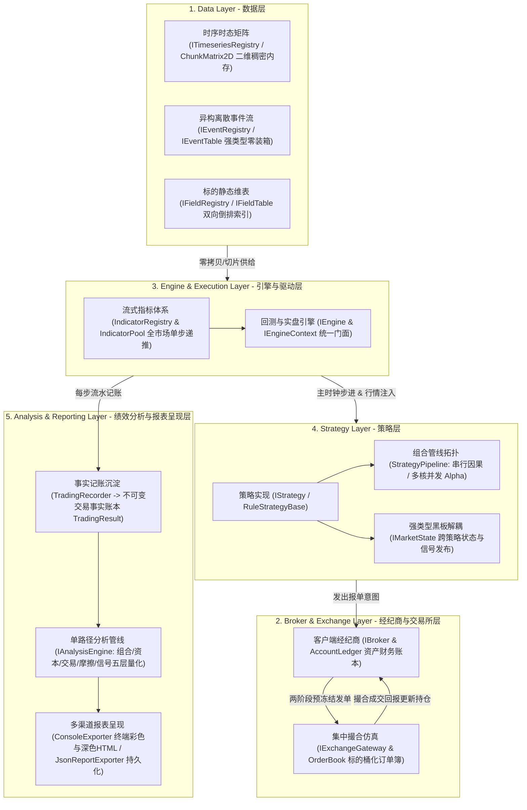

# CarrotQuant.Net

[](LICENSE)
[](https://dotnet.microsoft.com/download)

CarrotQuant.Net 是一个基于 .NET 开发的轻量级、高性能量化交易与回测框架，采用契约解耦的**多层分离架构**（数据层 / 经纪商与交易所撮合层 / 引擎与指标层 / 策略层 / 绩效分析与报表呈现层），支持回测与实盘双引擎。

---

## 核心特性

- **多层解耦架构**: 数据层 / 经纪商撮合层 / 引擎层 / 策略层 / 绩效分析层通过纯瘦契约解耦，同层物理隔离，各层可独立演进。
- **双格式数据源**: 统一支持 CSV 与 Parquet 格式，通过 `IStorageResolver` 屏蔽物理存储差异。
- **稠密矩阵 + 稀疏事件**: `ITimeseriesRegistry` 提供高性能二维时序矩阵（`GetMatrix`）与单标的一维序列（`GetSeries`）访问，`IEventTable` 提供点查与强类型流式 LINQ。
- **计算属性与极速复权**: `IEngineContext` 提供当期零分配极速取价门面（统一 `double`，仅当期，默认后复权），除权表全量极速滚动预热 + 跨模态覆盖校验；交易所撮合 100% 走真实未复权价格（Raw）。
- **增量流式指标子系统**: 独立命名空间 `Indicators`，纯净契约 `IStreamIndicator`，双精度防漂移，行业标准停牌 NaN 冻结跳过（Skip & Freeze），多值指标组合模式（MACD, BollingerBands），`IndicatorPool<T>` 全局单次更新多策略共享。
- **泛型事件系统**: 用户只需定义 record 类型，框架自动完成 CSV/Parquet → T 的零配置映射。
- **策略管线**: 支持串联/并联组合模式，引擎启动前通过 `Compile()` 优化拓扑。
- **Context 黑板模式**: 策略间通过 `IEngineContext` 共享状态与数据，实现策略逻辑与交易执行的解耦。
- **两阶段绩效分析**: 运行期通过 `TradingRecorder` 低开销沉淀纯交易事实（`TradingResult`），收尾期通过 `AnalysisEngine` 单路径驱动四层量化统计（组合净值、资本利用、交易归因、现实成本）与独立 Alpha 信号前向质量评估。
- **可插拔报表导出**: 表现层物理隔离，基于 `IReportExporter` 契约与 `GetMetrics()` 自描述指标流实现零耦合通排，支持终端彩色表格仪表盘与单文件深色 HTML 报表持久化（`ConsoleExporter`）。

---

## 项目结构

| 目录/项目 | 说明 |
| :--- | :--- |
| **CarrotBacktesting.NET** | **核心引擎**。包含数据层、经纪商与撮合、指标体系、引擎驱动、策略抽象、绩效分析与报表导出。 |
| **CarrotBackTesting.Net.UnitTest** | **单元测试**。覆盖数据层全部组件，含真实测试数据校验。 |
| **CarrotBackTesting.NET.TestData** | **测试数据集**。CSV/Parquet 格式的 A 股行情与复权因子数据。 |
| **CarrotBacktesting.NET.CLI** | **命令行工具**。支持零代码编译直接以 CLI 运行 YAML 回测会话与报告输出。 |

---

## 快速开始

### 1. 环境准备
- 安装 [.NET 10.0 SDK](https://dotnet.microsoft.com/download) 或更高版本。

### 2. 运行测试
```bash
dotnet test CarrotBackTesting.Net.UnitTest
```

### 3. 使用事件系统
```csharp
// 定义事件数据模型
public record AdjustmentFactor(double BackAdjFactor);

// 自动加载（CSV/Parquet 格式自动检测）
var resolver = new StorageResolver("path/to/data");
var table = EventSourceFactory.Create<AdjustmentFactor>(resolver, "ashare.adj_factor.baostock");

// O(1) 点查
table.TryGet(new DateTime(2021, 7, 21), "sh.600000", out var val);

// 注册到事件注册表
var registry = new EventRegistry();
registry.Register("adjustments", table);
```

### 4. 使用静态维表系统
```csharp
// 加载静态维表
var industryTable = FieldSourceFactory.Create(resolver, "ashare.industry.eastmoney");

// 链式点查与全表倒排索引选股
string industry = industryTable["sh.601958"]["board_name"];
var metalStocks = industryTable.GetKeys("钼"); // 无需记忆列名，全表倒排反查
```

### 5. 执行绩效分析与报表导出
```csharp
// 运行回测获取事实账本
TradingResult result = engine.Run();

// 驱动单路径分析管线生成综合报告
IAnalysisEngine analysisEngine = AnalysisEngine.CreateDefault();
AnalysisReport report = analysisEngine.Analyze(result);

// 导出控制台仪表盘与深色 HTML 报表
ConsoleExporter.Default.Export(report);
```

---

## 架构概览



详细类图、组件关系与业务时序见专著：👉 **[系统全景架构拓扑 (docs/diagram.md)](docs/diagram.md)**。

## 文档导航 (Wiki)

- **[系统全景架构拓扑 (docs/diagram.md)](docs/diagram.md)**: 完整的 Mermaid 六层解耦拓扑、组件归属与核心业务数据流向图。
- **[系统架构与研发红线 (AGENTS.md)](AGENTS.md)**: 框架总纲，涵盖分层架构设计、数字孪生模型、性能分级与研发红线。
- **[数据层内存架构与供给体系 (docs/data.md)](docs/data.md)**: `ChunkMatrix2D` 连续内存矩阵、4096 行分块轮转缓存、`EventTable` 表达式树零装箱映射、`FieldTable` 动态倒排选股与元数据推断。
- **[客户端经纪商与账户账本体系 (docs/broker.md)](docs/broker.md)**: `IBroker` 契约、`AccountLedger` 纯财务账本、两阶段挂单冻结状态机、零现金卖出平仓、T+N 跨日清算与实盘对账。
- **[交易所仿真与集中撮合体系 (docs/exchange.md)](docs/exchange.md)**: `IExchangeGateway` 与 `ISimulatedExchange` 契约、标的桶化 FIFO 挂单簿、纯计算撮合引擎、响应式纯行情驱动（`OnMarketData`）。
- **[核心引擎与执行体系 (docs/engine.md)](docs/engine.md)**: 引擎生命周期五态状态机、主时钟步进流水线、检查点持久化（`ICheckpointable`）。
- **[流式指标与计算属性开发指南 (docs/indicators.md)](docs/indicators.md)**: 增量流式指标契约（`IStreamIndicator`）、全市场标的数组容器（`IndicatorPool<T>`）、注册中心单步驱动、取价门面与除权因子安全供给。
- **[策略子系统与管线开发指南 (docs/strategy.md)](docs/strategy.md)**: 统一策略抽象、组合策略管线（串行/并行多核并发）、通用强类型黑板、Roslyn 动态免编译加载。
- **[绩效分析与量化评估子系统 (docs/analysis.md)](docs/analysis.md)**: 两阶段解耦架构、事实单一事实来源（`TradingResult`）、四层量化统计模型（组合净值、资本利用、交易归因、现实成本）、独立 Alpha 前向质量评估、垂直切片单文件高内聚组织。
- **[报表导出与呈现子系统开发指南 (docs/exporter.md)](docs/exporter.md)**: `IReportExporter` 契约规范、自描述指标流零耦合渲染机制、`ConsoleExporter` 控制台仪表盘、深色 HTML 报表持久化与自定义导出器扩展。
- **[配置管理与环境组织 (docs/configuration.md)](docs/configuration.md)**: `SessionConfig` 四大正交支柱、多态数据外链、跨环境基准路径级联解析与参数全量字典。
- **[底层数据存储与物理格式规范 (docs/data_format.md)](docs/data_format.md)**: 物理目录组织、Table ID 规范、Hive 年月分区、双时间轴契约与自描述缺省回退。
- **[标准研发工作流 (docs/workflow.md)](docs/workflow.md)**: 演示从数据准备、YAML 配置、策略编写到驱动引擎的标准实战流程。
- **[API 契约速查字典 (docs/API.md)](docs/API.md)**: 提供方法级精确签名、参数定义与异常规范（供日常查阅）。
- **[v3 历史报表规范归档 (CarrotBacktesting.NET/V3/README.md)](CarrotBacktesting.NET/V3/README.md)**: 用于迁移对照历史分析器与专业 Excel 报表规范。

---

## 开源协议

本项目采用 **Apache License 2.0** 协议开源。详情请参阅 [LICENSE](LICENSE) 文件。