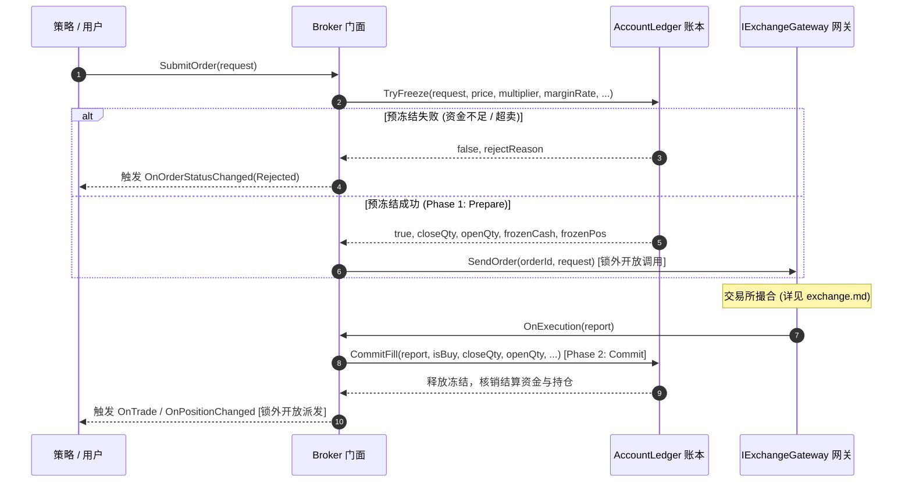
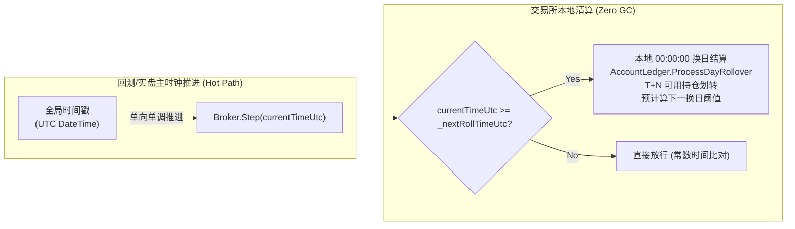

# 客户端经纪商与账户账本体系 (Client Broker & Account Ledger System)

本文档面向系统架构师与策略开发者，深入介绍 CarrotQuant.NET 中**客户端经纪商子系统**（`CarrotBacktesting.NET/Engine/Broker/`）的核心契约（`IBroker`）、账户财务账本（`AccountLedger`）、持仓实体（`PositionData`）、两阶段挂单冻结状态机、零现金卖出平仓支持、多时区自然日清算、以及在线实盘交易对接规范。

> [!NOTE]
> 关于交易所撮合机制、订单簿挂单排队、滑点与流动性模型，请参阅专门文档 [交易所仿真与集中撮合体系 (exchange.md)](exchange.md)。

---

## 目录
- [一、经纪商体系总览与架构设计](#一经纪商体系总览与架构设计)
- [二、核心契约分层 (IBroker)](#二核心契约分层-ibroker)
- [三、财务账本与单一事实来源 (AccountLedger)](#三财务账本与单一事实来源-accountledger)
- [四、两阶段挂单冻结与结算状态机 (Two-Phase Order Lifecycle)](#四两阶段挂单冻结与结算状态机-two-phase-order-lifecycle)
  - [1. Phase 1: 预冻结 (TryFreeze) 与开平仓精准拆分](#1-phase-1-预冻结-tryfreeze-与开平仓精准拆分)
  - [2. Phase 2: 成交核销 (CommitFill) 与守恒结算](#2-phase-2-成交核销-commitfill-与守恒结算)
  - [3. 零现金卖出平仓无损支持 (Zero-Cash Sell)](#3-零现金卖出平仓无损支持-zero-cash-sell)
  - [4. 部分成交分段精准核销 (Partial Fills)](#4-部分成交分段精准核销-partial-fills)
  - [5. 异常拒单与撤单全额解冻 (Unfreeze)](#5-异常拒单与撤单全额解冻-unfreeze)
- [五、多资产数学状态转移统一 (现货全额 vs 期货保证金)](#五多资产数学状态转移统一-现货全额-vs-期货保证金)
- [六、多时区自然日清算与 T+N 可用持仓划转 (ProcessDayRollover)](#六多时区自然日清算与-tn-可用持仓划转-processdayrollover)
- [七、动态盯市估值 (GetTotalEquity)](#七动态盯市估值-gettotalequity)
- [八、并发线程安全与开放调用 (Open Calls)](#八并发线程安全与开放调用-open-calls)
- [九、在线实盘交易集成与状态对账 (Online Trading & SyncState)](#九在线实盘交易集成与状态对账-online-trading--syncstate)

---

## 一、经纪商体系总览与架构设计

在 CarrotQuant.NET 的架构中，客户端经纪商体系负责**管理投资者自身的钱与持仓**。它在物理上与撮合交易所完全解耦：

```mermaid
graph TD
    subgraph StrategyLayer [策略层]
        Strategy[用户策略 / 组合管线]
    end

    subgraph BrokerSubsystem [客户端经纪商子系统 (Engine/Broker/)]
        Broker[Broker 门面<br>订单跟踪 / 锁外网关交互]
        AccountLedger[AccountLedger<br>纯财务账本 SSOT / 两阶段冻结 / 守恒结算]
        PositionData[PositionData<br>标的持仓实体 / T+N 批次队列]

        Broker --> AccountLedger
        AccountLedger --> PositionData
    end

    subgraph ExchangeGateway [物理网关契约 (解耦边界)]
        IExchangeGateway[IExchangeGateway 契约]
    end

    Strategy -->|调用 IBroker 契约| Broker
    Broker -->|SendOrder / CancelOrder| IExchangeGateway
    IExchangeGateway -->|OnExecution / OnOrderStateChanged| Broker
```

- **单一职责原则 (SRP)**：经纪商只管账户财务账本、在途预冻结、订单跟踪与 T+N 跨日划转，绝不承担交易所的撮合与滑点计算职责；
- **单一事实来源 (SSOT)**：`AccountLedger` 是账户资金与持仓的权威单点，所有涉及金额与头寸的变动必须收敛于此；
- **数字孪生一致性**：无论底层挂接的是回测模拟网关（`SimulatedExchangeGateway`）还是实盘柜台（CTP / 币安），经纪商与策略层代码 100% 保持一致。

---

## 二、核心契约分层 (IBroker)

`CarrotBacktesting.NET/Abstraction/Engine/IBroker.cs` 是策略层访问账户资金与持仓的权威门面契约：

```csharp
namespace CarrotBacktesting.NET.Abstraction.Engine;

public interface IBroker
{
    // 资金与持仓查询
    double GetCash();
    double GetTotalEquity();
    decimal GetPosition(string symbol);
    decimal GetAvailablePosition(string symbol);
    IReadOnlyDictionary<string, decimal> GetPositions();

    // 订单生命周期管理
    string SubmitOrder(OrderRequest request);
    void CancelOrder(string orderId);
    OrderStatus GetOrderStatus(string orderId);

    // 物理时钟单向推进与跨日结算
    void Step(DateTime currentTime);

    // 实盘状态对账同步
    void SyncState(double cash, IReadOnlyDictionary<string, decimal> positions);

    // 异步执行事件
    event Action<string, OrderStatus> OnOrderStatusChanged;
    event Action<ExecutionReport> OnTrade;
    event Action<PositionEvent>? OnPositionChanged;
}
```

---

## 三、财务账本与单一事实来源 (AccountLedger)

`AccountLedger` 是纯财务模型，内部维护：
1. **现金池**：
   - `Cash`: 当前实际持有现金；
   - `FrozenCash`: 报单挂牌预冻结资金（包含开仓保证金与预估手续费）；
   - `AvailableCash`: 当前可用现金，恒等于 `Cash - FrozenCash`。
2. **持仓池 (`PositionData`)**：
   - `TotalQuantity`: 总持仓数量（正数为多头，负数为空头）；
   - `FrozenQuantity`: 挂单预冻结持仓（平仓委托占用的锁定份额）；
   - `AvailableQuantity`: 当前可平仓数量，恒等于 `TotalQuantity - FrozenQuantity`；
   - `AveragePrice`: 加权成本持仓均价；
   - `PendingLots`: T+N 冻结批次队列，记录每一笔买入成交的锁定份额与解锁到期日。

---

## 四、两阶段挂单冻结与结算状态机 (Two-Phase Order Lifecycle)

为了杜绝多策略并发报单时的“资金双花（Double Spending）”与“持仓超卖（Over-selling）”，系统采用两阶段提交生命周期：



### 1. Phase 1: 预冻结 (TryFreeze) 与开平仓精准拆分
当用户调用 `SubmitOrder` 时：
1. **开平仓拆分**：依据当前标的的多空头寸，原子拆分为平仓部分 `closeQty` 与开仓部分 `openQty`（支持单笔大单原子完成多空双向反手翻仓）；
2. **持仓预冻结**：平仓部分直接从 `AvailableQuantity` 扣减并计入 `FrozenQuantity`，杜绝超卖；
3. **资金预冻结**：开仓部分按预估价格、乘数与保证金率计算保证金需求，并附加预估手续费，计入 `FrozenCash`，杜绝多单同时提交导致的资金双花透支。

### 2. Phase 2: 成交核销 (CommitFill) 与守恒结算
当网关推送成交回报 `OnExecution` 时：
1. 精确解冻对应的 `frozenCash` 与 `frozenPos`；
2. 现金与持仓精确守恒结算：
   - **现货买入**：扣减成交货款与佣金，新增 T+N 冻结批次进入 `PendingLots`，总持仓增加；
   - **现货卖出**：扣减持仓，增加成交回款扣减佣金后的净资金；
   - **期货开仓**：扣减开仓保证金与手续费，头寸按方向累加；
   - **期货平仓**：按开仓均价释放保证金，并计算已实现盈亏（Realized PnL）划入现金。

### 3. 零现金卖出平仓无损支持 (Zero-Cash Sell)
在全额现货交易中，投资者持有股票但现金账户余额为 0 时卖出平仓是合法的核心业务。历史版本中由于盲目校验预估手续费导致现金为 0 时卖出被误判资金不足拒单。
`AccountLedger.TryFreeze` 严格贯彻第一性原理：**纯平仓订单所需预冻结现金恒为 `0.0`**，手续费直接从卖出成交回款中扣除，100% 根除零现金平仓被拒的缺陷。

### 4. 部分成交分段精准核销 (Partial Fills)
在实盘或流动性受限撮合下，订单常分多次部分成交（如 100 股分 30 股与 70 股两次成交）。
`Broker` 维护 `RemainingCloseQuantity` 与 `RemainingOpenQuantity`：
- 首笔成交优先核销平仓配额并释放平仓冻结；
- 超出平仓配额的部分核销开仓配额并释放资金冻结；
- 彻底杜绝部分成交时因重复扣减或错误全量开仓导致的持仓虚增。

### 5. 异常拒单与撤单全额解冻 (Unfreeze)
若报单被网关拒单（`Rejected`）或由用户撤单（`Canceled`），`Broker` 调用 `ledger.Unfreeze(symbol, frozenCash, frozenPos)`，冻结资金全额归还可用现金，冻结持仓全额归还可用持仓，退出零脏状态。

---

## 五、多资产数学状态转移统一 (现货全额 vs 期货保证金)

系统依靠纯数值标的属性统合现货与衍生品，底层零冗余分叉：

| 资产类型 | 乘数 (`Multiplier`) | 保证金率 (`MarginRate`) | 允许卖空 (`AllowShort`) | 结算天数 (`SettleDays`) |
| :--- | :---: | :---: | :---: | :---: |
| **A 股现货** | 1.0 | 1.0 | `false` | 1 (T+1) |
| **美股现货** | 1.0 | 1.0 | `false` | 0 (T+0) 或 1 (T+1) |
| **股指/商品期货** | 真实合约乘数 (如 300) | 合约保证金率 (如 0.12) | `true` | 0 (T+0) |
| **双向外汇/加密合约** | 1.0 | 杠杆倒数 (如 0.05) | `true` | 0 (T+0) |

- **资金占用 / 保证金**：$|\text{Volume}| \times \text{Price} \times \text{Multiplier} \times \text{MarginRate}$
- **浮动盈亏**：$\text{Direction} \times (\text{CurrentPrice} - \text{OpenPrice}) \times \text{Volume} \times \text{Multiplier}$

---

## 六、多时区自然日清算与 T+N 可用持仓划转 (ProcessDayRollover)



1. **统一 IANA 时区标准**：支持 `"Asia/Shanghai"`、`"America/New_York"`、`"UTC"` 等标准跨平台时区标识；
2. **预计算换日阈值 (`NextRollTimeUtc`)**：初始化及每次换日完成时，预先计算交易所本地次日 `00:00:00` 对应的 UTC 绝对时间戳，热路径仅需一次整数时间戳比对即可判定是否日切，零高频 API 调用开销；
3. **T+N 持仓解锁**：跨日清算触发时，`AccountLedger.ProcessDayRollover` 遍历各标的的 `PendingLots`，将到达结算日期的持仓批次划入 `AvailableQuantity`，次日首根 Bar 即可用于平仓交易。

---

## 七、动态盯市估值 (GetTotalEquity)

`AccountLedger.GetTotalEquity(priceResolver)` 原生支持通过注入当前最新行情委托动态盯市：
$$\text{TotalEquity} = \text{Cash} + \sum (\text{Position} \times \text{CurrentPrice} \times \text{Multiplier}) + \text{UnrealizedPnL}$$
当未提供行情委托时，平滑降级采用持仓开仓均价（`AveragePrice`）计算成本资产，兼顾离线测算与在线实时盯市。

---

## 八、并发线程安全与开放调用 (Open Calls)

量化交易系统在多策略并发、多线程行情推送与跨组件回调时极易因锁竞争或锁重入发生死锁。CarrotQuant.NET 遵循严格的并发架构红线：

1. **锁内极简状态跃迁，锁外开放调用 (Open Calls)**：
   - 客户端 `Broker` 在向 `_gateway.SendOrder` 或 `_gateway.CancelOrder` 发起物理调用时，**严格在释放内部 `_syncLock` 之后执行**；
   - 所有的外部事件派发（`OnTrade`、`OnOrderStatusChanged`、`OnPositionChanged`）全部暂存至栈变量或预分配列表，在彻底退出锁后在锁外进行派发。绝不持有内部锁调用未知外部代码，从物理架构层面根绝死锁。
2. **128 位 `decimal` 撕裂读防御 (Torn Read Prevention)**：
   - 对 `GetPosition`、`GetAvailablePosition`、`GetOrderStatus` 等所有外部读取契约统一施加内部锁保护，杜绝 64 位 CPU 跨多寄存器读取 `decimal` 时发生数值撕裂。
3. **高并发压测保证**：经全套 20 线程并发高压测试验证，零死锁、零竞态脏读。

---

## 九、在线实盘交易集成与状态对账 (Online Trading & SyncState)

### 1. 状态对账同步 (`SyncState`)
在实盘交易中，因网络断线重连、盘前初始化或日切对账，需要将经纪商本地账本与真实柜台权威数据对齐：
```csharp
broker.SyncState(liveCash, livePositionsDictionary);
```
`AccountLedger.SyncState` 将原子重置现金池与可用持仓，并将已有在途冻结清空，确保本地状态与实盘柜台 100% 精确一致。

### 2. 在线交易集成测试验证
工程内置了全套在线交易集成测试套件（`OnlineTradingIntegrationTests.cs`）：
- 验证基于 `MockLiveExchangeGateway` 的多线程异步报单与成交回报；
- 验证部分成交（30% -> 70%）在现金与持仓上的分段核销；
- 验证柜台拒单后的预冻结资金与持仓原路全额回滚；
- 验证网络重连后 `SyncState` 对账；
- 验证多空双向反手大单跨 3 批次异步成交时的原子翻仓。
