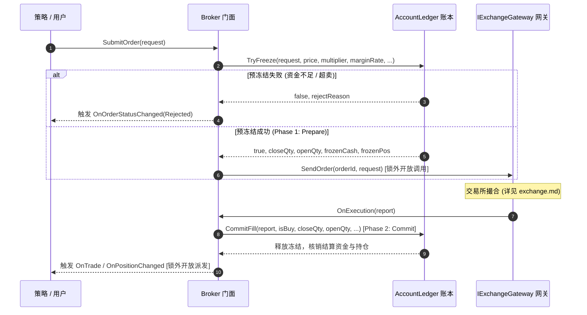
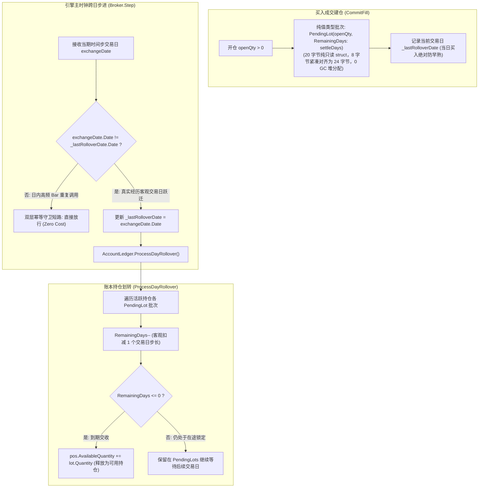
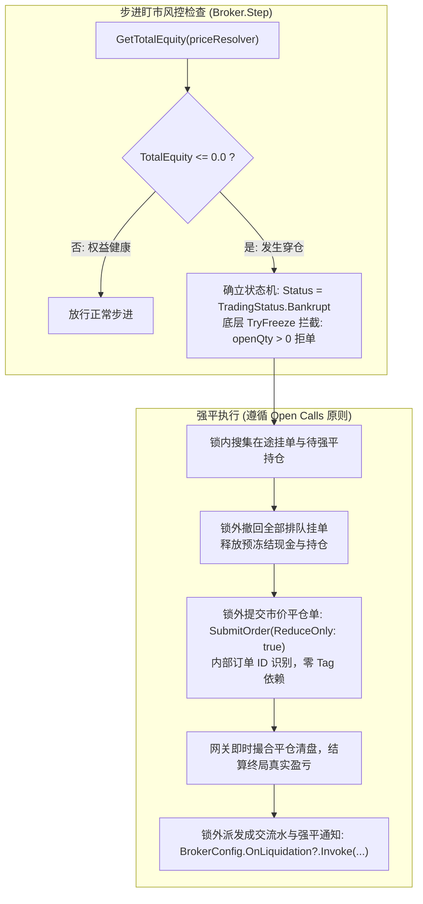

# 客户端经纪商与账户账本体系 (Client Broker & Account Ledger System)

本文档面向系统架构师与策略开发者，深入介绍 CarrotQuant.NET 中**客户端经纪商子系统**（`CarrotBacktesting.NET/Engine/Broker/`）的核心契约（`IBroker`）、账户财务账本（`AccountLedger`）、持仓实体（`PositionData`）、两阶段挂单冻结状态机、零现金卖出平仓支持、T+N 纯交易日步长递减清算、穿仓破产清算与强平机制、以及在线实盘交易对接规范。

> [!NOTE]
> 关于交易所撮合机制、订单簿挂单排队、滑点与流动性模型，请参阅专门文档 [交易所仿真与集中撮合体系 (exchange.md)](exchange.md)。

---

## 目录
- [一、经纪商体系总览与架构设计](#一经纪商体系总览与架构设计)
- [二、核心契约分层 (IBroker)](#二核心契约分层-ibroker)
- [三、财务账本与单一事实来源 (AccountLedger)](#三财务账本与单一事实来源-accountledger)
- [四、两阶段挂单冻结与结算状态机 (Two-Phase Order Lifecycle)](#四两阶段挂单冻结与结算状态机-two-phase-order-lifecycle)
  - [1. Phase 1: 预冻结 (TryFreeze) 与开平仓精准拆分](#1-phase-1-预冻结-tryfreeze-与开平仓精准拆分)
  - [2. Phase 2: 成交核销 (CommitFill) 与守恒结算](#2-phase-2-成交核销-commitfill-与守恒结算)
  - [3. 零现金卖出平仓无损支持 (Zero-Cash Sell)](#3-零现金卖出平仓无损支持-zero-cash-sell)
  - [4. 部分成交分段精准核销 (Partial Fills)](#4-部分成交分段精准核销-partial-fills)
  - [5. 异常拒单与撤单全额解冻 (Unfreeze)](#5-异常拒单与撤单全额解冻-unfreeze)
- [五、多资产数学状态转移统一 (现货全额 vs 期货保证金)](#五多资产数学状态转移统一-现货全额-vs-期货保证金)
- [六、T+N 纯交易日客观步长递减清算与可用持仓划转 (ProcessDayRollover)](#六tn-纯交易日客观步长递减清算与可用持仓划转-processdayrollover)
- [七、动态盯市估值 (GetTotalEquity)](#七动态盯市估值-gettotalequity)
- [八、穿仓爆仓、破产清算与强平机制 (Bankruptcy & Liquidation)](#八穿仓爆仓破产清算与强平机制-bankruptcy--liquidation)
- [九、并发线程安全与开放调用 (Open Calls)](#九并发线程安全与开放调用-open-calls)
- [十、在线实盘交易集成与状态对账 (Online Trading & SyncState)](#十在线实盘交易集成与状态对账-online-trading--syncstate)
- [十一、可观测性与能力接口扩展 (Capability Interfaces)](#十一可观测性与能力接口扩展-capability-interfaces)

---

## 一、经纪商体系总览与架构设计

在 CarrotQuant.NET 的架构中，客户端经纪商体系负责**管理投资者自身的钱与持仓**。它在物理上与撮合交易所完全解耦：

```mermaid
graph TD
    subgraph StrategyLayer [策略层]
        Strategy[用户策略 / 组合管线]
    end

    subgraph BrokerSubsystem [客户端经纪商子系统 (Engine/Broker/)]
        Broker[Broker 门面<br>订单跟踪 / 锁外网关交互]
        AccountLedger[AccountLedger<br>纯财务账本 SSOT / 两阶段冻结 / 守恒结算]
        PositionData[PositionData<br>标的持仓实体 / T+N 批次队列]

        Broker --> AccountLedger
        AccountLedger --> PositionData
    end

    subgraph ExchangeGateway [物理网关契约 (解耦边界)]
        IExchangeGateway[IExchangeGateway 契约]
    end

    Strategy -->|调用 IBroker 契约| Broker
    Broker -->|SendOrder / CancelOrder| IExchangeGateway
    IExchangeGateway -->|OnExecution / OnOrderStateChanged| Broker
```

- **单一职责原则 (SRP)**：经纪商只管账户财务账本、在途预冻结、订单跟踪与 T+N 跨日划转，绝不承担交易所的撮合与滑点计算职责；
- **单一事实来源 (SSOT)**：`AccountLedger` 是账户资金与持仓的权威单点，所有涉及金额与头寸的变动必须收敛于此；
- **数字孪生一致性**：无论底层挂接的是回测模拟网关（`SimulatedExchangeGateway`）还是实盘柜台（CTP / 币安），经纪商与策略层代码 100% 保持一致。

---

## 二、核心契约分层 (IBroker)

`CarrotBacktesting.NET/Abstraction/Engine/IBroker.cs` 是策略层访问账户资金与持仓的权威门面契约：

```csharp
namespace CarrotBacktesting.NET.Abstraction.Engine;

public interface IBroker
{
    // 资金与持仓查询
    double GetCash();
    double GetTotalEquity();
    decimal GetPosition(string symbol);
    decimal GetAvailablePosition(string symbol);
    double GetPositionCost(string symbol);
    IReadOnlyDictionary<string, decimal> GetPositions();

    // 订单生命周期管理与高频交易动词
    long SubmitOrder(OrderRequest request);
    long Buy(string symbol, decimal quantity, double price = 0.0, OrderType type = OrderType.Market, string orderTag = "", TimeInForce? timeInForce = null, bool reduceOnly = false);
    long Sell(string symbol, decimal quantity, double price = 0.0, OrderType type = OrderType.Market, string orderTag = "", TimeInForce? timeInForce = null, bool reduceOnly = false);
    long ClosePosition(string symbol, double price = 0.0, OrderType type = OrderType.Market, string orderTag = "", TimeInForce? timeInForce = null);
    long StopLoss(string symbol, double stopPrice, decimal? quantity = null, string orderTag = "", TimeInForce? timeInForce = null);
    long TakeProfit(string symbol, double targetPrice, decimal? quantity = null, string orderTag = "", TimeInForce? timeInForce = null);
    (long StopLossOrderId, long TakeProfitOrderId) Bracket(string symbol, decimal quantity, double stopPrice, double takeProfitPrice, string orderTag = "", TimeInForce? timeInForce = null, OrderDirection? closeDirection = null);
    void CancelOrder(long orderId);
    OrderStatus GetOrderStatus(long orderId);

    // 异步执行事件
    event Action<long, OrderStatus> OnOrderStatusChanged;
    event Action<ExecutionReport> OnTrade;
    event Action<PositionEvent>? OnPositionChanged;
}
```

> 💡 **分层契约与生命周期驱动分离**：`IBroker` 保持纯净的交易与持仓查询门面。时钟步进推进（`Step`）与柜台状态同步（`SyncState`）定义于专有基础设施契约 `IBrokerEngineDriver`，供引擎主循环与对账模块调用。详见 [第十一节](#十一可观测性与能力接口扩展-capability-interfaces)。

---

## 三、财务账本与单一事实来源 (AccountLedger)

`AccountLedger` 是纯财务模型，内部维护：
1. **现金池**：
   - `Cash`: 当前实际持有现金；
   - `FrozenCash`: 报单挂牌预冻结资金（包含开仓保证金与预估手续费）；
   - `AvailableCash`: 当前可用现金，恒等于 `Cash - FrozenCash`。
2. **持仓池 (`PositionData`)**：
   - `TotalQuantity`: 总持仓数量（正数为多头，负数为空头）；
   - `FrozenQuantity`: 挂单预冻结持仓（平仓委托占用的锁定份额）；
   - `AvailableQuantity`: 当前可平仓数量，恒等于 `TotalQuantity - FrozenQuantity`；
   - `AverageCost`: 加权平均持仓买入成本均价；
   - `OpenCommission`: 在途开仓手续费池（等比平摊）。
   - `PendingLots`: T+N 冻结批次队列，记录每一笔买入成交的锁定份额与解锁到期日。

---

## 四、两阶段挂单冻结与结算状态机 (Two-Phase Order Lifecycle)

为了杜绝多策略并发报单时的“资金双花（Double Spending）”与“持仓超卖（Over-selling）”，系统采用两阶段提交生命周期：



### 1. Phase 1: 预冻结 (TryFreeze)、通用净持仓与 ReduceOnly 守卫
当用户调用 `SubmitOrder` 时：
1. **原生 `ReduceOnly` 纯平仓意图守卫**：
   - 当 `request.ReduceOnly == true` 时（`ClosePosition`、`StopLoss`、`TakeProfit`、`Bracket` 内部自动绑定），系统执行严格的纯平仓约束：**只准减少当前持仓绝对值（`|Total|` 向 0 收敛）**；
   - 若可用平仓数量不足（因排队挂单冻结）或无持仓，立即返回 `OrderStatus.Rejected` 拒单，`openQty` 恒为 0，绝对防范反手开仓；
2. **自由交易模式（`ReduceOnly == false`）与多空 100% 镜像对称翻仓**：
   - **多头持仓卖出**：$Q \le Total$ 平多；$Q > Total$ 且现有多头全部可用时触发“多翻空”，自动拆分为 `closeQty = Total`（平多）与 `openQty = Q - Total`（开空并全额预冻结保证金）；
   - **空头持仓买入**：$Q \le |Total|$ 平空；$Q > |Total|$ 且现有空头全部可用时触发“空翻多”，自动拆分为 `closeQty = |Total|`（平空）与 `openQty = Q - |Total|`（开多并全额预冻结现金）；
   - **并发双花与竞争拦截**：若现有持仓存在挂单冻结，严禁反手开仓并直接拒单，确保头寸跃迁的原子性；
3. **持仓预冻结**：平仓部分直接扣减 `AvailableQuantity` 并累加至 `FrozenQuantity`，杜绝超卖；
4. **资金预冻结**：开仓部分按预估价格、乘数与保证金率计算保证金需求，并附加预估手续费，计入 `FrozenCash`，杜绝多单同时提交导致的资金双花透支；纯平仓部分预冻结现金恒为 `0.0`。

### 2. Phase 2: 成交核销 (CommitFill) 与守恒结算
当网关推送成交回报 `OnExecution` 时：
1. 精确解冻对应的 `frozenCash` 与 `frozenPos`；
2. 现金与持仓精确守恒结算：
   - **现货买入**：扣减成交货款与佣金，新增 T+N 冻结批次进入 `PendingLots`，总持仓增加；
   - **现货卖出**：扣减持仓，增加成交回款扣减佣金后的净资金；
   - **期货开仓**：扣减开仓保证金与手续费，头寸按方向累加；
   - **期货平仓**：按开仓均价释放保证金，并计算已实现盈亏（Realized PnL）划入现金。

### 3. 零现金卖出平仓无损支持 (Zero-Cash Sell)
在全额现货交易中，投资者持有股票但现金账户余额为 0 时卖出平仓是合法的核心业务。历史版本中由于盲目校验预估手续费导致现金为 0 时卖出被误判资金不足拒单。
`AccountLedger.TryFreeze` 严格遵循账本守恒契约：**纯平仓订单所需预冻结现金恒为 `0.0`**，手续费直接从卖出成交回款中扣除，100% 根除零现金平仓被拒的缺陷。

### 4. 部分成交分段精准核销 (Partial Fills)
在实盘或流动性受限撮合下，订单常分多次部分成交（如 100 股分 30 股与 70 股两次成交）。
`Broker` 维护 `RemainingCloseQuantity` 与 `RemainingOpenQuantity`：
- 首笔成交优先核销平仓配额并释放平仓冻结；
- 超出平仓配额的部分核销开仓配额并释放资金冻结；
- 彻底杜绝部分成交时因重复扣减或错误全量开仓导致的持仓虚增。

### 5. 异常拒单与撤单全额解冻 (Unfreeze)
若报单被网关拒单（`Rejected`）或由用户撤单（`Canceled`），`Broker` 调用 `ledger.Unfreeze(symbol, frozenCash, frozenPos)`，冻结资金全额归还可用现金，冻结持仓全额归还可用持仓，退出零脏状态。

### 6. 市价单保证金预估与资金校验机制 (Market Order Pricing)
市价单委托价格通常为 `0.0`，系统在 Phase 1 预冻结阶段通过以下机制评估资金需求：
1. **参考市价解析**：`Broker.GetEstimatedPrice` 从绑定网关（`ISimulatedExchange.GetBar`）获取标的最新基准行情切片，根据 `ExecutionPriceType`（Open、Vwap 或 Close）精准解析公允价格；
2. **滑点缓冲系数**：买单以 `marketPrice * (1.0 + Slippage)` 计算预估开仓成本，卖单以 `marketPrice * (1.0 - Slippage)` 预估；
3. **资金充足性检查**：当可用资金低于预估保证金与预估手续费之和时，拒绝委托并返回 `OrderStatus.Rejected`；
4. **无参考价处理**：当标的尚无市场行情记录（参考价 `<= 0` 或 `NaN`）时，`GetEstimatedPrice` 返回 `0.0`，买单由于无法确定资金需求直接拒绝。

---

## 五、多资产数学状态转移统一 (现货全额 vs 期货保证金)

系统依靠纯数值标的属性统合现货与衍生品，底层零冗余分叉：

| 资产类型 | 乘数 (`Multiplier`) | 保证金率 (`MarginRate`) | 允许卖空 (`AllowShort`) | 结算天数 (`SettleDays`) |
| :--- | :---: | :---: | :---: | :---: |
| **A 股现货** | 1.0 | 1.0 | `false` | 1 (T+1) |
| **美股现货** | 1.0 | 1.0 | `false` | 0 (T+0) 或 1 (T+1) |
| **股指/商品期货** | 真实合约乘数 (如 300) | 合约保证金率 (如 0.12) | `true` | 0 (T+0) |
| **双向外汇/加密合约** | 1.0 | 杠杆倒数 (如 0.05) | `true` | 0 (T+0) |

- **资金占用 / 保证金**：$|\text{Volume}| \times \text{Price} \times \text{Multiplier} \times \text{MarginRate}$
- **浮动盈亏**：$\text{Direction} \times (\text{CurrentPrice} - \text{OpenPrice}) \times \text{Volume} \times \text{Multiplier}$

---

## 六、T+N 纯交易日客观步长递减清算与可用持仓划转 (ProcessDayRollover)

在 $T+N$ 交易结算中（如 A 股现货 $T+1$、港美股 $T+2$ 或特定跨境/场外标的），传统自然日累加方案在跨周末或长假时会将休市日错误计入交收天数，导致提前违规解锁；而依赖未来全量日历数组又会在实盘增量流式按天追加（`AppendDate`）时发生未来越界异常。

CarrotQuant.NET 遵循第一性原理，确立**纯客观交易日步长递减模型**：



1. **纯事件驱动步长递减（回测与实盘 100% 同构）**：买入成交时仅在栈上生成紧凑值类型 `PendingLot`，不依赖任何未来日历数组或外部工作日判定委托；实盘流式按天追加行情天然自洽；
2. **双层绝对幂等日切守卫**：
   - 盘中高频（分钟/Tick）行情重复步进时，`exchangeDate.Date == _lastRolloverDate.Date` 立即短路，热路径零损耗；
   - 真实跨交易日推进时，仅在首个跨日 Bar 递减一个交易日步长，严防当日新开仓被提前划转（防早熟）。

---

## 七、动态盯市估值 (GetTotalEquity)

`AccountLedger.GetTotalEquity(priceResolver)` 原生支持通过注入当前最新行情委托动态盯市：
$$\text{TotalEquity} = \text{Cash} + \sum (\text{Position} \times \text{CurrentPrice} \times \text{Multiplier}) + \text{UnrealizedPnL}$$
当未提供行情委托时，平滑降级采用持仓开仓均价（`AveragePrice`）计算成本资产，兼顾离线测算与在线实时盯市。在盯市解析出公允最新价 `resolvedPrice > 0.0` 时，同步刷新持仓实体的最新价格 `pos.LastPrice = resolvedPrice`，保证持仓跟踪时刻贴合真实市场。

---

## 八、穿仓爆仓、破产清算与强平机制 (Bankruptcy & Liquidation)

在带有杠杆的衍生品或允许融券做空的交易场景中，若市场出现剧烈单边行情（如轧空暴涨 Short Squeeze），持仓浮亏可能穿透投资者本金，导致账户动态总权益跌破 0 元（穿仓）。

传统回测框架往往放任账户负资产存续跑完数年回测，严重粉饰下行风险，违背金融物理法则。CarrotQuant.NET 内置了坚固的**破产清算与强平机制（Liquidation Protocol）**：



1. **破产状态确立与熔断 (`TradingStatus.Bankrupt`)**：
   - 当账户总净值 $\text{TotalEquity} \le 0.0$ 时，经纪商与账本立即跃迁至状态 `TradingStatus.Bankrupt`；
   - 底层 `AccountLedger.TryFreeze` 执行前置拦截：凡涉及新开仓的委托（`openQty > 0`）一律拦截并返回拒单 `Account is bankrupt. Trading suspended.`；
2. **在途排队挂单集中撤销**：
   - 触发强平时，立即自动撤销挂单簿中全市场所有未成交限价单与在途条件单，释放全部冻结资金与持仓；
3. **市价强平清仓与零 Tag 内部识别**：
   - 对全市场现有活跃持仓生成标准市价平仓委托（`ReduceOnly: true`，`OrderTag` 留空）；
   - 强平识别完全由经纪商内部维护的订单 ID 集合权威管理，彻底拔除魔数标签（`OrderTag`）与网关特权旁路，复用成熟的撮合与事件分发管道；
4. **外部可观测性与断点续跑守恒**：
   - 锁外派发 `BrokerConfig.OnLiquidation` 回调供外部记录风险日志；
   - `AccountLedgerSnapshot` 包含 `TradingStatus Status = TradingStatus.Normal` 字段，断点续跑时状态机无损复原。

---

## 九、并发线程安全与开放调用 (Open Calls)

量化交易系统在多策略并发、多线程行情推送与跨组件回调时极易因锁竞争或锁重入发生死锁。CarrotQuant.NET 遵循严格的并发架构红线：

1. **锁内极简状态跃迁，锁外开放调用 (Open Calls)**：
   - 客户端 `Broker` 在向 `_gateway.SendOrder` 或 `_gateway.CancelOrder` 发起物理调用时，**严格在释放内部 `_syncLock` 之后执行**；
   - 所有的外部事件派发（`OnTrade`、`OnOrderStatusChanged`、`OnPositionChanged`、`OnLiquidation`）全部暂存至栈变量或预分配列表，在彻底退出锁后在锁外进行派发。绝不持有内部锁调用未知外部代码，从物理架构层面根绝死锁。
2. **128 位 `decimal` 撕裂读防御 (Torn Read Prevention)**：
   - 对 `GetPosition`、`GetAvailablePosition`、`GetOrderStatus` 等所有外部读取契约统一施加内部锁保护，杜绝 64 位 CPU 跨多寄存器读取 `decimal` 时发生数值撕裂。
3. **高并发压测保证**：经全套 20 线程并发高压测试验证，零死锁、零竞态脏读。

---

## 十、在线实盘交易集成与状态对账 (Online Trading & SyncState)

### 1. 状态对账同步 (`SyncState`)
在实盘交易中，因网络断线重连、盘前初始化或日切对账，需要将经纪商本地账本与真实柜台权威数据对齐：
```csharp
broker.SyncState(liveCash, livePositionsDictionary);
```
`AccountLedger.SyncState` 将原子重置现金池与可用持仓，并将已有在途冻结清空，确保本地状态与实盘柜台 100% 精确一致。

### 2. 在线交易集成测试验证
工程内置了全套在线交易集成测试套件（`OnlineTradingIntegrationTests.cs`）：
- 验证基于 `MockLiveExchangeGateway` 的多线程异步报单与成交回报；
- 验证部分成交（30% -> 70%）在现金与持仓上的分段核销；
- 验证柜台拒单后的预冻结资金与持仓原路全额回滚；
- 验证网络重连后 `SyncState` 对账；
- 验证多空双向反手大单跨 3 批次异步成交时的原子翻仓。

---

## 十一、可观测性与能力接口扩展 (Capability Interfaces)

遵循接口隔离原则（ISP），经纪商核心接口 `IBroker` 保持纯净精简，针对记账审计与系统装配扩展了专门的能力契约（位于 `CarrotBacktesting.NET.Abstraction.Engine`）：

### 1. 账户快照与结算事实供给 (`IAccountSnapshotProvider`)
```csharp
public interface IAccountSnapshotProvider
{
    // 获取当期账户资金与多空持仓快照（支持盯市估值）
    AccountSnapshot GetSnapshot(DateTime time, IEngineContext? context = null);

    // 换日结算与平仓事实事件（供记账器沉淀真实收益与交易日志）
    event Action<DailySettlementEvent>? OnSettlement;
    event Action<TradeClosedEvent>? OnTradeClosed;
}
```
- **记账器彻底解耦**：分析记录器（`TradingRecorder`）仅依赖 `IAccountSnapshotProvider` 能力契约，完全杜绝了对具体 `Broker` 类的反向依赖与强制向下转换。

### 2. 交易所网关提供者 (`IExchangeGatewayProvider`) 与安全封装
为了防御外部策略穿透 `Broker` 绕过两阶段预冻结直接向网关违规发单，`Broker` 对底层网关 `Gateway` 实行**显式接口实现**：
```csharp
public interface IExchangeGatewayProvider
{
    IExchangeGateway Gateway { get; }
}
```
- **封装安全闭环**：`Broker` 不暴露公共的 `Gateway` 属性。策略持有 `IBroker` 或 `Broker` 引用无法直接访问底层网关；
- **受保护的受控发现**：回测引擎在装配或步进阶段通过 `(broker as IExchangeGatewayProvider)?.Gateway` 安全感知仿真网关，兼顾了架构的灵活性与风控封装的绝对安全。

### 3. 引擎驱动契约 (`IBrokerEngineDriver`)
遵循接口隔离原则（ISP），经纪商的物理时钟步进推进与柜台状态同步独立于策略门面契约：
```csharp
public interface IBrokerEngineDriver : IBroker
{
    // 推进经纪商物理时钟时间步，执行多时区日切清算与 T+N 冻结批次解锁
    void Step(MarketTime currentTime);

    // 实盘断线重连或定时对账时，从外部权威数据源原子同步账户可用资金与持仓
    void SyncState(double cash, IReadOnlyDictionary<string, decimal> positions);
}
```
- **接口隔离**：策略层仅依赖面向交易与持仓查询的 `IBroker` 接口；
- **驱动控制**：`BacktestingEngine` 与 `LivingEngine` 持有 `IBrokerEngineDriver` 引用，由事件循环驱动时间步演进与对账。
