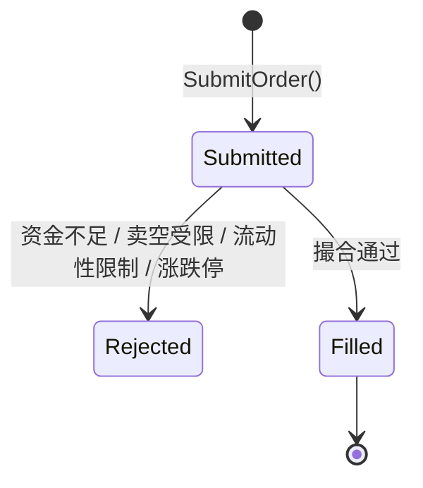
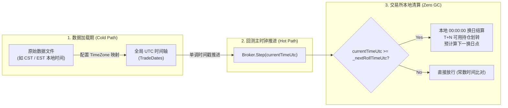

# 虚拟经纪商与撮合执行体系 (SimulatedBroker & Execution System)

本文档面向量化交易架构师与策略开发者，系统介绍 CarrotQuant.NET 中虚拟经纪商（`SimulatedBroker`）的核心契约（`IBroker`）、资产持仓状态机、多时区自然日清算与撮合规则模型。

---

## 目录
- [一、核心契约与职责定义 (IBroker)](#一核心契约与职责定义-ibroker)
- [二、账户模式与持仓状态机](#二账户模式与持仓状态机)
- [三、撮合规则与摩擦成本模型](#三撮合规则与摩擦成本模型)
- [四、多时区与本地自然日清算 (TimeZone & Settlement)](#四多时区与本地自然日清算-timezone--settlement)
- [五、规则 Hook 与依赖倒置](#五规则-hook-与依赖倒置)
- [六、配置规范与使用示例](#六配置规范与使用示例)

---

## 一、核心契约与职责定义 (IBroker)

在 CarrotQuant.NET 中，`IBroker` 是执行层与策略层交互的权威门面，统一抽象模拟回测环境（`SimulatedBroker`）与实盘网关（`LivingBroker`）：

```csharp
namespace CarrotBacktesting.NET.Abstraction.Engine;

public interface IBroker
{
    // 资金与持仓查询
    double GetCash();
    double GetTotalEquity();
    decimal GetPosition(string symbol);
    decimal GetAvailablePosition(string symbol);
    IReadOnlyDictionary<string, decimal> GetPositions();

    // 订单生命周期管理
    string SubmitOrder(OrderRequest request);
    void CancelOrder(string orderId);
    OrderStatus GetOrderStatus(string orderId);

    // 物理时钟单向推进
    void Step(DateTime currentTime);

    // 实盘状态对账同步
    void SyncState(double cash, IReadOnlyDictionary<string, decimal> positions);

    // 异步执行事件
    event Action<string, OrderStatus> OnOrderStatusChanged;
    event Action<ExecutionReport> OnTrade;
    event Action<PositionEvent>? OnPositionChanged;
}
```

### 单一物理入口原则 (Step Only)
外部引擎无需关心具体经纪商何时日切，仅需通过单一入口 `Step(DateTime currentTime)` 推动世界物理时间流逝。经纪商自治检测是否跨越交易所本地换日点并执行 T+N 持仓划转，彻底消除了冗余的外部 `RollDate` 调用。

---

## 二、账户模式与持仓状态机

`SimulatedBroker` 采用单一内核自适应支持现货与保证金两套经典业务范式：



### 1. 现货全额模式 (`Multiplier == 1.0 && MarginRate == 1.0 && !AllowShort`)
适用于 A 股普通股票、ETF 等标的：
- **买入扣款**：全额冻结并扣除成交金额与手续费：
  $$\text{Cash}_{\text{new}} = \text{Cash}_{\text{old}} - (\text{成交金额} + \text{手续费})$$
- **T+N 持仓锁定**：买入后总持仓 `TotalQuantity` 立即增加，但可用持仓 `AvailableQuantity` 根据结算天数 `SettleDays`（如 A 股 $N=1$）进入冻结队列 `PendingLots`，当日无法卖出；
- **卖出回款**：校验 `Quantity <= AvailableQuantity` 后扣减持仓并全额释放可用资金：
  $$\text{Cash}_{\text{new}} = \text{Cash}_{\text{old}} + (\text{成交金额} - \text{手续费})$$

### 2. 期货 / 衍生品保证金模式 (`MarginRate < 1.0 || Multiplier != 1.0 || AllowShort`)
适用于股指期货、商品期货、期权及外盘双向合约：
- **双向持仓**：多头持仓记为正数，空头持仓记为负数；
- **开仓占用保证金**：
  $$\text{MarginOccupied} = |\text{Quantity}| \times \text{Price} \times \text{Multiplier} \times \text{MarginRate}$$
  扣减账户可用现金：$\text{Cash}_{\text{new}} = \text{Cash}_{\text{old}} - (\text{MarginOccupied} + \text{手续费})$；
- **平仓盈亏释放**：
  $$\text{RealizedPnL} = (\text{FillPrice} - \text{AverageCost}) \times \text{CloseQuantity} \times \text{Multiplier} \quad (\text{多头平仓})$$
  $$\text{RealizedPnL} = (\text{AverageCost} - \text{FillPrice}) \times \text{CloseQuantity} \times \text{Multiplier} \quad (\text{空头平仓})$$
  释放保证金并计入已实现盈亏：$\text{Cash}_{\text{new}} = \text{Cash}_{\text{old}} + (\text{MarginReleased} + \text{RealizedPnL})$。

---

## 三、撮合规则与摩擦成本模型

### 1. 成交价滑点模型 (Slippage)
默认采用固定比例滑点，买入抬价，卖出折价：
$$\text{FillPrice}_{\text{Buy}} = \text{BasePrice} \times (1 + \text{Slippage})$$
$$\text{FillPrice}_{\text{Sell}} = \text{BasePrice} \times (1 - \text{Slippage})$$

### 2. 交易手续费模型 (Fee & MinFee)
手续费支持百分比费率与单笔最低消费门槛（如 A 股 5 元低吸保障）：
$$\text{Commission} = \max(\text{Turnover} \times \text{FeeRate}, \text{MinFee})$$

### 3. 流动性硬约束 (VolumeLimit)
为杜绝小盘股撮合成交量超过真实市场容量的作弊行为，配置项 `VolumeLimit` 严格限制单笔委托不得超过当前 Bar 物理成交量的指定比例（如 5%）：
$$\text{MaxAllowedQuantity} = \text{BarVolume} \times \text{VolumeLimit}$$
超出比例的订单直接被拒单（Rejected）。

### 4. 涨跌停封板拦截 (CheckLimit)
开启 `CheckLimit` 时，若挂载了 `OnCheckLimit` 委托，在触及涨跌停板时拦截不可成交的反向或顺向订单。

---

## 四、多时区与本地自然日清算 (TimeZone & Settlement)

CarrotQuant.NET 原生支持多时区数据与跨市场多标的回测，采用“数据源端一次性归一化至 UTC、经纪商端在本地时区日切”的设计：



### 1. 规范约定
- **时区命名标准**：统一采用标准 **IANA 时区标识**（如 `"Asia/Shanghai"`、`"America/New_York"`、`"UTC"`），跨平台自适应解析；
- **日切时间点 (Cutoff Time)**：统一采用交易所所在地的**本地自然日 `00:00:00`** 换日；
- **时态安全性**：输入时间戳若为 `DateTimeKind.Unspecified`，防御性视为 UTC 基准时间，杜绝系统本地时区隐式污染。

### 2. 预计算换日阈值机制 (NextRollTimeUtc)
为了避免在主时钟循环（热路径）中高频调用开销昂贵的时区转换 API（如 `ConvertTime`）：
1. 在初始化或每次日切完成时，Broker 预先计算出交易所本地次日 `00:00:00` 对应的 UTC 绝对时刻：
   $$\text{NextRollTimeUtc} = \text{ConvertTimeToUtc}(\text{ExchangeDate} + 1\text{天 } 00:00:00, \text{ExchangeTimeZone})$$
2. 在 `Step(currentTime)` 中，仅执行一次时间戳数值比对：
   $$\text{currentTime} \ge \text{NextRollTimeUtc}$$
   若未达到，直接放行，零额外开销；达到则触发本地清算并更新下一个阈值。

### 3. T+N 可用持仓解锁 (UnlockPendingLots)
清算触发时，倒序遍历持仓冻结队列 `PendingLots`：
$$\text{ExchangeDate} \ge \text{lot.AvailableDate} \implies \text{AvailableQuantity} += \text{lot.Quantity}$$
移除已到期的冻结份额，使次日首根 Bar 交易即可使用解锁持仓。

---

## 五、规则 Hook 与依赖倒置

为满足复杂的实盘定制需求（如动态保证金率、浮动阶梯手续费、期货品种不同乘数），`BrokerConfig` 提供了基于强类型委托的拦截器：

```csharp
public class BrokerConfig
{
    // 动态合约乘数 Hook (仅依赖标的维表 IFieldRegistry)
    public Func<string, IFieldRegistry?, double>? OnGetMultiplier { get; set; }

    // 动态保证金率 Hook (仅依赖标的维表 IFieldRegistry)
    public Func<string, IFieldRegistry?, double>? OnGetMarginRate { get; set; }

    // 动态结算天数 Hook
    public Func<string, int>? OnGetSettleDays { get; set; }

    // 动态自定义手续费计算 Hook
    public Func<OrderRequest, double, double>? OnCalculateFee { get; set; }

    // 动态自定义滑点计算 Hook
    public Func<OrderRequest, double, IDataRow, double>? OnCalculateSlippage { get; set; }

    // 动态流动性成交量约束 Hook
    public Func<OrderRequest, IDataRow, bool>? OnCheckVolume { get; set; }

    // 动态涨跌停拦截 Hook
    public Func<OrderRequest, IDataRow, bool>? OnCheckLimit { get; set; }
}
```

> [!NOTE]
> 规则 Hook 仅向外暴露标的维表抽象 `IFieldRegistry`，坚决不反向引入全局上下文 `IEngineContext`，保持严格的单向依赖拓扑。

---

## 六、配置规范与使用示例

### 1. Code-First 构造配置
```csharp
// A 股现货回测配置：T+1 结算、千一滑点、万三佣金（5元门槛）、不允许卖空、北京时区
var aStockBroker = new SimulatedBroker(new BrokerConfig
{
    InitialCash = 1_000_000.0,
    SettleDays = 1,
    AllowShort = false,
    FeeRate = 0.0003,
    MinFee = 5.0,
    Slippage = 0.001,
    TimeZoneId = "Asia/Shanghai"
});

// 期货保证金回测配置：T+0 结算、万一手续费、允许双向开平仓
var futureBroker = new SimulatedBroker(new BrokerConfig
{
    InitialCash = 1_000_000.0,
    SettleDays = 0,
    AllowShort = true,
    FeeRate = 0.0001,
    MinFee = 0.0,
    MarginRate = 0.1,
    Multiplier = 10.0
});
```

### 2. YAML 声明式配置
```yaml
broker:
  initial_cash: 1000000.0
  settle_days: 1
  allow_short: false
  fee_rate: 0.0003
  min_fee: 5.0
  slippage: 0.001
  volume_limit: 0.05
  check_limit: true
  time_zone_id: "Asia/Shanghai"
```
