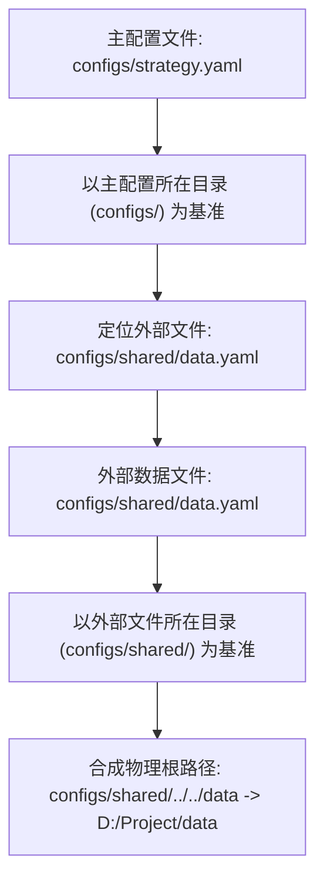

# 配置体系与环境组织指南 (Configuration Guide)

CarrotQuant.NET 采用纯 YAML 文件驱动引擎生命周期与数据供给，配置体系遵循**单一事实来源 (SSOT)**、**多态统一入口**与**基准目录级联解析**原则。

---

## 目录
- [一、配置设计规范](#一配置设计规范)
- [二、配置参数全量字典 (Parameter Reference)](#二配置参数全量字典-parameter-reference)
- [三、Broker 交易规则与对称 Hook 体系](#三-broker-交易规则与对称-hook-体系)
- [四、配置组织最佳实践：外链复用模式 (Recommended)](#四配置组织最佳实践外链复用模式-recommended)
- [五、相对路径级联解析机制 (Path Resolution)](#五相对路径级联解析机制-path-resolution)
- [六、直接内嵌配置模式 (Inline)](#六直接内嵌配置模式-inline)
- [七、配置序列化与动态导出 (Serialization & Saving)](#七配置序列化与动态导出-serialization--saving)
- [八、纯代码配置用法 (Code-First Configuration)](#八纯代码配置用法-code-first-configuration)

---

## 一、配置设计规范

1. **蛇形命名标准 (`snake_case`)**：配置参数采用标准蛇形命名（如 `start_date`, `initial_cash`, `table_id`；策略管线节点参数遵循驼峰或原样保留）。
2. **“四大支柱”浅嵌套结构**：
   - **`engine:`**：运行环境与生命周期（模式、起止时间）；
   - **`broker:`**：账户资金、交易制度、成本滑点、风控与资产乘数；
   - **`data:`**：时序数据、事件流、静态维表；
   - **`pipeline:`**：（可选）策略流水线拓扑编排、多 Alpha 生产与执行阶段。
   - 保持两层以内结构，避免深层缩进导致的排版与解析错误。
3. **多态统一入口**：
   - `data` 与 `pipeline` 字段均支持多态赋值：直接赋字符串表示引用外部独立 yaml 文件相对路径；直接赋映射对象表示直接内嵌配置。
4. **单一事实来源与零隐式逻辑**：
   - 系统计算严格遵循配置给定值，绝不在底层隐式猜列或自动回退查维表；
   - 动态特化一律由用户显式挂载对应的 Hook 承载。

---

## 二、配置参数全量字典 (Parameter Reference)

### 1. `engine` 运行环境设置 (`EngineConfig`)

| YAML 字段 | C# 属性 | 类型 | 必填 | 默认值 | 说明与取值范围 |
| :--- | :--- | :--- | :---: | :--- | :--- |
| `mode` | `Mode` | `string` | 否 | `"backtest"` | 引擎运行模式。可选值：`"backtest"`（历史回测）、`"living"`（实盘驱动）。 |
| `start_date` | `StartDate` | `DateTime?` | 否 | `null` | 回测起始日期。格式：`"YYYY-MM-DD"`（如 `"2025-01-01"`）。为空表示不限制起始时间。 |
| `end_date` | `EndDate` | `DateTime?` | 否 | `null` | 回测结束日期。格式：`"YYYY-MM-DD"`（如 `"2025-03-31"`）。为空表示不限制结束时间。 |

### 2. `broker` 虚拟经纪商设置 (`BrokerConfig`)

| YAML 字段 | C# 属性 | 类型 | 必填 | 默认值 | 说明与取值范围 |
| :--- | :--- | :--- | :---: | :--- | :--- |
| `initial_cash` | `InitialCash` | `double` | 否 | `1000000.0` | 初始账户可用资金（本金），单位为元。 |
| `settle_days` | `SettleDays` | `int` | 否 | `0` | 结算可用天数：`0` 即 T+0（日内即时可用，现代通用量化基准）；`1` 即 T+1（A 股次日可用）。 |
| `allow_short` | `AllowShort` | `bool` | 否 | `false` | 是否允许卖空。默认 `false`（现货多头安全基准，防止意外裸空穿仓；期货/外盘设为 `true`）。 |
| `fee_rate` | `FeeRate` | `double` | 否 | `0.001` | 基础综合交易摩擦费率（默认千分之一）。 |
| `min_fee` | `MinFee` | `double` | 否 | `0.0` | 单笔成交最低手续费门槛（通用国际市场为 0.0；A 股券商实战通常设 5.0）。 |
| `slippage` | `Slippage` | `double` | 否 | `0.001` | 固定比例滑点（如 `0.001` 代表买入上滑千一、卖出下滑千一；`0.0` 表示理想零滑点）。 |
| `volume_limit` | `VolumeLimit` | `double` | 否 | `0.05` | 成交量流动性硬约束：单笔最大允许成交量占当前 Bar 成交量的最大比例（默认 `0.05` 即 5%），严格杜绝无量封板或流动性枯竭时的虚假成交；设为 `0.0` 表示不限制流动性。 |
| `check_limit` | `CheckLimit` | `bool` | 否 | `false` | 是否开启涨跌停检查。开启后若挂载了 `OnCheckLimit` Hook 则执行封板拦截。 |
| `multiplier` | `Multiplier` | `double` | 否 | `1.0` | 默认合约乘数。股票按“股”计算为 `1.0`，期货按“手”计算填一手规格（如螺纹钢填 `10.0`）。 |
| `margin_rate` | `MarginRate` | `double` | 否 | `1.0` | 默认保证金率。股票全额现货为 `1.0`，期货按杠杆率填写（如 10 倍杠杆填 `0.1`）。 |
| `time_zone_id` | `TimeZoneId` | `string` | 否 | `"UTC"` | 交易所清算时区标识（遵循 IANA 标准如 `"Asia/Shanghai"`、`"America/New_York"` 或 `"UTC"`）。用于确定交易所本地自然日 00:00:00 换日与 T+N 持仓划转时刻。 |

### 3. `data` 统一入口 (`DataConfig`)

| YAML 字段 | C# 属性 | 类型 | 必填 | 默认值 | 说明与取值范围 |
| :--- | :--- | :--- | :---: | :--- | :--- |
| `data` | `Data` | `string` \| `Mapping` | 是 | - | **多态统一入口**：<br>1. **外链模式**：赋字符串路径指向外部独立配置文件（如 `"shared/data.yaml"`）；<br>2. **内嵌模式**：赋字典映射直接声明以下参数。 |
| `root` | `Root` | `string` | 是 | `""` | 数据存储区物理根目录。支持以当前配置文件所在目录为基准的相对路径（如 `"../../data"`）或操作系统绝对路径。 |
| `timeseries` | `Timeseries` | `List<TimeseriesConfig>` | 否 | `[]` | 时序行情矩阵列表（稠密数据），用于加载 OHLCV 宽表。 |
| `events` | `Events` | `List<EventStreamConfig>` | 否 | `[]` | 异构事件流列表（稀疏数据），用于挂载复权因子、公告、龙虎榜等 KV 数据。 |
| `fields` | `Fields` | `List<FieldTableConfig>` | 否 | `[]` | 标的静态属性与维表列表，用于挂载概念、行业、静态属性等平铺维表。 |

### 3. `timeseries` 时序项配置 (`TimeseriesConfig`)

| YAML 字段 | C# 属性 | 类型 | 必填 | 默认值 | 说明与取值范围 |
| :--- | :--- | :--- | :---: | :--- | :--- |
| `table_id` | `TableId` | `string` | 是 | - | 时序表唯一标识符，格式：`{market}.{category}.[sub/freq/adj].{source}`（如 `"ashare.kline.1d.raw.baostock"`）。 |
| `fields` | `Fields` | `List<string>?` | 否 | `null` | 需要加载的字段名列表（如 `["open", "high", "low", "close", "volume"]`）。若缺省或为 `null`，则加载表内包含的全部字段。 |
| `time_zone` | `TimeZone` | `string?` | 否 | `null` | 数据源时间戳时区标识符（遵循 IANA 标准如 `"Asia/Shanghai"`、`"America/New_York"` 或 `"UTC"`）。若数据源时间戳为无时区本地时间，将根据此时区转换为全局单调的 UTC 时间戳；若缺省或为 null，则视为 UTC 时间。 |
| `cache` | `Cache` | `bool` | 否 | `true` | 是否启用二进制对齐缓存。 |
| `page_size` | `PageSize` | `int` | 否 | `4096` | 缓存分页行数大小，默认固定为 4096（必须为 2 的幂，如 1024, 2048, 4096, 8192 等）。 |
| `refresh` | `Refresh` | `string` | 否 | `"lazy"` | 缓存刷新模式：`"lazy"`（默认，首次生成后只要存在直接加载，不检查原始数据）、`"auto"`（比对原始数据头尾时间戳增量补充）、`"force"`（强制清空并全量重刷）。 |
| `compression` | `Compression` | `string` | 否 | `"lz4"` | 缓存分块压缩算法：`"lz4"`（默认，3~5GB/s 超高速解码，节省 60%~70% 磁盘空间）、`"none"`（无压缩裸二进制块）。 |
| `commit_batch_size` | `CommitBatchSize` | `int` | 否 | `64` | 内存增量行定量落盘批次大小，默认 64 行。实盘单行追加达到该行数阈值时自动触发批量 Commit 增量落盘；若设为 0 或负数则禁用定量落盘，仅在引擎停止或 Dispose 时触发保底 Commit。 |
| `max_pages` | `MaxPages` | `int` | 否 | `4` | 最大常驻内存页数，默认为 4（必须为 2 的整数幂，如 2, 4, 8, 16 等）。底层以环形槽位管理内存分页，最老冷数据自动淘汰释放，确保超长高频回测与实盘常驻内存严格守恒；设为 0 或负数则禁用环形淘汰（全量常驻内存）。 |
| `prefetch` | `Prefetch` | `bool` | 否 | `true` | 是否启用后台异步双缓冲预读。仅在回测模式下生效；在实盘（Living）模式下自动物理短路熔断禁用。 |
| `nullable_fields` | `NullableFields` | `List<string>?` | 否 | `null` | 允许包含空值（NULL）的字段名列表（白名单）。默认全表所有字段严禁为 NULL；若检测到未在白名单中的字段存在 NULL，将立即抛出方案 C 诊断异常（含缺失行数、占比与样本行号）。若 `metadata.json` 中也定义了 `nullable_fields`，此处将与元数据配置合并生效。 |

> [!NOTE]
> **零空值契约与缺失值口径**：
> 1. **默认严禁 NULL（Zero-Tolerance）**：Parquet 文件中所有列（含时间戳、标的代码、价格、指标等）默认 100% 严禁出现 NULL。一旦出现非法缺失，立即抛出强类型 `InvalidDataException`（给出列名、缺失总行数、占比以及前 5 个损坏样本行号）。
> 2. **显式白名单放行**：仅当字段名配置在 `nullable_fields` 白名单中时才跳过检查。放行后，浮点类型严格置 IEEE 754 硬件 `NaN`，文本置空字符串 `""`，日期置 `DateTime.MinValue`，整型置 `0`。

### 4. `events` 事件项配置 (`EventStreamConfig`)

| YAML 字段 | C# 属性 | 类型 | 必填 | 默认值 | 说明与取值范围 |
| :--- | :--- | :--- | :---: | :--- | :--- |
| `name` | `Name` | `string` | 是 | - | 事件流在引擎上下文事件注册表 (`IEventRegistry`) 中的别名，策略通过 `context.Events.GetTable(name)` 或 `context.Events[name]` 依据此名称获取。 |
| `table_id` | `TableId` | `string` | 是 | - | 事件流物理存储表的唯一标识符（如 `"ashare.adj_factor.baostock"`）。 |
| `time_zone` | `TimeZone` | `string?` | 否 | `null` | 事件数据源时间戳时区标识符（遵循 IANA 标准如 `"Asia/Shanghai"`、`"UTC"`）。 |
| `nullable_fields` | `NullableFields` | `List<string>?` | 否 | `null` | 允许包含空值（NULL）的字段名列表（白名单）。默认全表所有字段严禁为 NULL；若检测到未在白名单中的字段存在 NULL，将立即抛出方案 C 诊断异常。若 `metadata.json` 中也定义了 `nullable_fields`，此处将与元数据配置合并生效。 |

### 5. `fields` 标的静态维表配置 (`FieldTableConfig`)

| YAML 字段 | C# 属性 | 类型 | 必填 | 默认值 | 说明与取值范围 |
| :--- | :--- | :--- | :---: | :--- | :--- |
| `name` | `Name` | `string` | 是 | - | 维表在引擎上下文维表注册表 (`IFieldRegistry`) 中的别名，策略通过 `context.Fields[name]` 或 `context.Fields.GetTable(name)` 访问。 |
| `table_id` | `TableId` | `string` | 是 | - | 维表物理存储表的唯一标识符（如 `"ashare.industry.eastmoney"`）。 |
| `key_column` | `KeyColumn` | `string?` | 否 | `null` | 主键列名。缺省时优先自动推断 `symbol` 列；若无 `symbol` 则采用首列。 |
| `nullable_fields` | `NullableFields` | `List<string>?` | 否 | `null` | 允许包含空值（NULL）的字段名列表（白名单）。默认全表所有字段严禁为 NULL；若检测到未在白名单中的字段存在 NULL，将立即抛出方案 C 诊断异常。若 `metadata.json` 中也定义了 `nullable_fields`，此处将与元数据配置合并生效。 |

---

## 三、Broker 交易规则与对称 Hook 体系

系统遵循**“静态数值配置驱动 95% 场景，对称 Hook 动态接管 5% 特化”**的设计哲学。系统计算严格使用配置值，绝不在底层隐式查询任何外部数据；仅当用户显式挂载 Hook 时，才由 Hook 覆盖对应环节的默认行为。

### 1. 配置参数与 Hook 对称映射矩阵

| 交易控制环节 | 基础配置参数 (纯数值/全局开关) | 对称 Hook 委托签名 | 默认行为与覆盖逻辑 |
| :--- | :--- | :--- | :--- |
| **成交量流动性** | `volume_limit` (`double`) | `Func<OrderRequest, IDataRow, bool>? OnCheckVolume` | 默认：若配置大于 0，单笔订单量超过 `bar.Volume * volume_limit` 则拦截或部分成交；<br>Hook 覆盖：自定义日内动态成交量、分档撮合。 |
| **结算可用天数** | `settle_days` (`int`) | `Func<string, int>? OnGetSettleDays` | 默认：全品种统一按配置结算天数执行（`0` 即 T+0，`1` 即 T+1）；<br>Hook 覆盖：多资产混合时按标的动态返回（如股票返回 1，ETF/期货返回 0）。 |
| **涨跌停判定** | `check_limit` (`bool`) | `Func<OrderRequest, IDataRow, bool>? OnCheckLimit` | 默认：若未挂载 Hook 则不限制；<br>Hook 覆盖：用户自主比对数据列（如 `limit_up`）或自定义板块涨跌停阈值。 |
| **交易手续费** | `fee_rate` + `min_fee` (`double`) | `Func<OrderRequest, double, double>? OnCalculateFee` | 默认：$\max(\text{min\_fee}, \text{turnover} \times \text{fee\_rate})$；<br>Hook 覆盖：用户自定义单向印花税、阶梯费率或返佣。 |
| **滑点摩擦** | `slippage` (`double`) | `Func<OrderRequest, double, IDataRow, double>? OnCalculateSlippage` | 默认：$\text{Price} \times (1 \pm \text{slippage})$；<br>Hook 覆盖：基于订单规模占全市场成交量比例计算二次方冲击成本。 |
| **合约乘数** | `multiplier` (`double`) | `Func<string, IFieldRegistry?, double>? OnGetMultiplier` | 默认：全品种使用配置纯数值（股票为 1.0）；<br>Hook 覆盖：多品种期货回测中，显式由用户读取 `fields?["specs"][symbol]` 维表。 |
| **保证金率** | `margin_rate` (`double`) | `Func<string, IFieldRegistry?, double>? OnGetMarginRate` | 默认：全品种使用配置纯数值（现货全额为 1.0）；<br>Hook 覆盖：按品种或杠杆分级显式从维表动态获取。 |

### 2. 代码配置与 Hook 挂载示例

```csharp
var config = new SessionConfig
{
    Broker = new BrokerConfig
    {
        InitialCash = 1_000_000,
        SettleDays = 1,          // A 股 T+1
        AllowShort = false,
        FeeRate = 0.0003,        // 万三佣金
        MinFee = 5.0,            // 最低 5 元
        Slippage = 0.001,        // 千一滑点
        VolumeLimit = 0.1,       // 单笔不超过当前 Bar 成交量的 10%
        CheckLimit = true        // 开启涨跌停检查
    }
};

// 1. 自定义涨跌停拦截 Hook（检查数据中是否包含权威 limit_up 列）
config.Broker.OnCheckLimit = (order, bar) =>
{
    if (order.IsBuy && bar.TryGetDouble("limit_up", out var upPrice) && bar.Close >= upPrice)
        return false; // 涨停禁止买入
    return true;
};

// 2. 自定义印花税 Hook（仅卖出额外收取千分之 0.5）
config.Broker.OnCalculateFee = (order, turnover) =>
{
    double commission = Math.Max(5.0, turnover * 0.0003);
    double stampTax = order.IsSell ? turnover * 0.0005 : 0.0;
    return commission + stampTax;
};
```

---

## 四、配置组织最佳实践：外链复用模式 (Recommended)

在实际应用中，数据存储区通常是全局统一的公共资源，而不同策略通常仅需调整回测起止时间与初始资金。因此推荐采用**“共享数据文件 + 独立策略配置”**的组织方式：

```
my_project/
├── configs/
│   ├── shared/
│   │   └── data_production.yaml    # 共享数据区配置（平铺以 root: 开头）
│   ├── strategy_alpha_1.yaml       # 策略 1 主配置
│   └── strategy_cta_2.yaml         # 策略 2 主配置
└── data/                           # 物理数据仓库
```

### 1. 独立共享数据配置 (`shared/data_production.yaml`)
遵循“文件即对象”设计，独立数据文件的根部直接平铺 `DataConfig` 的属性，无需多余包裹层：

```yaml
root: "../../data"                  # 数据存储区物理根目录
timeseries:
  - table_id: "ashare.kline.1m.raw.custom"
    fields: ["open", "high", "low", "close", "volume"]
  - table_id: "ashare.kline.1d.raw.baostock"
events:
  - name: "adjustments"
    table_id: "ashare.adj_factor.baostock"
fields:
  - name: "industry"
    table_id: "ashare.industry.eastmoney"
  - name: "concept"
    table_id: "ashare.concept.eastmoney"
```

### 2. 主策略配置文件 (`strategy_alpha_1.yaml`)
主策略配置包含运行参数、交易经纪商设置，并通过 `data` 字段指向外部共享数据配置文件：

```yaml
engine:
  mode: "backtest"
  start_date: "2025-01-01"
  end_date: "2025-03-31"

broker:
  initial_cash: 2000000.0
  settle_days: 1
  fee_rate: 0.0003
  min_fee: 5.0
  slippage: 0.001
  volume_limit: 0.1
  check_limit: true

data: "shared/data_production.yaml"
```

---

## 五、相对路径级联解析机制 (Path Resolution)

跨子目录引用相对路径时，依赖当前工作目录（`Environment.CurrentDirectory`）可能导致路径寻址失败。系统采用以配置文件所在物理目录为基准的级联解析机制：



1. **主配置解析**：`strategy.yaml` 中声明的 `data: "shared/data.yaml"`，以 `strategy.yaml` 所在的物理目录为基准合并为绝对路径；
2. **外部数据解析**：`data.yaml` 中声明的 `root: "../../data"`，以 **`data.yaml` 自身所在的物理目录**为基准进行合并，确保解析结果不受进程启动目录影响；
3. **绝对路径处理**：若配置中已是绝对路径（如 Windows 盘符路径 `D:/DataStore` 或 Linux 根路径 `/data`），解析器规范化分隔符后直接使用，不进行相对路径拼接。

---

## 六、直接内嵌配置模式 (Inline)

针对独立实验脚本或单元测试，系统支持单文件内嵌配置：

```yaml
engine:
  mode: "backtest"
  start_date: "2025-01-01"
  end_date: "2025-03-31"

broker:
  initial_cash: 1000000.0
  settle_days: 1
  fee_rate: 0.0003
  min_fee: 5.0
  slippage: 0.001

data:
  root: "./test_data"
  timeseries:
    - table_id: "ashare.kline.1d.raw.baostock"
  events:
    - name: "adjustments"
      table_id: "ashare.adj_factor.baostock"
```

加载器根据 YAML 节点类型（标量字符串或字典映射）自动解析对应配置模型。

---

## 七、配置序列化与动态导出 (Serialization & Saving)

系统配置支持通过实例方法直接序列化与落盘保存，底层由权威唯一的 `YamlSerializer` 驱动，形成完整的生命周期闭环：

```csharp
using CarrotBacktesting.NET.Config;

// 1. 在代码中构建或修改配置对象
var config = new SessionConfig
{
    Engine = new EngineConfig { Mode = "backtest" },
    Broker = new BrokerConfig
    {
        InitialCash = 1000000.0,
        SettleDays = 1,
        FeeRate = 0.0003,
        Slippage = 0.001
    },
    Data = new DataConfig
    {
        Root = "D:/QuantData",
        Timeseries = new List<TimeseriesConfig>
        {
            new() { TableId = "ashare.kline.1d.raw.baostock", Cache = true }
        }
    }
};

// 2. 导出为规范的标准下划线 YAML 文本
string yaml = config.ToYaml();

// 3. 或直接落盘保存至物理文件
config.Save("configs/strategy_auto.yaml");
```

针对测试环境与自动化脚本，推荐直接使用 C# 11 原始字符串字面量（Raw String Literals `"""..."""`）声明标准 YAML 文本，或通过标准数据结构（`Dictionary<string, object>`）由底层 `YamlSerializer` 序列化，杜绝领域模型自产自销造成的同源循环论证。

---

## 八、纯代码配置用法 (Code-First Configuration)

除了基于 YAML 文件的驱动方式，系统完全支持**纯代码驱动（Code-First）**。无需创建任何物理文件，直接通过 C# 强类型对象进行装配，适合量化研发、实验脚本、单元测试与动态组合策略。

### 1. 强类型对象声明法（POCO / Object Initializer）
最结构化的配置方式，配置对象可跨模块传递，并支持后续随时一键序列化为 YAML：

```csharp
using CarrotBacktesting.NET.Config;
using CarrotBacktesting.NET.Data;

// 1. 直接通过 C# 对象声明完整配置
var config = new SessionConfig
{
    Engine = new EngineConfig
    {
        Mode = "backtest",
        StartDate = new DateTime(2025, 1, 1),
        EndDate = new DateTime(2025, 12, 31)
    },
    Broker = new BrokerConfig
    {
        InitialCash = 1000000.0,
        SettleDays = 1,
        FeeRate = 0.0003,
        MinFee = 5.0,
        Slippage = 0.001,
        VolumeLimit = 0.1,
        CheckLimit = true
    },
    Data = new DataConfig
    {
        Root = "D:/QuantData",
        Timeseries = new List<TimeseriesConfig>
        {
            new()
            {
                TableId = "ashare.kline.1d.raw.baostock",
                Cache = true,
                PageSize = 4096,
                MaxPages = 4,
                Prefetch = true
            }
        },
        Events = new List<EventStreamConfig>
        {
            new() { Name = "adjustments", TableId = "ashare.adj_factor.baostock" }
        },
        Fields = new List<FieldTableConfig>
        {
            new() { Name = "industry", TableId = "ashare.industry.eastmoney", KeyColumn = "symbol" }
        }
    }
};

// 2. 通过统一路径解析器与装配工厂一键构建
var resolver = new StorageResolver(config.Data.Root);
var timeseries = TimeseriesRegistryFactory.Create(resolver, config.Data.Timeseries[0]);
var events = EventRegistryFactory.Create(resolver, config.Data.Events);
var fields = FieldRegistryFactory.Create(resolver, config.Data.Fields);
```

### 2. 工厂直连装配法（Direct Factory API）
无需中间配置模型对象，直接面向存储根目录与具名参数快速装配，调用简洁直接：

```csharp
using CarrotBacktesting.NET.Data;

string storageRoot = "D:/QuantData";

// 时序子系统（自动识别 CSV / Parquet）
var timeseries = TimeseriesRegistryFactory.Create(
    storageRoot: storageRoot,
    source: TimeseriesSourceFactory.Create(storageRoot, "ashare.kline.1d.raw.baostock"),
    pageSize: 4096,
    maxPages: 4,
    enableCache: true,
    prefetch: true
);

// 事件子系统（批量装配）
var events = EventRegistryFactory.Create(storageRoot, new[]
{
    new EventStreamConfig { Name = "adjustments", TableId = "ashare.adj_factor.baostock" }
});

// 维表子系统（批量装配）
var fields = FieldRegistryFactory.Create(storageRoot, new[]
{
    new FieldTableConfig { Name = "industry", TableId = "ashare.industry.eastmoney", KeyColumn = "symbol" }
});
```

### 3. 底层物理驱动组合装配（First-Principles Composability）
对于低级定制化开发、高性能测试或单表操作，可直接调用最底层的数据源工厂：

```csharp
using CarrotBacktesting.NET.Data;

var resolver = new StorageResolver("D:/QuantData");

// 直接获取独立维表并进行双向倒排检索
var industryTable = FieldSourceFactory.Create(resolver, "ashare.industry.eastmoney", keyColumn: "symbol");
var molyStocks = industryTable.GetKeys("钼");

// 直接获取单表事件流并自动执行年份分区剪枝
var adjTable = EventSourceFactory.Create(
    resolver, 
    "ashare.adj_factor.baostock", 
    startDate: new DateTime(2025, 1, 1), 
    endDate: new DateTime(2025, 12, 31)
);
```
