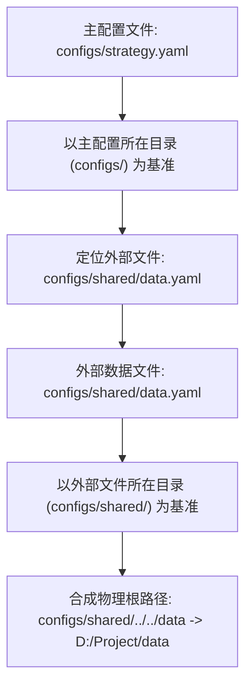

# 配置体系与环境组织指南 (Configuration Guide)

CarrotQuant.NET 采用纯 YAML 文件驱动引擎生命周期与数据供给，配置体系遵循**单一事实来源 (SSOT)**、**多态统一入口**与**基准目录级联解析**原则。

---

## 一、配置设计规范

1. **蛇形命名标准 (`snake_case`)**：配置参数采用标准蛇形命名（如 `start_date`, `initial_cash`, `table_id`）。
2. **“2 层浅嵌套”结构**：
   - **Level 1（模块划分）**：`engine:`、`data:`；
   - **Level 2（模块内部参数）**：直接平铺（如 `mode:`、`root:`、`timeseries:`）。
   - 保持两层以内结构，避免深层缩进导致的排版与解析错误。
3. **多态统一入口**：
   - 统一使用 `data` 字段，不额外引入辅助配置项；
   - `data` 节点支持两种赋值形式：直接赋字符串表示外部文件路径；直接赋字典表示内嵌配置对象。

---

## 二、配置参数全量字典 (Parameter Reference)

### 1. `engine` 模块 (`EngineSettings`)

| YAML 字段 | C# 属性 | 类型 | 必填 | 默认值 | 说明与取值范围 |
| :--- | :--- | :--- | :---: | :--- | :--- |
| `mode` | `Mode` | `string` | 否 | `"backtest"` | 引擎运行模式。可选值：`"backtest"`（历史回测）、`"living"`（实盘驱动）。 |
| `start_date` | `StartDate` | `DateTime?` | 否 | `null` | 回测起始日期。格式：`"YYYY-MM-DD"`（如 `"2025-01-01"`）。为空表示不限制起始时间。 |
| `end_date` | `EndDate` | `DateTime?` | 否 | `null` | 回测结束日期。格式：`"YYYY-MM-DD"`（如 `"2025-03-31"`）。为空表示不限制结束时间。 |
| `initial_cash`| `InitialCash`| `double` | 否 | `1000000.0` | 初始账户资产（本金），单位为元。 |

### 2. `data` 统一入口 (`DataConfig`)

| YAML 字段 | C# 属性 | 类型 | 必填 | 默认值 | 说明与取值范围 |
| :--- | :--- | :--- | :---: | :--- | :--- |
| `data` | `Data` | `string` \| `Mapping` | 是 | - | **多态统一入口**：<br>1. **外链模式**：赋字符串路径指向外部独立配置文件（如 `"shared/data.yaml"`）；<br>2. **内嵌模式**：赋字典映射直接声明以下参数。 |
| `root` | `Root` | `string` | 是 | `""` | 数据存储区物理根目录。支持以当前配置文件所在目录为基准的相对路径（如 `"../../data"`）或操作系统绝对路径。 |
| `timeseries` | `Timeseries` | `List<TimeseriesConfig>` | 否 | `[]` | 时序行情矩阵列表（稠密数据），用于加载 OHLCV 宽表。 |
| `events` | `Events` | `List<EventStreamConfig>` | 否 | `[]` | 异构事件流列表（稀疏数据），用于挂载复权因子、公告、龙虎榜等 KV 数据。 |

### 3. `timeseries` 时序项配置 (`TimeseriesConfig`)

| YAML 字段 | C# 属性 | 类型 | 必填 | 默认值 | 说明与取值范围 |
| :--- | :--- | :--- | :---: | :--- | :--- |
| `table_id` | `TableId` | `string` | 是 | - | 时序表唯一标识符，格式：`{market}.{category}.[sub/freq/adj].{source}`（如 `"ashare.kline.1d.raw.baostock"`）。 |
| `fields` | `Fields` | `List<string>?` | 否 | `null` | 需要加载的字段名列表（如 `["open", "high", "low", "close", "volume"]`）。若缺省或为 `null`，则加载表内包含的全部字段。 |
| `cache` | `Cache` | `bool` | 否 | `true` | 是否启用二进制对齐缓存。 |
| `page_size` | `PageSize` | `int` | 否 | `4096` | 缓存分页行数大小，默认固定为 4096（必须为 2 的幂，如 1024, 2048, 4096, 8192 等）。 |
| `refresh` | `Refresh` | `string` | 否 | `"lazy"` | 缓存刷新模式：`"lazy"`（默认，首次生成后只要存在直接加载，不检查原始数据）、`"auto"`（比对原始数据头尾时间戳增量补充）、`"force"`（强制清空并全量重刷）。 |
| `compression` | `Compression` | `string` | 否 | `"lz4"` | 缓存分块压缩算法：`"lz4"`（默认，3~5GB/s 超高速解码，节省 60%~70% 磁盘空间）、`"none"`（无压缩裸二进制块）。 |

> [!NOTE]
> **缺失值口径**：时序宽表中的缺失单元格（停牌、未上市、已退市等）遵循第一性原理统一严格置 `NaN`（非浮点回退 `default`），零业务状态臆测，零额外配置负担。

### 4. `events` 事件项配置 (`EventStreamConfig`)

| YAML 字段 | C# 属性 | 类型 | 必填 | 默认值 | 说明与取值范围 |
| :--- | :--- | :--- | :---: | :--- | :--- |
| `name` | `Name` | `string` | 是 | - | 事件流在引擎上下文事件注册表 (`IEventRegistry`) 中的别名，策略通过 `context.Events.GetProvider<T>(name)` 依据此名称获取。 |
| `table_id` | `TableId` | `string` | 是 | - | 事件流物理存储表的唯一标识符（如 `"ashare.adj_factor.baostock"`）。 |

---

## 三、配置组织最佳实践：外链复用模式 (Recommended)

在实际应用中，数据存储区通常是全局统一的公共资源，而不同策略通常仅需调整回测起止时间与初始资金。因此推荐采用**“共享数据文件 + 独立策略配置”**的组织方式：

```
my_project/
├── configs/
│   ├── shared/
│   │   └── data_production.yaml    # 共享数据区配置（平铺以 root: 开头）
│   ├── strategy_alpha_1.yaml       # 策略 1 主配置
│   └── strategy_cta_2.yaml         # 策略 2 主配置
└── data/                           # 物理数据仓库
```

### 1. 独立共享数据配置 (`shared/data_production.yaml`)
遵循“文件即对象”设计，独立数据文件的根部直接平铺 `DataConfig` 的属性，无需多余包裹层：

```yaml
root: "../../data"                  # 数据存储区物理根目录
timeseries:
  - table_id: "ashare.kline.1m.raw.custom"
    fields: ["open", "high", "low", "close", "volume"]
  - table_id: "ashare.kline.1d.raw.baostock"
events:
  - name: "adjustments"
    table_id: "ashare.adj_factor.baostock"
```

### 2. 主策略配置文件 (`strategy_alpha_1.yaml`)
主策略配置通过 `data` 字段指向外部共享数据配置文件：

```yaml
engine:
  mode: "backtest"
  start_date: "2025-01-01"
  end_date: "2025-03-31"
  initial_cash: 2000000.0

data: "shared/data_production.yaml"
```

---

## 四、相对路径级联解析机制 (Path Resolution)

跨子目录引用相对路径时，依赖当前工作目录（`Environment.CurrentDirectory`）可能导致路径寻址失败。系统采用以配置文件所在物理目录为基准的级联解析机制：



1. **主配置解析**：`strategy.yaml` 中声明的 `data: "shared/data.yaml"`，以 `strategy.yaml` 所在的物理目录为基准合并为绝对路径；
2. **外部数据解析**：`data.yaml` 中声明的 `root: "../../data"`，以 **`data.yaml` 自身所在的物理目录**为基准进行合并，确保解析结果不受进程启动目录影响；
3. **绝对路径处理**：若配置中已是绝对路径（如 Windows 盘符路径 `D:/DataStore` 或 Linux 根路径 `/data`），解析器规范化分隔符后直接使用，不进行相对路径拼接。

---

## 五、直接内嵌配置模式 (Inline)

针对独立实验脚本或单元测试，系统支持单文件内嵌配置：

```yaml
engine:
  mode: "backtest"
  start_date: "2025-01-01"
  end_date: "2025-03-31"
  initial_cash: 1000000.0

data:
  root: "./test_data"
  timeseries:
    - table_id: "ashare.kline.1d.raw.baostock"
  events:
    - name: "adjustments"
      table_id: "ashare.adj_factor.baostock"
```

加载器根据 YAML 节点类型（标量字符串或字典映射）自动解析对应配置模型。
