# CarrotQuant .NET 系统全景架构拓扑 (Architecture Topology)

本文档采用 **Mermaid (Docs as Code)** 维护 CarrotQuant.NET 的全景分层架构与数据流向，作为代码仓库、IDE 与技术文档中全系统拓扑的**单一事实来源 (SSOT)**。

---

## 一、系统架构全景拓扑图 (Full Layer Topology)

```mermaid
graph TD
    subgraph DataLayer [Data Layer - 数据层]
        subgraph Common [Common - 基础调度与元数据]
            IStorageResolver[IStorageResolver]
            TableMetadata[TableMetadata]
            TableMetadataInferer[TableMetadataInferer]
            StorageResolver[StorageResolver]

            StorageResolver --> IStorageResolver
            StorageResolver --> TableMetadata
            StorageResolver --> TableMetadataInferer
        end

        subgraph FieldsSubsystem [Fields - 标的属性与维表子系统]
            FieldSourceFactory[FieldSourceFactory]
            FieldTable[FieldTable]
            FieldRegistry[FieldRegistry]
            FieldRegistryFactory[FieldRegistryFactory]
            IFieldRegistry[IFieldRegistry]

            FieldSourceFactory --> FieldTable
            FieldTable --> FieldRegistry
            FieldRegistryFactory --> FieldRegistry
            FieldRegistry --> IFieldRegistry
        end

        subgraph TimeseriesSubsystem [Timeseries - 时序子系统]
            TimeseriesSourceBase[TimeseriesSourceBase]
            CsvTimeseriesSource[CsvTimeseriesSource]
            ParquetTimeseriesSource[ParquetTimeseriesSource]
            TimeseriesSourceFactory[TimeseriesSourceFactory]
            MarketDataAligner[MarketDataAligner]
            DynamicMarketMetadata[DynamicMarketMetadata]
            TimeseriesCache[TimeseriesCache]
            TimeseriesCacheManager[TimeseriesCacheManager&lt;T&gt;]
            ITimeseriesCache[ITimeseriesCache]
            ChunkMatrix2D[ChunkMatrix2D&lt;T&gt;]
            TimeseriesRegistry[TimeseriesRegistry]
            TimeseriesRegistryFactory[TimeseriesRegistryFactory]
            ITimeseriesRegistry[ITimeseriesRegistry]
            ITimeseriesWriter[ITimeseriesWriter]

            TimeseriesSourceBase --> CsvTimeseriesSource
            TimeseriesSourceBase --> ParquetTimeseriesSource
            MarketDataAligner --> TimeseriesSourceBase
            DynamicMarketMetadata --> TimeseriesRegistry
            TimeseriesSourceFactory --> CsvTimeseriesSource
            TimeseriesSourceFactory --> ParquetTimeseriesSource
            TimeseriesRegistryFactory --> TimeseriesRegistry
            CsvTimeseriesSource --> TimeseriesRegistry
            ParquetTimeseriesSource --> TimeseriesRegistry
            TimeseriesRegistry --> TimeseriesCacheManager
            TimeseriesCacheManager --> ITimeseriesCache
            TimeseriesCacheManager --> ChunkMatrix2D
            TimeseriesRegistry --> ITimeseriesRegistry
            TimeseriesRegistry --> ITimeseriesWriter
        end

        subgraph EventsSubsystem [Events - 事件子系统]
            EventSourceFactory[EventSourceFactory]
            CsvEventSource[CsvEventSource]
            ParquetEventSource[ParquetEventSource]
            EntityMapper[EntityMapper]
            EventTable[EventTable]
            EventRegistry[EventRegistry]
            EventRegistryFactory[EventRegistryFactory]
            IEventTable[IEventTable]
            IEventRegistry[IEventRegistry]

            EventSourceFactory --> CsvEventSource
            EventSourceFactory --> ParquetEventSource
            EntityMapper --> CsvEventSource
            EntityMapper --> ParquetEventSource
            CsvEventSource --> EventTable
            ParquetEventSource --> EventTable
            EventTable --> IEventTable
            EventRegistry --> IEventTable
            EventRegistryFactory --> EventRegistry
        end

        StorageResolver --> TimeseriesSourceFactory
        StorageResolver --> EventSourceFactory
        StorageResolver --> FieldSourceFactory
    end

    subgraph BrokerExchangeLayer [Broker and Exchange Layer - 经纪商与交易所层]
        subgraph BrokerSubsystem [Broker - 客户端经纪商体系]
            Broker[Broker]
            AccountLedger[AccountLedger]
            PositionData[PositionData]
            IBroker[IBroker]

            Broker --> AccountLedger
            AccountLedger --> PositionData
            Broker --> IBroker
        end

        subgraph ExchangeSubsystem [Exchange - 交易所撮合体系]
            SimulatedExchangeGateway[SimulatedExchangeGateway]
            OrderBook[OrderBook]
            MatchingEngine[MatchingEngine]
            ISimulatedExchange[ISimulatedExchange]
            IExchangeGateway[IExchangeGateway]

            SimulatedExchangeGateway --> OrderBook
            SimulatedExchangeGateway --> MatchingEngine
            SimulatedExchangeGateway --> ISimulatedExchange
            ISimulatedExchange --> IExchangeGateway
        end

        Broker --> IExchangeGateway
    end

    subgraph EngineExecutionLayer [Engine and Execution Layer - 引擎与驱动层]
        BacktestingEngine[BacktestingEngine]
        LivingEngine[LivingEngine]
        IEngine[IEngine]
        IEngineContext[IEngineContext]
        EngineContext[EngineContext]
        IMonitor[IMonitor]

        subgraph IndicatorSubsystem [Indicator Subsystem - 流式指标与计算属性体系]
            IIndicatorRegistry[IIndicatorRegistry]
            IndicatorRegistry[IndicatorRegistry]
            IndicatorPoolBase[IndicatorPool]
            IndicatorPoolTyped[IndicatorPool&lt;T&gt;]
            IStreamIndicator[IStreamIndicator]

            IndicatorRegistry --> IIndicatorRegistry
            IndicatorRegistry --> IndicatorPoolBase
            IndicatorPoolBase -->|泛型派生| IndicatorPoolTyped
            IndicatorPoolTyped --> IStreamIndicator
        end

        BacktestingEngine --> IEngine
        LivingEngine --> IEngine
        ITimeseriesRegistry --> IEngine
        IEventRegistry --> IEngine
        IFieldRegistry --> IEngine
        IEngine --> Broker
        IEngine --> SimulatedExchangeGateway
        IEngine --> IMonitor
        IEngine --> IndicatorRegistry
        IEngine --> EngineContext
        IndicatorRegistry --> EngineContext
        EngineContext --> IEngineContext
    end

    subgraph StrategyLayer [Strategy Layer - 策略层]
        IStrategy[IStrategy]
        ISignalStrategy[ISignalStrategy]
        RuleStrategyBase[RuleStrategyBase]
        IStrategyPipeline[IStrategyPipeline]
        StrategyPipeline[StrategyPipeline]
        SequentialPipeline[SequentialPipeline]
        ParallelPipeline[ParallelPipeline]
        IMarketState[IMarketState]

        IEngineContext --> IStrategy
        IStrategy --> ISignalStrategy
        IStrategy --> RuleStrategyBase
        IStrategy --> IStrategyPipeline
        IStrategyPipeline --> StrategyPipeline
        StrategyPipeline --> SequentialPipeline
        StrategyPipeline --> ParallelPipeline
        IEngineContext --> IMarketState
    end

    subgraph AnalysisLayer [Analysis and Reporting Layer - 绩效分析与报表呈现层]
        ITradingRecorder[ITradingRecorder]
        TradingRecorder[TradingRecorder]
        TradingResult[TradingResult]
        IAnalysisEngine[IAnalysisEngine]
        AnalysisEngine[AnalysisEngine]
        AnalysisEngineFactory[AnalysisEngineFactory]
        AnalysisReport[AnalysisReport]
        IAnalyzer[IAnalyzer]
        PortfolioAnalyzer[PortfolioAnalyzer]
        CapitalAnalyzer[CapitalAnalyzer]
        TradeAnalyzer[TradeAnalyzer]
        CostAnalyzer[CostAnalyzer]
        SignalAnalyzer[SignalAnalyzer]
        IReportExporter[IReportExporter]
        ConsoleExporter[ConsoleExporter]
        JsonReportExporter[JsonReportExporter]

        TradingRecorder --> ITradingRecorder
        TradingRecorder --> TradingResult
        TradingResult --> IAnalysisEngine
        AnalysisEngineFactory --> AnalysisEngine
        AnalysisEngine --> IAnalysisEngine
        AnalysisEngine --> IAnalyzer
        IAnalyzer --> PortfolioAnalyzer
        IAnalyzer --> CapitalAnalyzer
        IAnalyzer --> TradeAnalyzer
        IAnalyzer --> CostAnalyzer
        IAnalyzer --> SignalAnalyzer
        AnalysisEngine --> AnalysisReport
        AnalysisReport --> IReportExporter
        IReportExporter --> ConsoleExporter
        IReportExporter --> JsonReportExporter
    end

    IEngine --> TradingRecorder
    TradingResult --> AnalysisEngine
    AnalysisReport --> ConsoleExporter
    AnalysisReport --> JsonReportExporter
```

---

## 二、核心分层职责与运行生命周期

| 架构分层 | 核心职责 | 核心组件 / 契约 |
| :--- | :--- | :--- |
| **Data Layer (数据层)** | 底层存储解耦、Hive 分区解析、二进制对齐缓存与 ChunkMatrix2D 只读稠密矩阵供给。 | `StorageResolver`, `CsvTimeseriesSource`, `ParquetTimeseriesSource`, `TimeseriesRegistry`, `TimeseriesCacheManager<T>`, `ChunkMatrix2D<T>`, `IEventRegistry`, `IFieldRegistry` |
| **Broker & Exchange Layer (经纪商与交易所层)** | 账户资产财务账本、两阶段预冻结、标的桶化订单簿、滑点摩擦撮合与实盘柜台适配。 | `IBroker`, `Broker`, `AccountLedger`, `PositionData`, `IExchangeGateway`, `SimulatedExchangeGateway`, `OrderBook`, `MatchingEngine` |
| **Indicator Subsystem (流式指标体系)** | 全市场标的指标池数组连续存储、时钟步进单次递推驱动、策略免声明直接取价门面。 | `IStreamIndicator`, `IndicatorPool<T>`, `IndicatorRegistry`, `Sma`, `Ema`, `Wma`, `Vwap`, `Macd`, `BollingerBands`, `Atr`, `Rsi` |
| **Engine Layer (引擎驱动层)** | 回测时间步驱动与状态机推进、实盘增量事件循环、上下文注入、可观测性监控与检查点。 | `IEngine`, `BacktestingEngine`, `LivingEngine`, `IEngineContext`, `EngineContext`, `IMonitor` |
| **Strategy Layer (策略层)** | 黑板解耦多因子协同、组合模式串行/并行管线拓扑、Roslyn 源码热重载、风控与持仓规划。 | `IStrategy`, `ISignalStrategy`, `RuleStrategyBase`, `StrategyPipeline`, `SequentialPipeline`, `ParallelPipeline`, `IMarketState` |
| **Analysis Layer (绩效分析与报表层)** | 交易事实记账沉淀、单路径分析器管线、四层量化统计、Alpha 前向质量评估与终端/HTML/JSON 报表多介质导出。 | `ITradingRecorder`, `TradingRecorder`, `TradingResult`, `IAnalysisEngine`, `AnalysisEngine`, `AnalysisEngineFactory`, `IAnalyzer`, `AnalysisReport`, `IReportExporter`, `ConsoleExporter`, `JsonReportExporter` |

---

## 三、系统关键数据流向 (Core Workflows)

1. **时序与行情供给流向**：
   `StorageResolver` → (`CsvTimeseriesSource` / `ParquetTimeseriesSource`) → `ChunkMatrix2D<T>` → `ITimeseriesRegistry` → `IEngine`。
2. **指标增量计算流向**：
   引擎主时钟驱动 `_indicators.Step(_context)` 批量泵送当前 Bar 行情 → 全市场标的指标池单步单次增量递推更新 → 策略在 `OnUpdate` 中通过 `context.Indicators.Get<T>()` 常数时间 $O(1)$ 直取最新指标值。
3. **交易指令与撮合执行流向**：
   策略通过 `context.Broker` 发出订单意图 → `Broker` 驱动 `AccountLedger` 完成两阶段预冻结 → 通过 `IExchangeGateway` 路由至 `SimulatedExchangeGateway`（回测订单簿撮合）或实盘柜台 → 撮合成交回报通过 Open Calls 无锁异步回调通知策略更新仓位。
4. **交易事实沉淀与分析导出流向**：
   引擎主循环每步执行流水实时同步至 `TradingRecorder` → 回测结束时终局固化为不可变 `TradingResult` → `AnalysisEngine` 单路径调度五大 `IAnalyzer` → 汇聚生成 `AnalysisReport` 聚合根 → 一键分发至 `ConsoleExporter`（ANSI 彩色表格 / 深色 HTML）与 `JsonReportExporter`（标准 JSON 持久化）。
