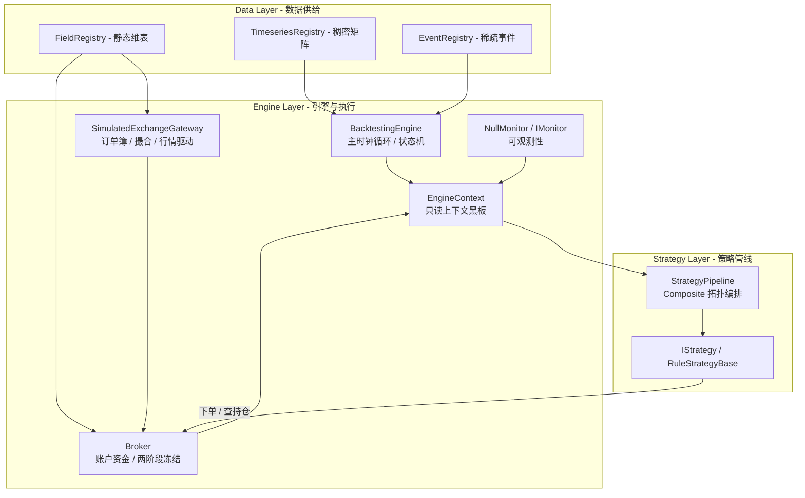
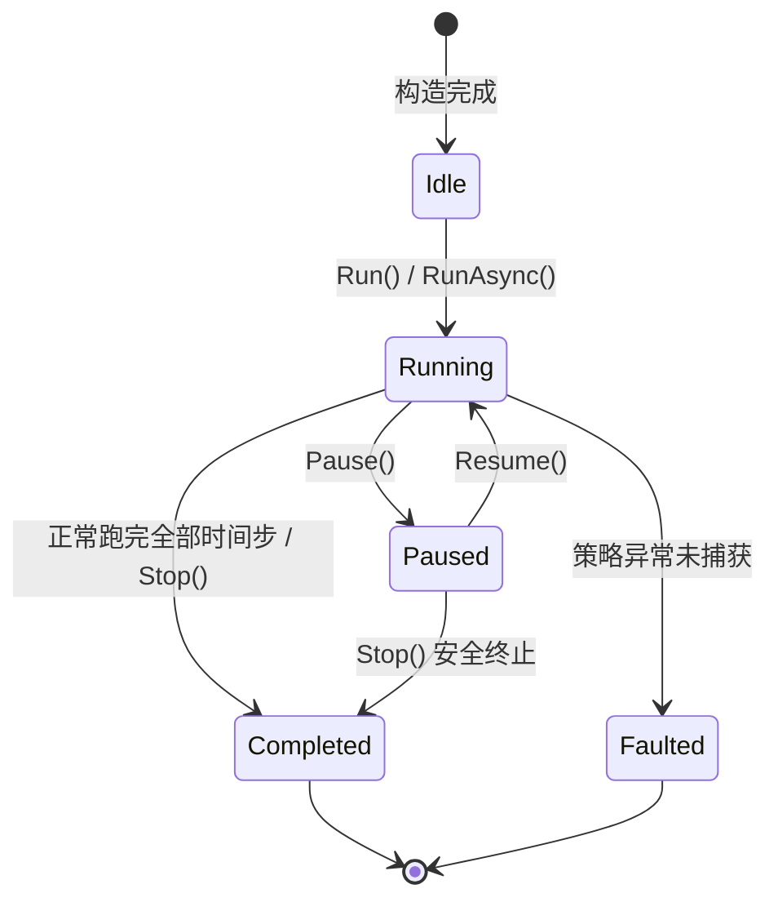

# 核心回测引擎与运行时调度 (BacktestingEngine & Runtime System)

本文档面向量化系统架构师与策略开发者，系统介绍 CarrotQuant.NET 的回测引擎（`BacktestingEngine`）、运行时只读上下文（`EngineContext`）以及检查点容灾体系（`ICheckpointable`）的架构设计、状态机调度与热路径优化。

---

## 目录
- [一、架构总览与分层职责](#一架构总览与分层职责)
- [二、引擎生命周期与状态机](#二引擎生命周期与状态机)
- [三、主时钟步进推进机制](#三主时钟步进推进机制)
- [四、运行时只读上下文 (EngineContext)](#四运行时只读上下文-enginecontext)
- [五、检查点保存与断点复原 (ICheckpointable)](#五检查点保存与断点复原-icheckpointable)
- [六、顶层会话门面 (BacktestSession)](#六顶层会话门面-backtestsession)

---

## 一、架构总览与分层职责



### 核心分层设计原则
1. **单一内核与纯单向依赖 (DAG)**：
   - 依赖关系严格自顶向下：`IFieldRegistry` $\to$ `Broker` / `SimulatedExchangeGateway` $\to$ `EngineContext` $\to$ `BacktestingEngine`；
   - 经纪商仅依赖标的静态维表抽象 `IFieldRegistry` 与网关契约 `IExchangeGateway`，彻底消除对运行时上下文的双向循环依赖；详细清算与撮合机制见独立文档 [经纪商与交易所体系 (broker.md)](broker.md)；
2. **读写分离与零装箱**：
   - 上下文（`IEngineContext`）为策略层提供纯只读门面；
   - 策略与经纪商之间的交互严格通过强类型订单请求（`OrderRequest`）与执行回报（`ExecutionReport`）进行，杜绝策略直接改写账户内部状态。

---

## 二、引擎生命周期与状态机

引擎统一实现 `IEngine` 核心调度契约与 `ICheckpointable` 快照契约，由五态有限状态机（FSM）驱动生命周期流转：



### 状态机核心状态定义与约束
| 状态 (EngineStatus) | 物理含义 | 允许的操作 |
| :--- | :--- | :--- |
| **`Idle`** | 初始空闲状态 | `Run()`、`RunAsync()`、`RestoreCheckpoint()` |
| **`Running`** | 主循环正在推进 | `Pause()`、`Stop()`、外部 `CancellationToken` 取消 |
| **`Paused`** | 步进循环安全挂起 | `Resume()`、`Stop()` |
| **`Completed`** | 回测全周期完成或被提前终止 | 终止态，资源安全释放 |
| **`Faulted`** | 策略异常崩溃 | 终止态，错误已上报并安全注销监听 |

> [!IMPORTANT]
> - **确定性终止防护**：在 `Paused` 状态下调用 `Stop()` 或取消令牌时，内部采用双重条件守卫，唤醒后立即退出循环，绝不多跑一个时间步；
> - **安全级联释放**：引擎调用 `Dispose()` 时自动级联释放底层 `StrategyPipeline`，并防御并发 `ObjectDisposedException` 异常穿透。

---

## 三、主时钟步进推进机制

回测主时钟在 `BacktestingEngine.Run()` 中以整数索引推进循环，每步执行确定性离散事件与管线驱动，热路径保持零堆内存分配（Zero GC）：

### 1. 二分日期裁剪与尾日纳秒推移
回测开始前，引擎基于 `DynamicMarketMetadata.TradeDates` 快速二分定位起止索引：
- **纯日期截至时间防护**：若配置的 `EndDate` 未包含时分秒（即 `TimeOfDay == TimeSpan.Zero`），引擎自动将其推移至当日最后纳秒：
  $$\text{TargetEndDate} = \text{EndDate.Date} + 1\text{天} - 1\text{纳秒Tick} \quad (23:59:59.9999999)$$
  确保截至日全天的盘中所有分钟 Bar（如 09:30 至 15:00）全部被包含在回测中，绝不丢失尾日数据。

### 2. 热路径 5 相位微观状态机 (EnginePhase Pipeline)
每个时间步内部严格按 5 个微观时序相位依序推进，全程无堆内存分配（Zero GC）：
1. **Phase 1: PreMarket（盘前准备阶段）**：
   - `_context.Phase = EnginePhase.PreMarket`；
   - 推进经纪商跨日结算 `_brokerDriver.PreMarketStep(currentTime)`（T+N 可用持仓解锁，先结算后可用）；
   - 当日所有行情均尚未发生，`EngineContext` 严禁访问当期任何数据（包含 open），访问 `offset == 0` 严格抛出异常防前瞻偏差。
2. **Phase 2: Open（开盘阶段）**：
   - `_context.Phase = EnginePhase.Open`；
   - 驱动仿真交易所执行开盘切片撮合 `_simExchange.Step(currentTime, _marketData, i, EnginePhase.Open)`（仅依据 `bar.Open` 撮合在途隔夜单，严禁偷看当期 Bar 的 `High/Low`）；
   - 若策略/管线 `UpdatePhase` 配置为 `EnginePhase.Open`，触发策略开盘单次决策 `_pipeline.OnUpdate(_context)` 并即刻完成开盘价撮合。
3. **Phase 3: Intraday（盘中阶段）**：
   - `_context.Phase = EnginePhase.Intraday`；
   - 驱动盘中条件单判定 `_brokerDriver.ProcessConditionalOrders(currentTime)`；
   - 探测并派发离散异构事件（公告、舆情、停复牌等）`_pipeline.OnEvent(...)`。
4. **Phase 4: Close（收盘阶段）**：
   - `_context.Phase = EnginePhase.Close`；
   - 指标注册中心单步驱动 `_indicators.Step(_context)`，统一单次泵送当期完整 OHLCV 矩阵；
   - 驱动仿真交易所执行收盘撮合 `_simExchange.Step(currentTime, _marketData, i, EnginePhase.Close)`（撮合开盘挂起的 VWAP / Close 订单）；
   - 若策略/管线 `UpdatePhase` 配置为 `EnginePhase.Close`（默认黄金标准），触发策略收盘单次决策 `_pipeline.OnUpdate(_context)`，委托进入挂单簿留待次日撮合。
5. **Phase 5: PostMarket（盘后结算阶段）**：
   - `_context.Phase = EnginePhase.PostMarket`；
   - 触发日终穿仓与破产清算核验 `_brokerDriver.CheckLiquidation(currentTime)`；
   - 沉淀日终真实净值快照点与持仓快照，上报执行进度。

### 3. 复权因子冷启动极速滚动与跨模态覆盖告警
- **免剪枝全量加载**：除权因子事件表（`ashare.adj_factor.*`）全历史仅 2~3 MB，不按起测年份激进剪枝；
- **从头滚动至 StartDate (< 0.5ms)**：引擎在正式进入主循环前，按时间序从历史首个事件极速滚动遍历至起测日，直接覆写沉淀出全市场截至起测日的权威累计因子；
- **跨模态覆盖校验（有行情无因子必报警）**：启动前扫描全市场，若发现某标的在行情矩阵中存在有效价格，但除权表中完全查无此人，立即通过 `IMonitor.Log` 输出醒目的聚合 Warning 告警并采样打印前 5 只标的代码，杜绝因因子漏载导致的静默失真。

---

## 四、运行时只读上下文 (EngineContext)

`EngineContext` 是策略层在 `OnUpdate` 与 `OnEvent` 中获取环境状态的唯一入口，统一收敛极简当期取价门面与指标注册中心：

```csharp
public class EngineContext : IEngineContext
{
    public int CurrentIndex { get; }
    public DateTime CurrentTime { get; }
    public EnginePhase Phase { get; }
    public ITimeseriesRegistry Timeseries { get; }
    public IEventRegistry Events { get; }
    public IFieldRegistry Fields { get; }
    public IBroker Broker { get; }
    public IMarketState Market { get; }
    public IndicatorRegistry Indicators { get; }

    // 统一取价与时序回溯门面（专职当期及历史负向回溯快照，统一 double，默认 Post 后复权，负向回溯 offset <= 0，offset > 0 严格抛出未来函数熔断）
    public double GetClose(string symbol, int offset = 0, PriceMode mode = PriceMode.Post);
    public double GetClose(int symbolIndex, int offset = 0, PriceMode mode = PriceMode.Post);
    public double GetOpen(string symbol, int offset = 0, PriceMode mode = PriceMode.Post);
    public double GetOpen(int symbolIndex, int offset = 0, PriceMode mode = PriceMode.Post);
    public double GetHigh(string symbol, int offset = 0, PriceMode mode = PriceMode.Post);
    public double GetHigh(int symbolIndex, int offset = 0, PriceMode mode = PriceMode.Post);
    public double GetLow(string symbol, int offset = 0, PriceMode mode = PriceMode.Post);
    public double GetLow(int symbolIndex, int offset = 0, PriceMode mode = PriceMode.Post);
    public double GetVolume(string symbol, int offset = 0, PriceMode mode = PriceMode.Raw); // 成交量默认保持物理量 Raw
    public double GetVolume(int symbolIndex, int offset = 0, PriceMode mode = PriceMode.Raw);
    public double GetField(string symbol, string fieldName, int offset = 0, PriceMode mode = PriceMode.Post);
    public double GetField(int symbolIndex, string fieldName, int offset = 0, PriceMode mode = PriceMode.Post);
}
```

- **单例内联更新**：每个回测任务全局仅分配一个 `EngineContext` 实例，每时间步仅通过内部 `UpdateStep` 字段赋值更新，不产生额外托管堆对象分配；
- **物理价格与策略价格严格隔离**：交易所撮合（`SimulatedExchangeGateway`）与资产账本（`Broker`）100% 走真实未复权价格（Raw），策略决策通过门面默认享受无跳空的平滑后复权价格（Post）。

---

## 五、检查点保存与断点复原 (ICheckpointable)

遵循接口隔离原则（ISP），检查点持久化能力抽象为独立的 `ICheckpointable` 契约，与引擎核心接口 `IEngine` 正交组合：

```csharp
namespace CarrotBacktesting.NET.Abstraction.Engine;

public interface ICheckpointable
{
    byte[] SaveCheckpoint();
    void RestoreCheckpoint(byte[] checkpoint);
}
```

`BacktestingEngine` 通过多接口实现提供该能力：
```csharp
public class BacktestingEngine : IEngine, ICheckpointable, IDisposable
```

### 1. 32 字节二进制快照布局
快照采用固定 32 字节小端序二进制流紧凑打包：
```
+---------------+---------------+---------------+---------------+---------------+---------------+
| Magic (4B)    | Version (4B)  | Status (4B)   | StepIndex (4B)| TimeTicks(8B) | Progress (8B) |
| 0x43514254    | 0x00000001    | (EngineStatus)| (int)         | (long)        | (double)      |
+---------------+---------------+---------------+---------------+---------------+---------------+
```

### 2. 防护与恢复契约
- **魔数防护**：文件头必须精确匹配 `0x43514254`（ASCII 标识 `"CQBT"`），若数据损坏或格式不符显式抛出 `InvalidDataException`；
- **状态机守护**：仅允许在引擎处于 `Idle` 状态时调用 `RestoreCheckpoint`；在 `Running` 或 `Paused` 下恢复将立即抛出 `InvalidOperationException`，杜绝运行期竞态污染；
- **断点续跑**：恢复后，引擎将从 `StepIndex + 1` 自动开始后续步进，步数与进度精确衔接。

---

## 六、顶层会话门面 (BacktestSession)

`BacktestSession`（位于 `CarrotBacktesting.NET`）作为系统的顶层门面（Facade），统筹配置解析、引擎执行与绩效分析导出。支持声明式配置驱动与编程式策略挂载两种使用模式：

### 1. 声明式配置执行 (Declarative Execution)
基于 YAML 配置文件直接执行回测，并依据配置完成绩效分析与报表导出：

```csharp
using CarrotBacktesting.NET;

// 依据配置文件执行回测并生成分析报告
var report = BacktestSession.Run("configs/session.yaml");
```

### 2. 编程式策略挂载 (Programmatic Execution)
加载环境与账户配置，并在代码中显式注入自定义策略实例：

```csharp
using CarrotBacktesting.NET;

// 加载配置并注入自定义策略实例
using var session = BacktestSession.Load("configs/session.yaml", new DualMaStrategy());
session.Run();
var report = session.Analyze();
```

### 3. 结果与底层组件访问
回测完成后，可通过实例属性访问不可变交易事实账本与引擎上下文：

```csharp
// 获取不可变交易事实账本
TradingResult? facts = session.Result;

// 访问底层引擎运行时上下文
IEngineContext context = session.Engine.Context;
```
