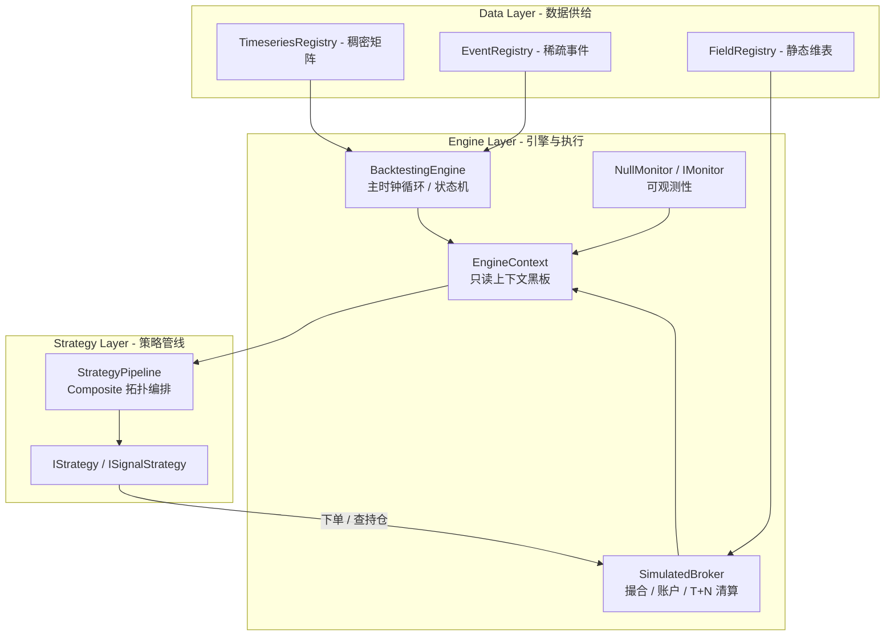
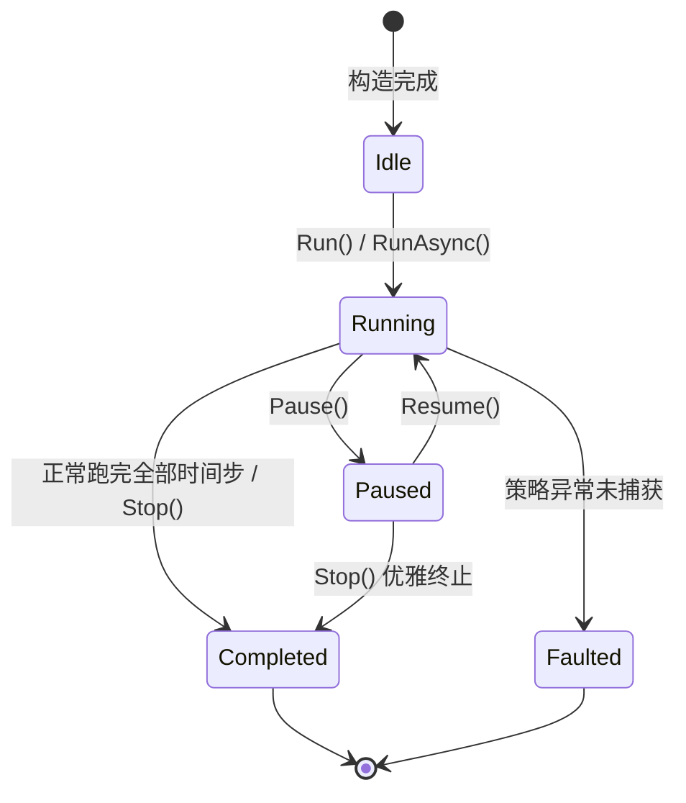

# 核心回测引擎与运行时调度 (BacktestingEngine & Runtime System)

本文档面向量化系统架构师与策略开发者，系统介绍 CarrotQuant.NET 的回测引擎（`BacktestingEngine`）、运行时只读上下文（`EngineContext`）以及检查点容灾体系（`ICheckpointable`）的架构设计、状态机调度与热路径优化。

---

## 目录
- [一、架构总览与分层职责](#一架构总览与分层职责)
- [二、引擎生命周期与状态机](#二引擎生命周期与状态机)
- [三、主时钟步进推进机制](#三主时钟步进推进机制)
- [四、运行时只读上下文 (EngineContext)](#四运行时只读上下文-enginecontext)
- [五、检查点保存与断点复原 (ICheckpointable)](#五检查点保存与断点复原-icheckpointable)

---

## 一、架构总览与分层职责



### 核心分层设计原则
1. **单一内核与纯单向依赖 (DAG)**：
   - 依赖关系严格自顶向下：`IFieldRegistry` $\to$ `SimulatedBroker` $\to$ `EngineContext` $\to$ `BacktestingEngine`；
   - 经纪商仅依赖标的静态维表抽象 `IFieldRegistry`，彻底消除对运行时上下文的双向循环依赖；详细清算与撮合机制见独立文档 [虚拟经纪商体系 (broker.md)](broker.md)；
2. **读写分离与零装箱**：
   - 上下文（`IEngineContext`）为策略层提供纯只读门面；
   - 策略与经纪商之间的交互严格通过强类型订单请求（`OrderRequest`）与执行回报（`ExecutionReport`）进行，杜绝策略直接改写账户内部状态。

---

## 二、引擎生命周期与状态机

引擎统一实现 `IEngine` 核心调度契约与 `ICheckpointable` 快照契约，由五态有限状态机（FSM）驱动生命周期流转：



### 状态机核心状态定义与约束
| 状态 (EngineStatus) | 物理含义 | 允许的操作 |
| :--- | :--- | :--- |
| **`Idle`** | 初始空闲状态 | `Run()`、`RunAsync()`、`RestoreCheckpoint()` |
| **`Running`** | 主循环正在推进 | `Pause()`、`Stop()`、外部 `CancellationToken` 取消 |
| **`Paused`** | 步进循环安全挂起 | `Resume()`、`Stop()` |
| **`Completed`** | 回测全周期完成或被提前终止 | 终止态，资源安全释放 |
| **`Faulted`** | 策略异常崩溃 | 终止态，错误已上报并安全注销监听 |

> [!IMPORTANT]
> - **确定性终止防护**：在 `Paused` 状态下调用 `Stop()` 或取消令牌时，内部采用双重条件守卫，唤醒后立即退出循环，绝不多跑一个时间步；
> - **安全级联释放**：引擎调用 `Dispose()` 时自动级联释放底层 `StrategyPipeline`，并防御并发 `ObjectDisposedException` 异常穿透。

---

## 三、主时钟步进推进机制

回测主时钟在 `BacktestingEngine.Run()` 中以整数索引推进循环，每步执行确定性离散事件与管线驱动，热路径保持零堆内存分配（Zero GC）：

### 1. 二分日期裁剪与尾日纳秒推移
回测开始前，引擎基于 `DynamicMarketMetadata.TradeDates` 快速二分定位起止索引：
- **纯日期截至时间防护**：若配置的 `EndDate` 未包含时分秒（即 `TimeOfDay == TimeSpan.Zero`），引擎自动将其推移至当日最后纳秒：
  $$\text{TargetEndDate} = \text{EndDate.Date} + 1\text{天} - 1\text{纳秒Tick} \quad (23:59:59.9999999)$$
  确保截至日全天的盘中所有分钟 Bar（如 09:30 至 15:00）全部被包含在回测中，绝不丢失尾日数据。

### 2. 热路径步进流水线 (Step Pipeline)
每个时间步内部严格按以下顺序执行，全程无堆内存分配：
1. **时钟推进**：`_context.UpdateStep(i, currentTime)`，更新上下文中的索引与当前物理时间戳；
2. **时序缓存滑动**：`_timeseries.StepTo(i)`，驱动底层 4096 行分块内存槽位滑动与异步预读；
3. **经纪商时钟推进与跨日结算**：调用 `_broker.Step(currentTime)`，由经纪商自主比对换日阈值 `_nextRollTimeUtc`，到达交易所本地次日 00:00:00 时自动触发 T+N 可用持仓划转（详见 [broker.md](broker.md)）；
4. **离散事件探测**：常数时间探测 `_events.HasNewEvents(currentTime)`，命中时调用预分配静态缓冲派发；
5. **策略管线执行**：驱动 `_pipeline.OnUpdate(_context)`，策略黑板与状态机协同。

---

## 四、运行时只读上下文 (EngineContext)

`EngineContext` 是策略层在 `OnUpdate` 与 `OnEvent` 中获取环境状态的唯一入口：

```csharp
public class EngineContext : IEngineContext
{
    public int CurrentIndex { get; }
    public DateTime CurrentTime { get; }
    public ITimeseriesRegistry Timeseries { get; }
    public IEventRegistry Events { get; }
    public IFieldRegistry Fields { get; }
    public IBroker Broker { get; }
    public IMarketState Market { get; }
    public IMonitor Monitor { get; }
}
```

- **单例内联更新**：每个回测任务全局仅分配一个 `EngineContext` 实例，每时间步仅通过内部 `UpdateStep` 字段赋值更新，不产生额外托管堆对象分配；
- **状态隔离**：策略层仅能通过只读属性读取数据与指标，无法篡改引擎状态或数据源缓冲区。

---

## 五、检查点保存与断点复原 (ICheckpointable)

遵循接口隔离原则（ISP），检查点持久化能力抽象为独立的 `ICheckpointable` 契约，与引擎核心接口 `IEngine` 正交组合：

```csharp
namespace CarrotBacktesting.NET.Abstraction.Engine;

public interface ICheckpointable
{
    byte[] SaveCheckpoint();
    void RestoreCheckpoint(byte[] checkpoint);
}
```

`BacktestingEngine` 通过多接口实现提供该能力：
```csharp
public class BacktestingEngine : IEngine, ICheckpointable, IDisposable
```

### 1. 32 字节二进制快照布局
快照采用固定 32 字节小端序二进制流紧凑打包：
```
+---------------+---------------+---------------+---------------+---------------+---------------+
| Magic (4B)    | Version (4B)  | Status (4B)   | StepIndex (4B)| TimeTicks(8B) | Progress (8B) |
| 0x43514254    | 0x00000001    | (EngineStatus)| (int)         | (long)        | (double)      |
+---------------+---------------+---------------+---------------+---------------+---------------+
```

### 2. 防护与恢复契约
- **魔数防护**：文件头必须精确匹配 `0x43514254`（ASCII 标识 `"CQBT"`），若数据损坏或格式不符显式抛出 `InvalidDataException`；
- **状态机守护**：仅允许在引擎处于 `Idle` 状态时调用 `RestoreCheckpoint`；在 `Running` 或 `Paused` 下恢复将立即抛出 `InvalidOperationException`，杜绝运行期竞态污染；
- **断点续跑**：恢复后，引擎将从 `StepIndex + 1` 自动开始后续步进，步数与进度精确衔接。
