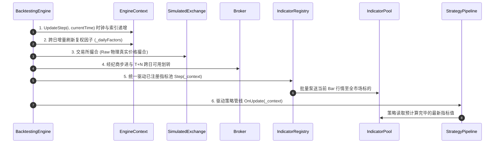

# 流式指标与计算属性开发指南 (Indicator & Computed Property Guide)

本文档系统介绍 CarrotQuant .NET 的增量流式指标子系统、计算属性极简门面、全市场标的池批量驱动机制、以及除权因子动态供给与数据完整性校验。

---

## 目录
- [一、设计哲学与第一性原理 (Philosophy & First Principles)](#一设计哲学与第一性原理-philosophy--first-principles)
- [二、核心契约与实体模型 (Core Contracts & Entity Model)](#二核心契约与实体模型-core-contracts--entity-model)
- [三、经典流式指标库与数值特性 (Stream Indicator Library)](#三经典流式指标库与数值特性-stream-indicator-library)
- [四、引擎主时钟驱动与步进隔离 (Engine Step Pipeline & Isolation)](#四引擎主时钟驱动与步进隔离-engine-step-pipeline--isolation)
- [五、统一取价门面与除权因子供给 (Pricing Facades & Adjustment Safety)](#五统一取价门面与除权因子供给-pricing-facades--adjustment-safety)
- [六、策略端极速开发范式与实战范例 (Developer Experience & Practical Examples)](#六策略端极速开发范式与实战范例-developer-experience--practical-examples)

---

## 一、设计哲学与第一性原理 (Philosophy & First Principles)

在严肃量化投研与生产交易中，传统指标库常常陷入两大陷阱：
1. **全量切片重算（Full-slice recalculation）**：每来一根 Bar 就对全历史序列跑一次滑动窗口重算，复杂度随时间步单调递增，高频回测迅速退化为不可接受的几十分钟甚至数小时；
2. **过度设计与接口套娃（Interface-Duplication Anti-Pattern）**：为每个类生造无多态价值的镜像接口（如 `IIndicatorRegistry` / `IIndicatorPool<out T>`），导致虚派发（V-Table Indirection）层层嵌套、无法被 JIT 内联，并且意外将引擎内部调度方法暴露给策略层。

CarrotQuant .NET 确立**三大底层原则**：
- **真正的增量推进一步（$O(1)$ Incremental Step）**：每个指标内部仅维持状态机（如当前累加和、指数平滑值、微型环形回溯缓冲），每根 Bar 仅需固定次数的浮点运算，复杂度严格恒定为 $O(1)$，百万步计算仅需几毫秒；
- **三位一体极简收敛（Zero Interface Bloat）**：彻底消除多余的镜像接口，统一收敛为：
  - `IStreamIndicator`（指标统一接口契约）
  - `IndicatorPool<T>`（全市场标的数组连续容器，继承非泛型基类 `IndicatorPool`）
  - `IndicatorRegistry`（全局指标管理中心，直接作为具象类挂载于 `context.Indicators`）
- **引擎步进隔离与 100% 零 GC（Zero Heap Allocation & Access Isolation）**：步进调度方法 `Step` 与 `Reset` 被严格声明为 `internal`，对策略层完全隐身；热路径遍历采用写时复制（COW）的平铺快照数组，单步推进零锁争用、零内存分配。

```mermaid
graph TD
    subgraph IndicatorArchitecture [指标子系统三位一体拓扑]
        Reg[IndicatorRegistry - 注册中心具象类]
        Ctx[EngineContext.Indicators] --> Reg

        subgraph Pools [全市场标的池容器集合]
            PoolBase["IndicatorPool (非泛型基类, Step internal)"]
            PoolBase <|-- PoolTyped["IndicatorPool&lt;T&gt; (强类型容器, 扁平数组 T[] _instances)"]
        end

        Reg -->|注册与持有| PoolBase
        Engine[BacktestingEngine] -->|时间步内部单次步进| Reg
        Reg -.内部驱动 Step.-> PoolBase
        PoolTyped -.O(1) 连续数组寻址.-> Strategy[策略层 IStrategy]

        subgraph Indicators [增量流式指标库 IStreamIndicator]
            SMA[Sma 简单均线]
            EMA[Ema 指数均线]
            MACD[Macd 异同移动平均]
            BOLL[BollingerBands 布林带]
            ATR[Atr 真实波幅]
            RSI[Rsi 相对强弱]
        end

        PoolTyped -->|持有标的实例集合| Indicators
    end
```

---

## 二、核心契约与实体模型 (Core Contracts & Entity Model)

### 1. 统一指标契约 (`IStreamIndicator`)
统一位于 `CarrotBacktesting.NET.Abstraction.Indicators` 命名空间：

```csharp
public interface IStreamIndicator
{
    // 单一增量输入入口，5 个基础原生浮点参数，严格零装箱
    void Update(double open, double high, double low, double close, double volume);

    // 当前最新指标值
    double Value { get; }
    double Current => Value;

    // 预热就绪指示（冷启动窗口未满足前为 false）
    bool IsReady { get; }

    // 负数时序索引器：0 代表当期，-1 代表上一期，-2 代表上两期；正数强行熔断抛出 ArgumentOutOfRangeException
    double this[int offset] { get; }

    // 重置指标内部状态（回测开始前或跨周期复原）
    void Reset();
}
```

> [!IMPORTANT]
> **绝对的防未来函数偷价熔断**：`this[int offset]` 索引器在 `offset > 0` 时显式抛出 `ArgumentOutOfRangeException`，从物理内存切片上彻底斩断未来函数（Lookahead Bias）。

### 2. 全市场连续标的池 (`IndicatorPool<T>`)
作为全市场标的高性能集合容器，内部直接持有按标的全局列索引（`symbolIndex`）排列的连续扁平数组 `T[] _instances`：

```csharp
public abstract class IndicatorPool
{
    public string Name { get; }
    public int Count { get; }
    public PriceMode Mode { get; }

    internal abstract void Step(IEngineContext context);
    internal abstract void Reset();
}

public sealed class IndicatorPool<T> : IndicatorPool where T : class, IStreamIndicator
{
    // 标的全局列索引寻址（热路径 O(1)，CPU L2 Cache 极致亲和）
    public T this[int symbolIndex] { get; }

    // 标的代码映射寻址
    public T this[string symbol] { get; }
}
```

- **激进内联与边界检查消除**：无符号整数压缩比对 `(uint)symbolIndex >= (uint)_instances.Length`，单指令完成上下界检查，消除虚方法派发；
- **步进调度严格封装**：`Step` 与 `Reset` 标记为 `internal override`，在引擎程序集内部流转，外部策略代码只能访问只读属性与索引器，杜绝策略误调。

### 3. 全局指标注册中心 (`IndicatorRegistry`)
直接作为具体类挂载于 `IEngineContext.Indicators`：

```csharp
public sealed class IndicatorRegistry
{
    // 声明式注册或获取（若已注册同名指标则直接返回，多策略全局单步只算一次）
    public IndicatorPool<T> GetOrAdd<T>(string name, Func<T> factory, PriceMode mode = PriceMode.Post)
        where T : class, IStreamIndicator;

    // 单标的快捷直取门面（免去策略声明字段）
    public T Get<T>(string name, int symbolIndex) where T : class, IStreamIndicator;
    public T Get<T>(string name, string symbol) where T : class, IStreamIndicator;

    public bool Has(string name);

    // 内部生命周期管理（对策略彻底隐身）
    internal void Step(IEngineContext context);
    internal void Reset();
}
```

- **显式双重检查锁定 (DCL)**：在并发管线多线程注册场景下，`lock (_lock)` 配合外内双重 `TryGetValue` 保证工厂委托严格单次执行，杜绝多分配导致的“幽灵标的池”；
- **写时复制快照 (COW Snapshot)**：内部维护 `volatile IndicatorPool[] _activePools`，主循环每步执行无锁局部变量快照读取，100% 纯无锁推进，零 GC。

---

## 三、经典流式指标库与数值特性 (Stream Indicator Library)

所有指标实现位于 `CarrotBacktesting.NET.Indicators` 命名空间，继承自 `StreamIndicatorBase` 纯数学基类：

| 指标类型 | 构造参数 | 增量递推物理公式 | 特殊边界防护 |
| :--- | :--- | :--- | :--- |
| **`Sma`** (简单均线) | `period, lookback` | $S_t = S_{t-1} + C_t - C_{t-p}$<br>$SMA_t = S_t / p$ | 百万步高精度浮点漂移校正；停牌 `NaN` 冻结与复牌顺延 |
| **`Ema`** (指数均线) | `period, lookback` | $\alpha = \frac{2}{p+1}$<br>$EMA_t = (C_t - EMA_{t-1})\times \alpha + EMA_{t-1}$ | 前 $p$ 步简单平均冷启动平滑对齐；支持实数差离平滑 |
| **`Macd`** (异同移动平均) | `fast=12, slow=26, signal=9` | $DIF = EMA_{fast} - EMA_{slow}$<br>$DEA = EMA(DIF, signal)$<br>$HIST = (DIF - DEA)\times 2$ | **熊市负数 DIF 严格防御**：解除 $<=0$ 限制，负值死叉不挂死；子流只读保护 |
| **`BollingerBands`** | `period=20, stdDev=2.0` | $MB = SMA_p$<br>$\sigma = \sqrt{\frac{1}{p}\sum(C_i - MB)^2}$<br>$UP/DN = MB \pm k\sigma$ | 样本方差无偏递推；子流 `Upper/Middle/Lower` 正交只读展开 |
| **`Atr`** (真实波幅) | `period=14` | $TR = \max(H-L, \|H-C_{prev}\|, \|L-C_{prev}\|)$<br>$ATR_t = EMA(TR, p)$ | 首步平滑预热；大幅跳空缺口真实波幅精准捕获 |
| **`Rsi`** (相对强弱) | `period=14` | $RS = \frac{EMA(Gain, p)}{EMA(Loss, p)}$<br>$RSI = 100 - \frac{100}{1 + RS}$ | 单边单调行情极值（0.0 或 100.0）极值防御；分母为零安全兜底 |

---

## 四、引擎主时钟驱动与步进隔离 (Engine Step Pipeline & Isolation)

在 `BacktestingEngine` 主循环的单一时间步中，指标子系统的步进执行顺序至关重要：



### 关键架构保障：
1. **单步单次计算（Single-step Once-calculation）**：无论管线内编排了多少个策略、无论多核并发（`ParallelPipeline`）还是串行融合（`SequentialPipeline`），同一指标池全局单步仅泵送计算一次，性能提升数倍；
2. **时钟对齐（Perfect Time Alignment）**：在策略的 `OnUpdate` 被调用时，所有已注册指标已经处于当期 Bar 步进完毕的状态，策略直接通过 `this[0]` 读取当期值，通过 `this[-1]` 读取上期值，逻辑清晰自洽。

---

## 五、统一取价门面与除权因子供给 (Pricing Facades & Adjustment Safety)

### 1. 取价门面与 `PriceMode`
`EngineContext` 提供集中式取价门面，支持标的代码与列索引双重重载：

```csharp
double GetClose(string symbol, PriceMode mode = PriceMode.Post);
double GetClose(int symbolIndex, PriceMode mode = PriceMode.Post);
double GetOpen(string symbol, PriceMode mode = PriceMode.Post);
double GetHigh(string symbol, PriceMode mode = PriceMode.Post);
double GetLow(string symbol, PriceMode mode = PriceMode.Post);
double GetVolume(string symbol, PriceMode mode = PriceMode.Raw); // 始终保持物理 Raw
```

- **约定优于配置**：价格类字段默认采用 `PriceMode.Post`（后复权），消除除权除息造成的假跳空突破；
- **成交量物理守恒**：`GetVolume` 严格保持物理原始成交量（Raw 股数），绝不乘以复权因子，防止虚假放大流动性；
- **白名单机制**：仅允许价格字段（open, high, low, close）在 Post 模式下乘因子，市盈率、换手率等非价格字段受白名单保护，防止误乘；
- **热路径零堆分配**：`EngineContext` 内部对价格矩阵实施单次惰性解析缓存（`_resolvedClose`），百万步循环堆分配增量恒为 **0 bytes**。

### 2. 除权因子供给与严格一一对应告警
- **冷启动极速滚动**：回测启动时，引擎从历史首个除权事件单调滚动沉淀至起测日，耗时 $<0.5\text{ms}$；
- **首日有效行情覆盖前置拦截**：
  若标的在行情矩阵中已产生有效价格（非 NaN），但除权表中完全无记录，或首条除权事件的生效日期滞后于标的首个有效交易日（例如 2025 年上市有交易，但除权表从 2026 年才开始记载），引擎在启动时立即抛出格式化警告：
  ```
  [Warning] 检测到标的在产生有效行情前未提供除权因子，将回退为基准因子 1.0 (标的: sz.001234, 首日有效行情: 2025-06-01, 首条除权生效日: 2026-05-20)
  ```
  彻底杜绝因数据断档导致的静默失真。

---

## 六、策略端极速开发范式与实战范例 (Developer Experience & Practical Examples)

### 范式 1：持有标的池（推荐：高频与全市场遍历场景）
在 `OnStart` 中注册并持有强类型 `IndicatorPool<T>` 引用，在 `OnUpdate` 中利用连续数组纳秒级寻址：

```csharp
public class DualMaStrategy : IStrategy
{
    public string Name => "DualMaStrategy";
    private IndicatorPool<Sma> _fastMa = null!;
    private IndicatorPool<Sma> _slowMa = null!;

    public void OnStart(IEngineContext context)
    {
        // 声明并注册指标池（默认使用 Post 后复权，引擎主循环统一泵送）
        _fastMa = context.Indicators.GetOrAdd("sma5", () => new Sma(5));
        _slowMa = context.Indicators.GetOrAdd("sma20", () => new Sma(20));
    }

    public void OnUpdate(IEngineContext context)
    {
        int symbolCount = context.Timeseries.Metadata.Symbols.Count;
        for (int i = 0; i < symbolCount; i++)
        {
            var fast = _fastMa[i];
            var slow = _slowMa[i];

            if (!fast.IsReady || !slow.IsReady)
                continue;

            // 当期值 [0]，上期值 [-1]
            if (fast[0] > slow[0] && fast[-1] <= slow[-1])
            {
                // 金叉：发出买入委托
                string symbol = context.Timeseries.Metadata.Symbols[i];
                context.Broker.SubmitOrder(new OrderRequest(
                    symbol, OrderDirection.Buy, OrderType.Market, 100, 0.0));
            }
        }
    }
}
```

### 范式 2：免声明直取门面（推荐：单标的或简单规则场景）
无需在类中定义私有变量字段，直接通过 `context.Indicators.Get<T>` 读取：

```csharp
public class MacdQuickStrategy : IStrategy
{
    public string Name => "MacdQuickStrategy";

    public void OnStart(IEngineContext context)
    {
        context.Indicators.GetOrAdd("macd", () => new Macd(12, 26, 9));
    }

    public void OnUpdate(IEngineContext context)
    {
        // 跨策略共享读取单标的指标
        var macd = context.Indicators.Get<Macd>("macd", "sh.600000");

        if (macd.IsReady && macd.Dif[0] > macd.Dea[0] && macd.Dif[-1] <= macd.Dea[-1])
        {
            // DIF 上穿 DEA
        }
    }
}
```
