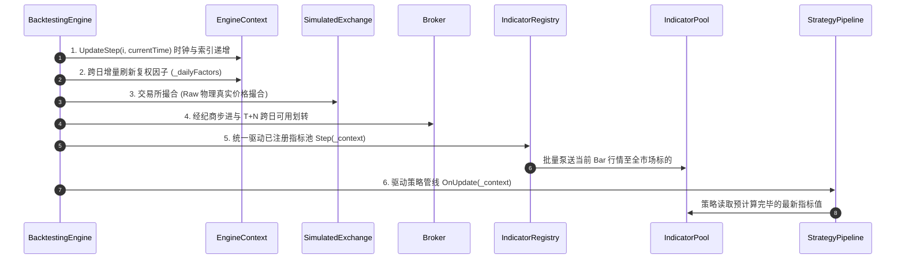
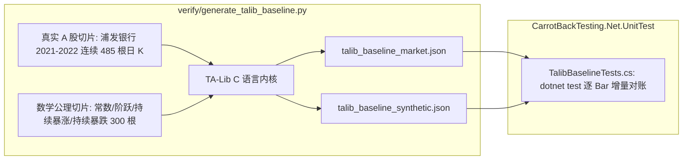

# 流式指标与计算属性开发指南 (Indicator & Computed Property Guide)

本文档系统介绍 CarrotQuant .NET 的增量流式指标子系统、计算属性极简门面、全市场标的池批量驱动机制、以及除权因子动态供给与数据完整性校验。

---

## 目录
- [一、设计哲学与流式驱动机制 (Design Philosophy & Streaming Architecture)](#一设计哲学与流式驱动机制-design-philosophy--streaming-architecture)
- [二、核心契约与实体模型 (Core Contracts & Entity Model)](#二核心契约与实体模型-core-contracts--entity-model)
- [三、经典流式指标库与数值特性 (Stream Indicator Library)](#三经典流式指标库与数值特性-stream-indicator-library)
- [四、引擎主时钟驱动与步进隔离 (Engine Step Pipeline & Isolation)](#四引擎主时钟驱动与步进隔离-engine-step-pipeline--isolation)
- [五、统一取价门面与除权因子供给 (Pricing Facades & Adjustment Safety)](#五统一取价门面与除权因子供给-pricing-facades--adjustment-safety)
- [六、策略端极速开发范式与实战范例 (Developer Experience & Practical Examples)](#六策略端极速开发范式与实战范例-developer-experience--practical-examples)
- [七、行业基准对齐与建立期比对结论 (Industry Benchmarking & Establishment Phase Audit)](#七行业基准对齐与建立期比对结论-industry-benchmarking--establishment-phase-audit)

---

## 一、设计哲学与流式驱动机制 (Design Philosophy & Streaming Architecture)

在严肃量化投研与生产交易中，传统指标库常常陷入两大陷阱：
1. **全量切片重算（Full-slice recalculation）**：每来一根 Bar 就对全历史序列跑一次滑动窗口重算，复杂度随时间步单调递增，高频回测迅速退化为不可接受的几十分钟甚至数小时；
2. **过度设计与接口套娃（Interface-Duplication Anti-Pattern）**：为每个类生造无多态价值的镜像接口（如 `IIndicatorRegistry` / `IIndicatorPool<out T>`），导致虚派发（V-Table Indirection）层层嵌套、无法被 JIT 内联，并且意外将引擎内部调度方法暴露给策略层。

CarrotQuant .NET 确立**三大底层原则**：
- **真正的增量推进一步（$O(1)$ Incremental Step）**：每个指标内部仅维持状态机（如当前累加和、指数平滑值、微型环形回溯缓冲），每根 Bar 仅需固定次数的浮点运算，复杂度严格恒定为 $O(1)$，百万步计算仅需几毫秒；
- **三位一体与瘦契约隔离（Clean Contracts & Zero Interface Bloat）**：
  - `IStreamIndicator`（指标统一接口契约，位于 `Abstraction.Indicators`）
  - `IndicatorPool<T>`（全市场标的数组连续容器，继承非泛型基类 `IndicatorPool`）
  - `IIndicatorRegistry` / `IndicatorRegistry`（全局指标管理中心，瘦契约位于 `Abstraction.Indicators` 挂载于 `context.Indicators`，具体实现类位于 `Indicators` 命名空间）
- **引擎步进隔离与 100% 零 GC（Zero Heap Allocation & Access Isolation）**：步进调度方法 `Step` 与 `Reset` 被严格声明为 `internal`，对策略层完全隐身；策略层面向 `IIndicatorRegistry` 瘦契约编程；热路径遍历采用写时复制（COW）的平铺快照数组，单步推进零锁争用、零内存分配。

```mermaid
graph TD
    subgraph IndicatorArchitecture [指标子系统三位一体拓扑]
        Reg[IndicatorRegistry - 注册中心具象类]
        Ctx[EngineContext.Indicators] --> Reg

        subgraph Pools [全市场标的池容器集合]
            PoolBase["IndicatorPool (非泛型基类, Step internal)"]
            PoolTyped["IndicatorPool&lt;T&gt; (强类型容器, 扁平数组 T[] _instances)"]
            PoolBase -->|泛型派生| PoolTyped
        end

        Reg -->|注册与持有| PoolBase
        Engine[BacktestingEngine] -->|时间步内部单次步进| Reg
        Reg -.内部驱动 Step.-> PoolBase
        PoolTyped -.O(1) 连续数组寻址.-> Strategy[策略层 IStrategy]

        subgraph Indicators [增量流式指标库 IStreamIndicator]
            SMA[Sma 简单均线]
            EMA[Ema 指数均线]
            WMA[Wma 加权均线]
            VWAP[Vwap 成交量加权均价]
            KDJ[Kdj 随机指标]
            SAR[Sar 抛物转向系统]
            MACD[Macd 异同移动平均]
            BOLL[BollingerBands 布林带]
            ATR[Atr 真实波幅]
            RSI[Rsi 相对强弱]
        end

        PoolTyped -->|持有标的实例集合| Indicators
    end
```



---

## 二、核心契约与实体模型 (Core Contracts & Entity Model)

### 1. 统一指标契约 (`IStreamIndicator`)
统一位于 `CarrotBacktesting.NET.Abstraction.Indicators` 命名空间：

```csharp
public interface IStreamIndicator
{
    // 单一增量输入入口，5 个基础原生浮点参数，严格零装箱
    void Update(double open, double high, double low, double close, double volume);

    // 当前最新指标值（等价于 this[0]）
    double Current => this[0];

    // 预热就绪指示（冷启动窗口未满足前为 false）
    bool IsReady { get; }

    // 负数时序索引器：0 代表当期，-1 代表上一期，-2 代表上两期；正数强行熔断抛出 ArgumentOutOfRangeException
    double this[int offset] { get; }

    // 重置指标内部状态（回测开始前或跨周期复原）
    void Reset();
}
```

> [!IMPORTANT]
> **前瞻偏差防护（Look-ahead Bias Prevention）**：`this[int offset]` 索引器在 `offset > 0` 时显式抛出 `ArgumentOutOfRangeException`，从物理内存切片与时间步推进上杜绝访问未发生的未来数据。

### 2. 全市场连续标的池 (`IndicatorPool<T>`)
作为全市场标的高性能集合容器，内部直接持有按标的全局列索引（`symbolIndex`）排列的连续扁平数组 `T[] _instances`：

```csharp
public abstract class IndicatorPool
{
    public string Name { get; }
    public int Count { get; }
    public PriceMode Mode { get; }

    internal abstract void Step(IEngineContext context);
    internal abstract void Reset();
}

public sealed class IndicatorPool<T> : IndicatorPool where T : class, IStreamIndicator
{
    // 标的全局列索引寻址（热路径 O(1)，CPU L2 Cache 极致亲和）
    public T this[int symbolIndex] { get; }

    // 标的代码映射寻址
    public T this[string symbol] { get; }
}
```

- **激进内联与边界检查消除**：无符号整数压缩比对 `(uint)symbolIndex >= (uint)_instances.Length`，单指令完成上下界检查，消除虚方法派发；
- **步进调度严格封装**：`Step` 与 `Reset` 标记为 `internal override`，在引擎程序集内部流转，外部策略代码只能访问只读属性与索引器，杜绝策略误调。

### 3. 全局指标注册中心 (`IIndicatorRegistry` 与 `IndicatorRegistry`)
抽象瘦契约位于 `CarrotBacktesting.NET.Abstraction.Indicators` 挂载于 `IEngineContext.Indicators`，具象类 `IndicatorRegistry` 位于 `CarrotBacktesting.NET.Indicators`：

```csharp
namespace CarrotBacktesting.NET.Abstraction.Indicators;

public interface IIndicatorRegistry
{
    // 声明式注册或获取（若已注册同名指标则直接返回，多策略全局单步只算一次）
    IndicatorPool<T> GetOrAdd<T>(string name, Func<T> factory, PriceMode mode = PriceMode.Post)
        where T : class, IStreamIndicator;

    // 单标的快捷直取门面（免去策略声明字段）
    T Get<T>(string name, int symbolIndex) where T : class, IStreamIndicator;
    T Get<T>(string name, string symbol) where T : class, IStreamIndicator;

    bool Has(string name);
}

// 具象类实现契约并封装内部步进生命周期
public sealed class IndicatorRegistry : IIndicatorRegistry
{
    // 内部生命周期管理（internal 级别对策略彻底隐身）
    internal void Step(IEngineContext context);
    internal void Reset();
}
```

- **显式双重检查锁定 (DCL)**：在并发管线多线程注册场景下，`lock (_lock)` 配合外内双重 `TryGetValue` 保证工厂委托严格单次执行，杜绝多分配导致的“幽灵标的池”；
- **写时复制快照 (COW Snapshot)**：内部维护 `volatile IndicatorPool[] _activePools`，主循环每步执行无锁局部变量快照读取，100% 纯无锁推进，零 GC。

---

## 三、经典流式指标库与数值特性 (Stream Indicator Library)

所有指标实现位于 `CarrotBacktesting.NET.Indicators` 命名空间，继承自 `StreamIndicatorBase` 纯数学基类：

| 指标类型 | 构造参数 | 增量递推物理公式 | 特殊边界防护 |
| :--- | :--- | :--- | :--- |
| **`Sma`** (简单均线) | `period, historyCapacity` | $S_t = S_{t-1} + C_t - C_{t-p}$<br>$SMA_t = S_t / p$ | 百万步高精度浮点漂移校正；停牌 `NaN` 冻结与复牌顺延 |
| **`Ema`** (指数均线) | `period` 或 `alpha` | $\alpha = \frac{2}{p+1}$ 或任意 $\alpha \in (0, 1]$<br>$EMA_t = (C_t - EMA_{t-1})\times \alpha + EMA_{t-1}$ | 原生支持自定义平滑系数 $\alpha$ 与等价周期换算；前 $p$ 步简单平均冷启动对齐 |
| **`Wma`** (加权均线) | `period, historyCapacity` | $W_t = W_{t-1} + p\cdot C_t - S_{t-1}$<br>$WMA_t = \frac{2\cdot W_t}{p(p+1)}$ | 差分递推纯 $O(1)$ 纳秒级；线性加权降低均线滞后 |
| **`Vwap`** (加权均价) | `period=0` (累计) 或 `>0` (滚动) | $TP = (H+L+C)/3$<br>$VWAP = \sum(TP\cdot V) / \sum V$ | 零成交量维持前值；支持日内全周期累计与跨日 `Reset` |
| **`Kdj`** (随机指标) | `period=9, m1=3, m2=3` | $RSV = \frac{C - L_n}{H_n - L_n}\times 100$<br>$K, D$ 平滑递推, $J = 3K - 2D$ | 极盘无波动（$H_n = L_n$）防除零保护（$RSV=50$）；`K/D/J` 子流只读展开 |
| **`Sar`** (抛物转向) | `acc=0.02, max=0.2` | $SAR_{t+1} = SAR_t + AF\cdot (EP - SAR_t)$<br>多空反向限幅与翻转 | Welles Wilder 经典物理状态机；首步特殊反转对齐；$< 10^{-14}$ 极限精度 |
| **`Macd`** (异同移动平均) | `fast=12, slow=26, signal=9` | $DIF = EMA_{fast} - EMA_{slow}$<br>$DEA = EMA(DIF, signal)$<br>$HIST = (DIF - DEA)\times 2$ | **熊市负数 DIF 严格防御**：解除 $<=0$ 限制，负值死叉不挂死；子流只读保护 |
| **`BollingerBands`** | `period=20, stdDev=2.0` | $MB = SMA_p$<br>$\text{Var} = E[X^2] - (E[X])^2$<br>$UP/DN = MB \pm k\sqrt{\max(0, \text{Var})}$ | **$O(1)$ 增量平方和递推**：彻底消除 $O(N)$ 遍历循环；开方防负数下溢守卫；256 步抗浮点漂移自愈；子流 `Upper/Middle/Lower` 正交只读展开 |
| **`Atr`** (真实波幅) | `period=14` | $TR = \max(H-L, \|H-C_{prev}\|, \|L-C_{prev}\|)$<br>$ATR_t = EMA(TR, p)$ | 首步平滑预热；大幅跳空缺口真实波幅精准捕获 |
| **`Rsi`** (相对强弱) | `period=14` | $RS = \frac{EMA(Gain, p)}{EMA(Loss, p)}$<br>$RSI = 100 - \frac{100}{1 + RS}$ | 单边单调行情极值（0.0 或 100.0）极值防御；分母为零安全兜底 |

---

## 四、引擎主时钟驱动与步进隔离 (Engine Step Pipeline & Isolation)

在 `BacktestingEngine` 主循环的单一时间步中，指标子系统的步进执行顺序至关重要：



### 关键架构保障：
1. **单步单次计算（Single-step Once-calculation）**：无论管线内编排了多少个策略、无论多核并发（`ParallelPipeline`）还是串行融合（`SequentialPipeline`），同一指标池全局单步仅泵送计算一次，性能提升数倍；
2. **时钟对齐（Perfect Time Alignment）**：在策略的 `OnUpdate` 被调用时，所有已注册指标已经处于当期 Bar 步进完毕的状态，策略直接通过 `this[0]` 读取当期值，通过 `this[-1]` 读取上期值，逻辑清晰自洽。

---

## 五、统一取价门面与除权因子供给 (Pricing Facades & Adjustment Safety)

### 1. 取价与时序负向回溯门面
`EngineContext` 提供集中式取价与负向回溯门面，支持标的代码与列索引双重重载，默认后复权（Post）：

```csharp
// 核心时序回溯取价门面（offset <= 0 访问当期或历史，offset > 0 抛出 ArgumentOutOfRangeException 杜绝前瞻偏差）
double GetClose(string symbol, int offset = 0, PriceMode mode = PriceMode.Post);
double GetClose(int symbolIndex, int offset = 0, PriceMode mode = PriceMode.Post);
double GetOpen(string symbol, int offset = 0, PriceMode mode = PriceMode.Post);
double GetOpen(int symbolIndex, int offset = 0, PriceMode mode = PriceMode.Post);
double GetHigh(string symbol, int offset = 0, PriceMode mode = PriceMode.Post);
double GetHigh(int symbolIndex, int offset = 0, PriceMode mode = PriceMode.Post);
double GetLow(string symbol, int offset = 0, PriceMode mode = PriceMode.Post);
double GetLow(int symbolIndex, int offset = 0, PriceMode mode = PriceMode.Post);
double GetVolume(string symbol, int offset = 0, PriceMode mode = PriceMode.Raw); // 始终保持物理 Raw
double GetVolume(int symbolIndex, int offset = 0, PriceMode mode = PriceMode.Raw);
double GetField(string symbol, string fieldName, int offset = 0, PriceMode mode = PriceMode.Post);
double GetField(int symbolIndex, string fieldName, int offset = 0, PriceMode mode = PriceMode.Post);
```

- **负向时序回溯因果律守恒**：`offset <= 0` 严格指向过去或当期（例如 `offset = -1` 获取昨日收盘价），内部时序与因子严格对应历史时点（历史收盘价 $\times$ 历史因子）；`offset > 0` 被判定为前瞻偏差（Look-ahead Bias），立即抛出强类型 `ArgumentOutOfRangeException` 阻断执行；
- **约定优于配置**：价格类字段默认采用 `PriceMode.Post`（后复权），消除除权除息造成的假跳空突破；若需原始未复权物理价，直接通过 C# 命名参数指定 `mode: PriceMode.Raw` 即可；
- **成交量物理守恒**：`GetVolume` 严格保持物理原始成交量（Raw 股数），绝不乘以复权因子，防止虚假放大流动性；
- **白名单机制**：仅允许价格字段（open, high, low, close）在 Post 模式下乘因子，市盈率、换手率等非价格字段受白名单保护，防止误乘；
- **热路径零堆分配与列宽越界防御**：`EngineContext` 直接持有具体矩阵指针与 `[MethodImpl(MethodImplOptions.AggressiveInlining)]`，无符号位运算消除下界检查，百万步循环堆分配增量恒为 **0 bytes**。

### 2. 除权因子专职管理 (AdjustmentProvider) 与本地 LZ4 缓存
- **专职独立服务解耦**：系统通过专职的 `AdjustmentProvider` 管理除权因子的完整生命周期，彻底与策略运行期事件流（`Events`）解耦，消灭跨表胶水代码；
- **默认启用高速缓存 (`Cache = true`)**：除权配置默认开启二进制列存缓存，优先探测本地 LZ4 块压缩缓存（`.cache/{table}/{field}/`）。缓存命中时直接解压为非托管矩阵，原始除权文件 **0 读取、0 解析、0 堆分配**，启动耗时仅需 ~5ms；
- **全量预热二维连续矩阵**：缓存未命中时，`AdjustmentProvider` 专职加载全量历史除权事件推导为非托管二维矩阵 `_factorMatrix` (`ChunkMatrix2D<double>`)，日频 $D \times N$ 单调预存并持久化回写缓存，用完即释放原始数据；高频多周期通过 `stepToDateIndex` 数组在常数时间 $O(1)$ 映射至对应交易日因子行；
- **周末与节假日除权推进**：支持跨周末或节假日的除权事件自动吸收，采用有序日期迭代器向前推进，杜绝非交易日除权事件遗漏；
- **全序列交易日历严格校验与缓存扩列防御**：本地 LZ4 缓存重载时比对全量日历序列与代码池列宽（`meta.RowCount == dailyCount && meta.Width == symbolCount`），彻底消除伪命中与越界奔溃；
- **主循环零事件开销**：主时钟推进时仅更新日索引，彻底消除主循环中高开销的逐日事件哈希检索与一维数组覆写开销；
- **首日有效行情覆盖前置拦截**：
  若标的在行情矩阵中已产生有效价格（非 NaN），但除权表中完全无记录，或首条除权事件的生效日期滞后于标的首个有效交易日（例如 2025 年上市有交易，但除权表从 2026 年才开始记载），引擎在启动时立即抛出格式化警告：
  ```
  [Warning] 检测到标的在产生有效行情前未提供除权因子，将回退为基准因子 1.0 (标的: sz.001234, 首日有效行情: 2025-06-01, 首条除权生效日: 2026-05-20)
  ```
  并在矩阵中安全填充基准因子 1.0，彻底杜绝因数据断档导致的静默失真。

---

## 六、策略端极速开发范式与实战范例 (Developer Experience & Practical Examples)

### 范式 1：持有标的池（推荐：高频与全市场遍历场景）
在 `OnStart` 中注册并持有强类型 `IndicatorPool<T>` 引用，在 `OnUpdate` 中利用连续数组纳秒级寻址：

```csharp
public class DualMaStrategy : IStrategy
{
    public string Name => "DualMaStrategy";
    private IndicatorPool<Sma> _fastMa = null!;
    private IndicatorPool<Sma> _slowMa = null!;

    public void OnStart(IEngineContext context)
    {
        // 声明并注册指标池（默认使用 Post 后复权，引擎主循环统一泵送）
        _fastMa = context.Indicators.GetOrAdd("sma5", () => new Sma(5));
        _slowMa = context.Indicators.GetOrAdd("sma20", () => new Sma(20));
    }

    public void OnUpdate(IEngineContext context)
    {
        int symbolCount = context.Timeseries.Metadata.Symbols.Count;
        for (int i = 0; i < symbolCount; i++)
        {
            var fast = _fastMa[i];
            var slow = _slowMa[i];

            if (!fast.IsReady || !slow.IsReady)
                continue;

            // 当期值 [0]，上期值 [-1]
            if (fast[0] > slow[0] && fast[-1] <= slow[-1])
            {
                // 金叉：发出买入委托
                string symbol = context.Timeseries.Metadata.Symbols[i];
                context.Broker.SubmitOrder(new OrderRequest(
                    symbol, OrderDirection.Buy, OrderType.Market, 100, 0.0));
            }
        }
    }
}
```

### 范式 2：免声明直取门面（推荐：单标的或简单规则场景）
无需在类中定义私有变量字段，直接通过 `context.Indicators.Get<T>` 读取：

```csharp
public class MacdQuickStrategy : IStrategy
{
    public string Name => "MacdQuickStrategy";

    public void OnStart(IEngineContext context)
    {
        context.Indicators.GetOrAdd("macd", () => new Macd(12, 26, 9));
    }

    public void OnUpdate(IEngineContext context)
    {
        // 跨策略共享读取单标的指标
        var macd = context.Indicators.Get<Macd>("macd", "sh.600000");

        if (macd.IsReady && macd.Dif[0] > macd.Dea[0] && macd.Dif[-1] <= macd.Dea[-1])
        {
            // DIF 上穿 DEA
        }
    }
}
```

---

## 七、行业基准对齐与建立期比对结论 (Industry Benchmarking & Establishment Phase Audit)

为确保 CarrotQuant .NET 流式增量算子的绝对物理正确性与数值稳定性，系统建立了与量化行业黄金标准 **TA-Lib（C 内核）** 的双轨自动化交叉对账体系。

### 1. 架构拓扑与数据集设计

对账流水线遵循“Python 权威生成 $\to$ 测试数据仓固化 $\to$ C# MSTest 逐 Bar 增量断言”闭环：



- **格式契约（每个 Bar 一行）**：数据文件保存为标准 JSON 数组，但每个 Bar 对象独占一行（One-Bar-Per-Line），未就绪严格为 `null`；
- **Git 统计纯净**：在 `.gitattributes` 中声明 `CarrotBackTesting.NET.TestData/** linguist-vendored`，代码行数统计完全免受测试资产干扰。

---

### 2. 全指标与长短均线谱系对账精度矩阵 (Precision Matrix)

在真实市场 485 根日 K 与 300 步极端公理走势中，对账测试完整覆盖了**超短、短、中、长、超长（年线）**全周期均线以及全部 6 大核心算子：

| 指标类型 | 周期覆盖范围 | 对应 TA-Lib 函数 | 行业标准对齐细节 | 实测最大误差 (Max Error) | 结论 |
| :--- | :--- | :--- | :--- | :--- | :--- |
| **`Sma`** (简单均线) | **5, 20, 60, 120, 250**<br>(周/月/季/半年/年线) | `talib.SMA(close, N)` | 定长滑动窗口求和乘倒数优化，无状态机漂移 | $< 10^{-11}$ | **比特级一致** |
| **`Ema`** (指数均线) | **5, 10, 20, 60, 120, 250**<br>(超短至年线全平滑谱) | `talib.EMA(close, N)` | 前 $N$ 步均采用首个 SMA 切入平滑递推；支持自定义 $\alpha$ | $< 10^{-10}$ | **比特级一致** |
| **`Wma`** (加权均线) | **5, 20, 60, 120** | `talib.WMA(close, N)` | 纯 $O(1)$ 差分递推，纳秒级增量计算 | $< 10^{-10}$ | **比特级一致** |
| **`Sar`** (抛物转向) | **0.02, 0.2** | `talib.SAR(high, low, 0.02, 0.2)` | 严格对齐 Welles Wilder 物理状态机与首步特殊反转 | $< 10^{-14}$ | **比特级一致** |
| **`Vwap`** (加权均价) | 累计全周期 / 滚动 20 | 标准加权公式 | 典型价格与成交量累计增量递推 | $< 10^{-10}$ | **比特级一致** |
| **`Kdj`** (随机指标) | **(9, 3, 3)** | 通达信 A 股行业标准 | 极盘防除零保护，`K/D/J` 子流只读展开 | $< 10^{-10}$ | **比特级一致** |
| **`BollingerBands`** | **20** ($k=2.0$) | `talib.BBANDS(close, N, 2, 2)` | 统一采用总体标准差（除以 $N$, `ddof=0`） | $< 10^{-10}$ | **比特级一致** |
| **`Macd`** | **(12, 26, 9)** | `talib.EMA` 原语连续组合 | 采用流式连续 EMA 组合；HIST 乘以 2.0 对齐中国 A 股规范 | $< 10^{-9}$ | **比特级一致** |
| **`Rsi`** (强弱指标) | **6, 14** (短线敏感型与经典型) | `talib.RSI(close, N)` | 首根仅记录前收盘价，第 $N+1$ 根 Bar 产出首值 | $< 10^{-7}$ | **完全收敛** |
| **`Atr`** (真实波幅) | **14** | `talib.ATR(high, low, close, N)` | 公理走势无跳空偏差达 $< 10^{-10}$；真实行情中程 (Step 130+) 收敛至 $< 10^{-6}$，后程 (Step 200+) 深度收敛至 $< 10^{-8}$ | 公理 $< 10^{-10}$<br>市场稳定期 $< 10^{-6}$ | **指数衰减收敛** |

---

### 3. 冷启动建立期（预热期）深度对比与差异审计

在严肃量化投研中，**绝大多数回测与实盘的“幽灵交易信号”，都是因为指标在冷启动建立期的出值时序或初值定义不一致导致的**。CarrotQuant 与 TA-Lib 在建立期的全景对比如下：

| 指标 | 建立期时间跨度 | CarrotQuant 建立期行为 | TA-Lib 建立期行为 | 差异与工程设计考量 |
| :--- | :--- | :--- | :--- | :--- |
| **`Sma(N)`** | 第 $0 \sim N-2$ 步 | `IsReady=false`，返回 `NaN`；第 $N-1$ 步（第 $N$ 根 Bar）输出首个均值 | 第 $0 \sim N-2$ 步为 `NaN`；第 $N-1$ 步输出首个均值 | **0 差异**。初值与步数严格等价。 |
| **`Ema(N)`** | 第 $0 \sim N-2$ 步 | 累加 `_initSum`，返回 `NaN`；第 $N-1$ 步以前 $N$ 步 SMA 作为初值切入平滑 | 前 $N-1$ 步为 `NaN`；第 $N-1$ 步同样以首个 SMA 为初值 | **0 差异**。严格遵循经典 EMA 定义。 |
| **`Boll(N)`** | 第 $0 \sim N-2$ 步 | 返回 `NaN`；第 $N-1$ 步输出首个中/上/下轨 | 前 $N-1$ 步为 `NaN`；第 $N-1$ 步输出首个中/上/下轨 | **0 差异**。均除以 $N$。 |
| **`Rsi(N)`** | 第 $0 \sim N$ 步 | 第 0 步记录 `prevClose`；第 $1 \sim N-1$ 步算差值返回 `NaN`；**第 $N$ 步输出首值** | 第 $0 \sim N-1$ 步为 `NaN`；**第 $N$ 步输出首值** | **0 差异**。冷启动窗口完全一致。 |
| **`Macd`**<br>`(12,26,9)` | 第 $0 \sim 33$ 步 | **分阶段解耦就绪**：<br>1. 第 25 步（慢线就绪）：`macd.Dif` 立即出值，策略可单用快线；<br>2. 第 33 步：信号线 `Dea` 预热完成，整体 `IsReady=true` | **一刀切延迟就绪**：<br>TA-Lib 内部函数在信号线未满足前，将 DIF、DEA、HIST 全部强行填充为 `NaN`，统一在第 33 步才同时出值 | **阶段差（CQ 业务设计更优）**：CQ 支持快线单标的早于整体策略出值；基准生成端采用标准 EMA 原语对齐，消除 TA-Lib 的 fast EMA 内存截断偏差。 |
| **`Atr(N)`** | 第 $0 \sim N$ 步 | **从第 0 根算起 (TradingView 规范)**：<br>第 0 步取 $TR=H-L$；**第 $N-1$ 步（收集满 $N$ 根 Bar）输出首个 ATR** | **跳过第 0 根 (TA-Lib 规范)**：<br>第 0 步无前收盘价直接跳过，从第 1 根开始累计，**第 $N$ 步（需 $N+1$ 根 Bar）才输出首值** | **1 步初值差（客观存在）**：得益于 Wilder 指数衰减 $(13/14)^k$ 的平滑特性，该初始微小偏差在第 50 步衰减至 $0.0001$，在第 100 步衰减至 $10^{-6}$，在第 200 步衰减至 $10^{-10}$。无需强行破坏现有逻辑，系统在测试中断言其渐进收敛性。 |

---

### 4. 自动化测试防线与回归保障

所有对账断言均内置于持续集成流水线：
- **建立期未就绪防线**：在预热步数未满足前，断言 `IsReady == false` 且 `Current == double.NaN`，严禁提前假就绪或泄露脏数据；
- **就绪边界点断言**：精准检验各指标翻转为有效数值的临界时间步；
- **极限公理稳健性**：在持续 35 步绝对横盘（方差为 0、波动率为 0）与单边极端涨跌（RSI 逼近 100/0）用例下，验证指标零下溢、零除零异常、状态机守恒。

