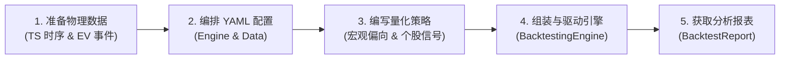

# CarrotQuant .NET 标准研发工作流 (Standard Workflow)

本文档演示从物理数据准备、配置组织、策略编写到驱动回测引擎的标准流程。

---

## 目录
- [全流程概览](#全流程概览)
- [步骤一：准备物理数据](#步骤一准备物理数据)
- [步骤二：组织 YAML 配置文件](#步骤二组织-yaml-配置文件)
- [步骤三：编写量化策略](#步骤三编写量化策略)
- [步骤四：装配与驱动回测引擎](#步骤四装配与驱动回测引擎)
- [步骤五：获取全过程分析报告](#步骤五获取全过程分析报告)

---

## 全流程概览



---

## 步骤一：准备物理数据

CarrotQuant.NET 采用“时序行情矩阵 (TS)”与“异构事件流 (EV)”双轨制数据管理：

1. **时序行情表 (TimeSeries)**：存放高频或日度 OHLCV 稠密矩阵。
   - 路径范例：`./data/ashare.kline.1d.raw.baostock/year=2025/data.parquet` 或 `./data/ashare.kline.1d.raw.baostock/year=2025/sh.600000.csv`
2. **事件数据流 (Event)**：存放复权因子、公告、龙虎榜等稀疏 KV 数据。
   - 路径范例：`./data/ashare.adj_factor.baostock/year=2025/data.csv` 或 `./data/ashare.adj_factor.baostock/data.csv`
3. **元数据 (`metadata.json`)**：每个表根目录下定义 schema（包含字段名与数据类型）。

> [!NOTE]
> 详细物理存储结构、Table ID 规范、双时间轴契约与缺省回退推断请参阅 [数据存储与格式规范 (data_format.md)](data_format.md)。

---

## 步骤二：组织 YAML 配置文件

在实际项目中，推荐将数据源配置独立为共享文件，策略主配置只需统一外链引入。

### 1. 独立共享数据配置 (`configs/shared/data.yaml`)
```yaml
root: "../../data"
timeseries:
  - table_id: "ashare.kline.1d.raw.baostock"
    fields: ["open", "high", "low", "close", "volume"]
events:
  - name: "adjustments"
    table_id: "ashare.adj_factor.baostock"
```

### 2. 主策略回测配置 (`configs/strategy_ma.yaml`)
```yaml
engine:
  mode: "backtest"
  start_date: "2025-01-01"
  end_date: "2025-03-31"
  initial_cash: 1000000.0

# 外部数据配置文件路径
data: "shared/data.yaml"
```

---

## 步骤三：编写量化策略

策略通过实现 `IStrategy` 接入运行上下文 `IEngineContext`，无需直接持有底层物理存储或经纪商实例。

### 1. 定义事件数据模型 (Record)
用于接收复权因子等异构数据，由框架自动完成字段映射：
```csharp
public record AdjustmentFactor(double BackAdjFactor);
```

### 2. 编写策略业务逻辑
```csharp
using CarrotBacktesting.NET.Abstraction.Data;
using CarrotBacktesting.NET.Abstraction.Engine;
using CarrotBacktesting.NET.Abstraction.Strategy;

public class DoubleMaStrategy : IStrategy
{
    public string Name => "Double_MA_Strategy";

    public IEnumerable<string> GetRequiredColumns() => new[] { "close" };

    public void OnUpdate(IEngineContext context)
    {
        // 1. 宏观状态检查：若标记跳过计算则直接返回
        var market = context.Market.GetState<MarketContext>();
        if (market?.SkipAlpha == true) return;

        // 2. 获取行情矩阵与事件流
        IReadOnlyMatrix2D<double> closeMatrix = context.Data.GetMatrix<double>("close");
        IEventProvider<AdjustmentFactor> adjProvider = context.Events.GetProvider<AdjustmentFactor>("adjustments");

        int currentRow = context.CurrentIndex;
        if (currentRow < 20) return; // 历史数据不足

        // 3. 遍历全市场股票进行指标计算与信号触发
        for (int col = 0; col < context.Data.Metadata.SymbolCount; col++)
        {
            string symbol = context.Data.Metadata.Symbols[col];
            double todayClose = closeMatrix[currentRow, col];

            // 简单均线计算
            double ma5 = 0.0, ma20 = 0.0;
            for (int i = 0; i < 5; i++) ma5 += closeMatrix[currentRow - i, col];
            for (int i = 0; i < 20; i++) ma20 += closeMatrix[currentRow - i, col];
            ma5 /= 5.0;
            ma20 /= 20.0;

            decimal currentPos = context.Broker.GetPosition(symbol);

            // 金叉开仓买入
            if (ma5 > ma20 && currentPos == 0)
            {
                context.Broker.SubmitOrder(new OrderRequest(
                    symbol, OrderDirection.Buy, OrderType.Limit, todayClose, 1000m));
            }
            // 死叉平仓卖出
            else if (ma5 < ma20 && currentPos > 0)
            {
                context.Broker.SubmitOrder(new OrderRequest(
                    symbol, OrderDirection.Sell, OrderType.Limit, todayClose, currentPos));
            }
        }
    }

    public void OnOrderChanged(IEngineContext context, ExecutionReport report)
    {
        // 监听物理成交回报
        Console.WriteLine($"[成交回报] 单号: {report.OrderId}, 品种: {report.Symbol}, 均价: {report.FillPrice}, 数量: {report.FillQuantity}");
    }
}
```

---

## 步骤四：装配与驱动回测引擎

在回测入口程序中加载配置、初始化数据供给并运行回测引擎：

```csharp
using CarrotBacktesting.NET.Config;
using CarrotBacktesting.NET.Data;

// 1. 加载 YAML 配置（自动处理相对路径归一化）
EngineConfig config = EngineConfigLoader.Load("configs/strategy_ma.yaml");

// 2. 初始化物理存储调度器
var resolver = new StorageResolver(config.Data.Root);

// 3. 构造数据供给器 (IDataProvider)
var fieldRegistry = new SimpleFieldRegistry();
var seriesSource = new ParquetMarketSeriesSource(resolver, "ashare.kline.1d.raw.baostock", fieldRegistry);
var dataProvider = new CachedDataProvider(seriesSource, fieldRegistry, config.Data.Root);

// 4. 挂载事件流
var eventRegistry = new EventRegistry();
var adjProvider = EventProviderBuilder.Build<AdjustmentFactor>(resolver, "ashare.adj_factor.baostock");
eventRegistry.Register("adjustments", adjProvider);

// 5. 编排策略管线并运行引擎
var strategy = new DoubleMaStrategy();
// (后续装配 BacktestingEngine 并调用 engine.Run())
```

---

## 步骤五：获取全过程分析报告

引擎在回测生命周期结束时，通过 `IRecorder` 统一生成包含全周期流水统计的 `BacktestReport`：

- **核心指标**：累积收益率、年化收益率、夏普比率、最大回撤、胜率、盈亏比；
- **全量流水**：订单列表 (`OrderContext`)、闭合交易流水 (`TradeContext`)、净值时间序列快照 (`PortfolioSnapshot`)。

报告对象可直接对接控制台输出、导出为 Excel 整合报告或提交至 Web 前端渲染。
